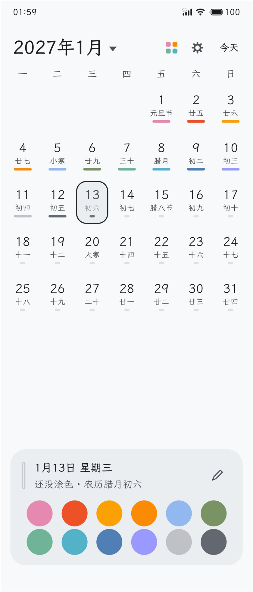
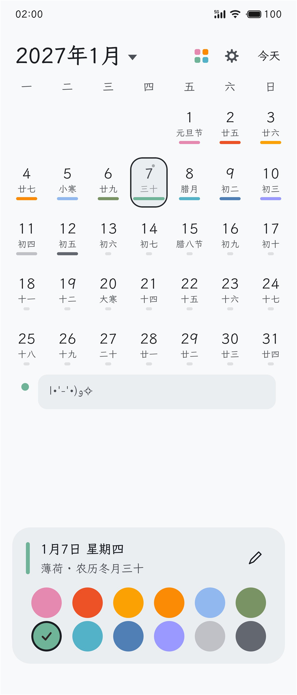
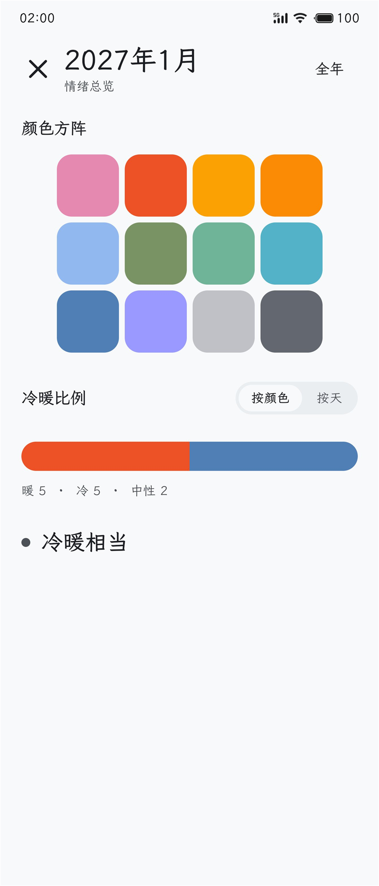

# 心绪日历 · xinxu-calendar

[](https://github.com/An431022/xinxu-calendar/releases)
[](LICENSE)
[](https://github.com/deepseek-ai/deepseek-harness)  

用颜色记录每天的心情。

给每天涂上色彩，绘制岁月，留下足迹。

  

## 为什么做这个

**我总感觉生活灰蒙蒙的，让人丧失兴趣，但我觉得不该是这样。
我要给每天涂上颜色，等一个月、一年后再回头看，看看这些月、这些年究竟是个什么样子的。
——这便是制作这个app的原因。**

## 设计特色
1. **随开即用**：进入APP——点击色盘极速涂色，不用确认、没有多余步骤
2. **允许空白，绝不惩罚**——没有连续天数，没有「本月已记录 12/31」
3. **随时补记**，忘了就忘了呗，想起来了再涂色
4. **统计只呈现体验，不制造焦虑**——不给百分比、不排名

底色是：这东西应该像一串**足迹**，而不是一张需要每天签到的表。

## 功能

- **十二色色板**，按 Material 3 的 HCT 色彩空间算出，每色有名字与含义；冷暖中性分三档
- **一天可以涂多个颜色**——上午和晚上心情相反是常事
- **文字备注挂在颜色上**，因为一天里的两种颜色往往就是两种截然不同的心情；没涂色的日子也能写字
- **网格下方排列备注标签**（色点 + 文字），太长时收起两行，点一下展开滚动
- **编辑时日历收起来**，只留选中那一排，把空间让给输入
- **月度统计**：整月颜色铺成方阵，冷暖比例条，一句模糊的结论（「这个月偏暖」）
- **两种统计口径**可切换：按颜色数 / 按当天的第一个颜色。它们经常给出相反的结论，这正是两种都留的原因
- **纯本地**：没有网络权限，记录只在这台手机上

## 技术栈

Kotlin · Jetpack Compose · Material 3 · Room + KSP

- `minSdk 26`，`targetSdk 37`，AGP 9.4.1 / Gradle 9.6.0 / Kotlin 2.4.20
- 数据库不写迁移：`note` 列类型本来就是 `TEXT`，从纯文本换成 JSON 对象时 Room 察觉不到 schema 变化——一本记录足迹的应用，迁移代码本身就是最大的风险源
- `app/schemas/` 随代码提交

## 自己构建

```bash
git clone https://github.com/An431022/xinxu-calendar.git
cd xinxu-calendar
./gradlew :app:assembleDebug
```

需要 JDK 17+ 与 Android SDK（platform 37、build-tools 37）。

正式包需要 `keystore.properties` 指向一个签名密钥；没有它也能构建 debug 版，只是 `assembleRelease` 会因为没有签名配置而失败。

## 隐私

安装包**没有声明 INTERNET 权限**，代码里也没有任何联网调用。所有记录存在应用私有的 Room 数据库里，不会上传到任何地方。
## License

MIT
