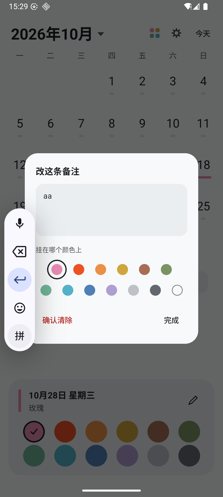
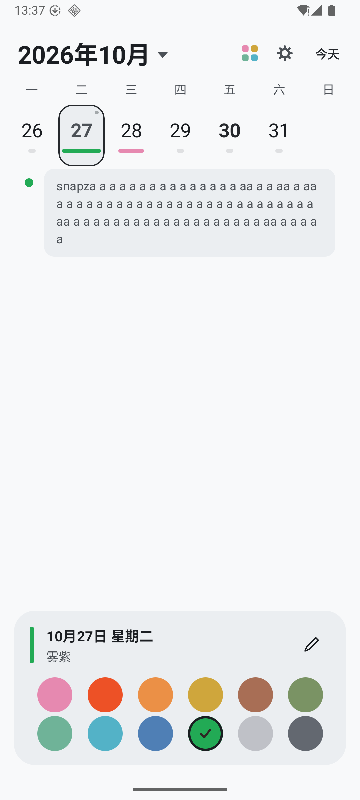
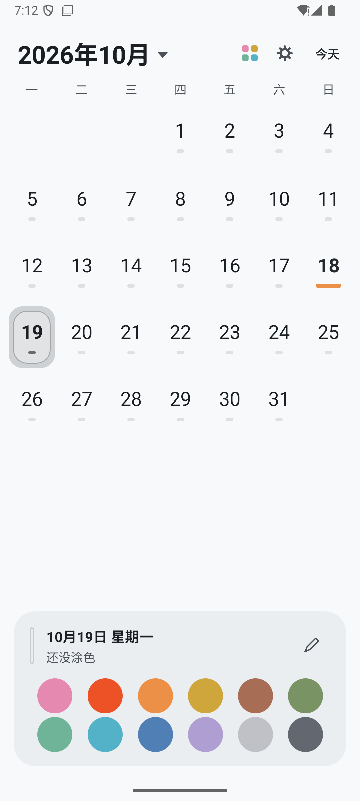
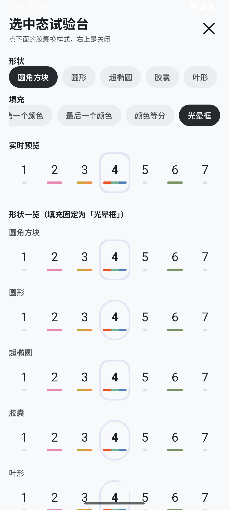
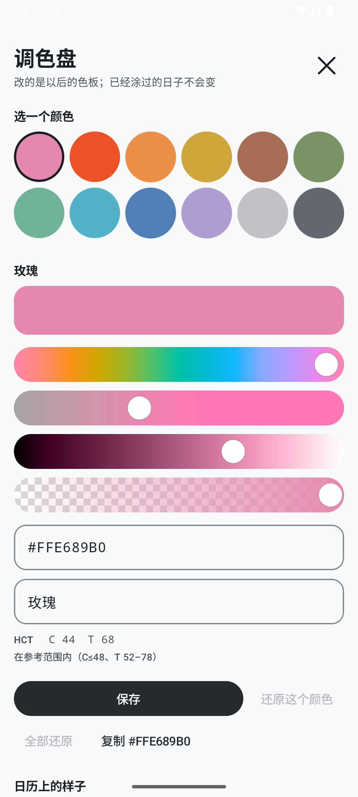
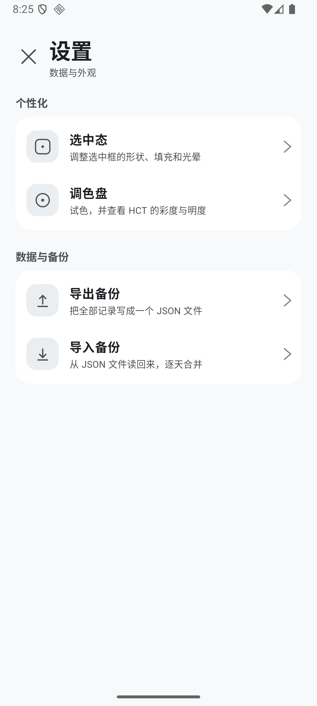
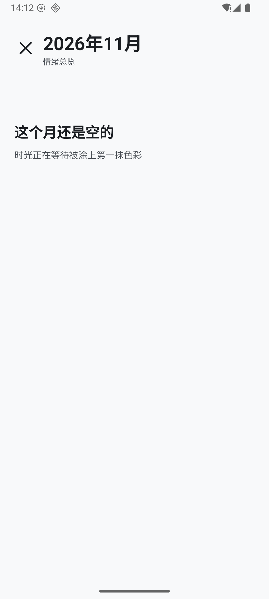
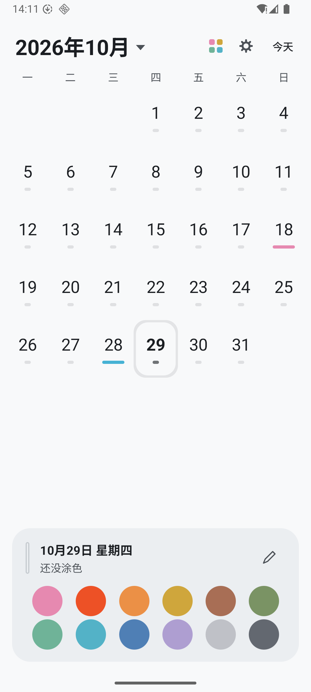
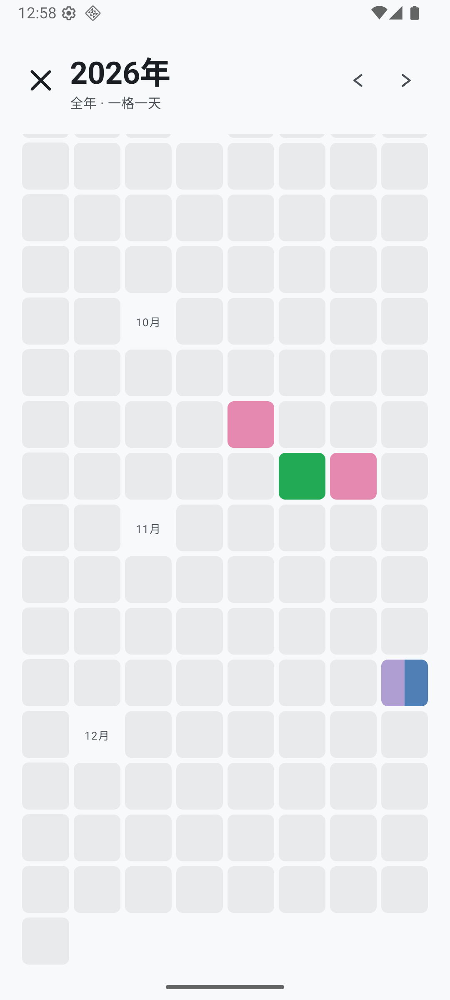
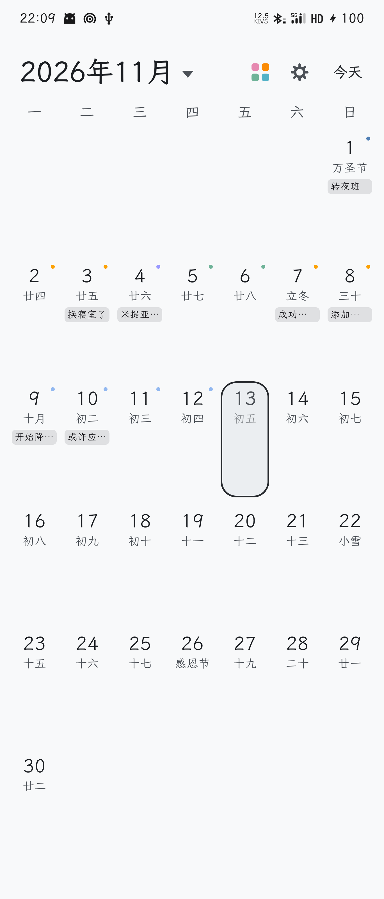

# 「色彩日历」开发计划

> 版本：v0.1 草案 ｜ 日期：2026-10-03
> 状态：**待你拍板 3 个决策点**（见第 12 节），确认后进入 M0

---

## 1. 一句话定位

**一款用颜色记录每天的日历 —— 不是任务打卡，而是给自己留下一串可以回看的足迹。**

| 项 | 决定 |
|---|---|
| 目标用户 | 先是你自己。做完善后开源给有同样需求的人 |
| 平台 | Android 手机（不做跨平台、不做 iOS、不做平板适配） |
| 数据 | **纯本地**，无账号、无网络（节假日数据可选更新） |
| 商业模式 | 无。开源项目 |

---

## 2. 核心理念与设计红线

你说的那句「不希望每天填个颜色成为一种负担」，我认为是整个项目**最重要的约束**，比任何单个功能都重要。

记录类 App 的成败不在功能多少，而在**用户第 30 天还会不会打开它**。功能可以慢慢加，一旦交互变重就救不回来了。

因此定下四条不可违背的红线：

| # | 红线 | 具体含义 |
|---|---|---|
| 1 | **三步内记完** | 打开 App → 点今天 → 点颜色。**没有「保存」按钮**，目标 3 秒内完成 |
| 2 | **允许留白，绝不惩罚** | 没涂的日子就是空的。**不做**连续打卡天数、**不做**"本月已记录 12/31 天"这类进度条 |
| 3 | **允许补记** | 忘了随时能补，不限时间。默认**不推送提醒**（想要可手动开） |
| 4 | **统计只呈现经历，不制造焦虑** | 月统计展示"你这个月经历了什么"，不展示"你漏了多少" |

> ⚠️ 第 2 条要特别强调：**连续打卡（streak）看似激励，实际是把浪漫变成 KPI。** 一旦断掉一次，人往往就彻底放弃了整个 App。这个项目坚决不要 streak。

---

## 3. 功能清单

### MVP（v0.1）—— 目标是「你自己能天天用起来」
- [x] 月视图日历（照魅族蓝本还原主体结构）
- [x] 点击任意日期 → 选 1 个或多个颜色
- [x] 日期下方**彩色分段小横条**（你的图二）
- [x] 月度统计页：**颜色方阵** + **冷暖比例**
- [x] 本地存储、无账号、无网络
- [x] 深色模式跟随系统

### 使用后回填（v0.1 之后，按用户真实使用提的需求）
- [x] **文字记录（备注）**（M6，2026-10-16）：面板右上角铅笔 → 输入框 → 逐字落库。详见 §8.6
- [x] **备注按颜色分组 + 网格下方标签条**（M7，2026-10-16，0.1.2）：一天多种颜色 = 多种心情，每条备注挂到具体颜色上；编辑时日历只留选中那一排腾空间。详见 §8.6
- [ ] 导出 / 导入：**优先级被这次使用抬高了** —— 现在库里有真实记录，一次误卸载就全没了

### v0.2 —— 蓝本还原度
- [ ] 农历 / 节气 / 传统节日（廿三、寒露、重阳节、万圣夜…）
- [ ] 法定节假日 + 调休「休 / 班」徽标
- [ ] 「宜 / 忌」卡片
- [ ] **展开态**：颜色以更大色块排在节假日 chip 下方（你的图三）2026.10.30由用户添加：宣告舍弃，评估后认为没有开发必要

### v0.3 —— 时间尺度拉长
- [ ] 年度视图：12 个月或 365 天铺成一张大马赛克
- [ ] 冷暖趋势（按月/按季）
- [ ] 自定义颜色（Material 风格取色器：选色相 + 明度，彩度由系统封顶）
- [ ] 导出 / 导入（备份，也是开源后别人迁移数据的前提）

### 明确不做（避免分心）
- ❌ 桌面小组件 —— 低摩擦记录的终极形态，但工作量大，v0.4 之后再议
- ❌ 事件日程（魅族日历的「+」是加日程，我们不做，见第 8 节）
- ❌ 自定义色板 —— **不在 v0.1**，排到 v0.3（要额外做一个 Material 风格的取色器，工作量不小）
- ❌ 多设备同步 —— 需要账号和后端，与「纯本地」定位冲突
- ❌ 社交 / 分享排行 —— 与「私人足迹」的调性完全相反

---

## 4. 核心交互流程

### 主流程：记录今天
```
打开 App
  └─ 直接落在「本月」视图，今天已高亮
       └─ 点一下今天
            └─ 底部弹出色板（12 个颜色，大圆点，一屏放得下）
                 └─ 点 1~N 个颜色 → 实时看到日期下方的色条变化
                      └─ 下滑 / 点空白处关闭 = 自动保存
```
**没有「保存」按钮** —— 点击即生效，关闭即落库。

### 支线：补记
```
月视图 → 点任意过去的日期 → 同一个色板 → 同样自动保存
（不加任何"你在补记"的提示或标记）
```

### 支线：看统计
```
月视图顶部 → 「统计」入口
  └─ 颜色方阵（这个月的颜色按顺序铺开）
  └─ 冷暖比例条 + 一句结论（如"这个月偏暖"）
```

---

## 5. 数据模型

极简，两张表就够。

```
DayEntry（一天一条）—— 实现见 data/DayEntryEntity.kt，表名 day_entry，库文件 xinxu.db
  date        TEXT PRIMARY KEY   -- ISO "2026-10-03"
  colorIds    TEXT               -- 有序颜色 id，逗号分隔，如 "cool_mint,cool_sky,cool_mist"
  note        TEXT NULL          -- 备注。v0.1 是纯文本；v0.1.2 起装 JSON 对象 {colorId: 文字}
  updatedAt   INTEGER            -- 最后修改时间
```

注意 `date` 存的是 **ISO 字符串而不是时间戳**：字符串的字典序就是日期序，按月取数可以用 `LIKE '2026-10-%'` 前缀匹配（比 `BETWEEN` 少一类月末/闰年算错的机会），而且在任何 SQLite 工具里都能直接看懂。

```
PaletteColor（写在代码里，不入库）—— 实现见 data/Palette.kt
  id           String            -- "warm_flame"，一旦发布永不改名、永不删除
  light / dark Int               -- 浅色 / 深色两套色值（深色不是调暗，是独立按 tone+15 算的）
  name         String            -- "朱红"
  temperature  WARM | COOL | NEUTRAL
```

**Room 版本 1，schema 导出到 `app/schemas/`。** 刻意不提供 `fallbackToDestructiveMigration()` —— 那会在改表时把用户所有记录直接删掉，而这个 App 的全部价值就是那些记录。以后改表必须老老实实写迁移。

**备注为什么没有升版本、没有写迁移（v0.1.2，2026-10-16）。** 备注从"一天一条纯文本"改成
"按颜色分组"时，`note` 列改成装 JSON。列的类型本来就是 `TEXT`，**Room 察觉不到 schema 变化**，
所以升级路径上没有任何一步会碰用户的记录。代价只是新旧数据混在同一列里，靠 `decodeNotes()`
兜底：解析失败（v0.1 的纯文本）就整句归到"不归属任何颜色"那一档，一个字都不丢。

一本记录足迹的应用，**迁移代码本身就是最大的风险源**。能用"不改 schema"解决的事，就不写迁移
—— 迁移写错了是静默删数据，而 `JSONException` 的 try/catch 最坏也只是把文字退化成纯文本。

**关键约定：颜色 id 是永久稳定的。** 以后想调整某个颜色的具体色值可以，但 id 不能变、不能删 —— 否则用户历史记录里的颜色就丢了。色板只能「新增」和「标记废弃」，不能移除。

---

## 6. 色板：12 色固定 + 自定义入口（基于 Material 3 色调体系）

**你的要求我拆成两层**：① 不要尖锐的高饱和色；② 连自定义颜色也不能跑出这个调性。

Material 3 底层的色彩空间 **HCT**（Hue 色相 + Chroma 彩度 + Tone 感知明度）正好就是为这件事设计的 —— 它把「彩度」和「明度」解耦，于是可以用**彩度封顶**从数学上保证颜色永远不会变刺眼。

### 6.1 三条硬约束

| 约束 | 取值 | 作用 |
|---|---|---|
| **彩度封顶** | chroma ≤ **48** | Material 色调板的实际天花板。这就是"不刺眼"的技术保证 |
| **明度区间** | tone **52–78** | 白底上看得清，又不至于压住日期数字 |
| **色相分布** | 暖 5 / 冷 5 / 中性 2 | 冷暖统计要对半开才公平 |

**两处有意破例**（都写死在 `tools/palette/generate.mjs` 里，每次生成会自动把破例项打印出来，不会悄悄溜过去）：

- **朱红 `#ED5126`，C79** —— 你 2026-10-03 亲自定的。原来那个 `#E27768` 你觉得"有些素了"。我试过把彩度压回 48，得到 `#CE6A4F`：一种偏暗的砖红，**反而比原来更素**（明度也从 62 掉到 56）。加上"热烈、激动、生气"本来就是整块色板里情绪最响的那一个，所以这里保留你的色值，让它成为全板唯一一个高饱和色。
- **石墨 `#636870`，T44** —— 低于 52 的下限是有意的。它代表"沉重、黑暗"，明度就该低。它也是全板唯一一个深到在深色模式下可以当背景用的颜色。

### 6.2 十二色

> 色值由 `tools/palette/generate.mjs` 调用 Material 官方 `material-color-utilities` **计算生成**，不是手调的。想调整只需改脚本里的 hue / chroma / tone（或直接给 `lightOverride` 指定色值）再重跑。对照图见同目录 `palette.png`。
>
> **注意这里藏着两个同名的东西，别混**：
> - **生成阶段**：`generate.mjs`（Node）用官方 `material-color-utilities` 算色值。上面说的就是它。
> - **运行阶段**：Android 里**没有**引入官方库 —— 它没发布到 Maven。调色盘的 HCT 读数用的是 `io.github.kyant0.hct:hct`（决策 71）。两者算的是同一套 HCT，但不是同一个包。

| id | 名称 | 浅色 | 深色 | 温度 | 大致含义 |
|---|---|---|---|---|---|
| `warm_rose` | 玫瑰 | `#E689B0` | `#FFBCD5` | 暖 | 心动、柔软 |
| `warm_flame` | 朱红 | `#ED5126` | `#FF9072` | 暖 | 热烈、激动、生气 |
| `warm_honey` | 蜜橘 | `#EB9046` | `#FFC298` | 暖 | 充实、有干劲 |
| `warm_amber` | 琥珀 | `#CFA63C` | `#FCCF61` | 暖 | 开心、轻快 |
| `warm_caramel` | 焦糖 | `#A86E55` | `#D49479` | 暖 | 踏实、沉稳 |
| `cool_moss` | 苔绿 | `#7A9364` | `#A1BB89` | 冷 | 满足、缓慢 |
| `cool_mint` | 薄荷 | `#6FB398` | `#97DDC0` | 冷 | 清爽、放松 |
| `cool_sky` | 晴空 | `#53B2C7` | `#7FDCF2` | 冷 | 平静、清醒 |
| `cool_deep` | 深海 | `#4F7FB5` | `#77A6DF` | 冷 | 低落、沉思 |
| `cool_mist` | 雾紫 | `#AE9ED1` | `#D7C7FC` | 冷 | 忧郁、敏感 |
| `neutral_cloud` | 云灰 | `#BFC1C7` | `#DBDDE2` | 中性 | 平淡、记不清 |
| `neutral_ink` | 石墨 | `#636870` | `#8A8E96` | 中性 | 沉重、黑暗 |

（`neutral` 不参与冷暖比例计算，单独显示为"中性"占比。）

**为什么是固定的 12 色，而不是一上来就自由取色？**

1. **降低摩擦** —— 12 个大圆点一屏点中，比拉起取色轮盘快 10 倍（服务红线 1）
2. **让统计有意义** —— 冷暖判断需要颜色有明确归属，随手调的颜色没法分类
3. **建立自己的语言** —— 用久了你会知道"蜜橘"代表什么，这比色号有意义

### 6.3 自定义颜色也必须走同一套约束

**不做**传统那种 HSV 取色轮盘。那种轮盘的外圈天然就是"彩度拉满"，随手一拉就是刺眼的纯色 —— 正好是你想避免的东西。

自定义改成两步：

1. 拖一条**色相带**选 Hue（0–360）
2. 拖一条**明度条**选 Tone（限制在 52–78）

**Chroma 由系统给定上限 48，用户根本碰不到。** 这样无论怎么调，出来的颜色都还在同一个调性里。

> **2026-10-29 修订：这套"卡住用户"的方案没有采用。**
>
> 上面那两步（只给色相带 + 明度条、Chroma 由系统卡在 48）是**最初的设想**。实际做出来的是
> 设置页里那个**开放的 HCT 调色盘**（`ui/debug/ColorLabScreen.kt`，见 8.10）：
> 色相 / 彩度 / 明度 / 透明度四根渐变条，彩度能拖到 120、明度能到 0 和 100。
>
> 改的理由有三条：
>
> 1. 用户要的是"我想调成什么样就能调成什么样"（2026-10-29：「更直观」）。
> 2. 卡死上限的滑块在"我就想要这个颜色"面前就是一堵墙。而这是他**给自己**用的记录工具，
>    不是给陌生人做的产品 —— 后台把可用范围收窄，收益是零、代价是每次都要绕。
> 3. 越界的伤害是**可以提示的**：HCT 读数 + 参考线（C≤48、T 52–78）还在，只提示、不拦截；
>    想回头有「还原这个颜色」和「全部还原」。
>
> **同时作废的还有"调色盘只试色、不写盘"这条限定**：现在保存就写盘（`PaletteOverrideStore`），
> 只是它只影响"以后新涂的颜色"—— 已经涂过的日子存了涂色当时的快照，不会跟着变（见 6.6）。
>
> 保留下来的是 6.1 里那条更根本的约束：**十二色的值必须稳定**。自定义只是把"默认值"
> 换成用户自己的值，那十二个 id 以及它们代表的心情，一个都没动。

### 6.4 为什么不用 Material You 动态取色

Material You 会从壁纸里抽色生成主题。**这个 App 不能用** —— 那会让同一份记录在不同手机上显示成不同颜色，"蜜橘代表充实"这套语言立刻就散了。色板必须**跨设备稳定**，这正是它和普通 Material 应用的区别所在。

### 6.5 背景色与外壳配色（2026-10-04 定）

**背景是色板的舞台，它自己不能有颜色。**

这话听着像废话，但它是可执行的：背景一旦带色相，它就会给屏幕上所有色块悄悄垫一层底，冷色最先被染脏（深海、雾紫、晴空会显得比实际更冷、更闷）。而这个 App 的核心语言恰恰是**冷暖对比**，所以底色不能先偏一边。

**定的两个值**：

| 模式 | 背景 | 位置 |
|---|---|---|
| 浅色 | **`#F8F9FA`**（冷白，几乎中性、带一丝冷） | `Theme.kt` 的 `background` / `surface` |
| 深色 | **`#1C1A18`**（暖深灰） | 同上 |

候选对照图在 `tools/palette/backgrounds.png`（浅色 6 个 / 深色 4 个），每一行都把十二色直接铺在该背景上。

**连带后果：外壳也必须跟着去掉暖调。**

原来的底部面板（`#EFE2DC`）、描边（`#D8C2BB`）、选中块（`#2E2724`）是一整套**暖米色**，那是照着旧背景 `#FDF8F6` 配的。直接搬到冷白上会显出一层黄气 —— 像在蓝白纸上贴了一张奶油色的纸。

所以浅色这套外壳全部改成了中性灰：

| 用途 | 旧值（暖） | 新值（中性） |
|---|---|---|
| 底部面板 `surfaceVariant` | `#EFE2DC` | `#EBEEF1` |
| 面板描边 `outlineVariant` | `#D8C2BB` | `#C6CBD0` |
| 选中块 `primary` | `#2E2724` | `#26292D` |

**深色那套保持暖调**，因为它的背景 `#1C1A18` 本身就是暖的 —— 两种模式的背景温度不同，外壳各自跟随即可，不需要强行统一。十二色的浅色/深色两个版本是**独立算出**的（见 6.2），跟外壳无关，所以这次改动没有动它们一个像素。

**空条颜色会自动跟随。** 日历格里"未涂色"那一小节用的是 `lerp(surface, onSurface, 0.10f)`，不是写死的色值（见 8.1.1），所以换背景时它会自己跟着变，不需要回来改第二处。

---

### 6.6 自定义十二色：2026-10-29 定稿

用户 2026-10-19 提出了"让用户改这十二个颜色本身"，当时因为下面三个问题没答案而暂缓。
2026-10-29 用户给了第一条的答案，剩下两条顺着定了下来。

**1. 历史记录跟着变不变 → 不变**

用户原话：「过去的日子永远留下当时的颜色。」

所以每条记录要存一份**涂色当时**的色值快照（`ColorSnapshot`）：

- `DayEntry.colorSnapshots: Map<颜色 id, ColorSnapshot>`；
- 快照存 **light / dark 两个值**。只存浅色的话，切深色模式时历史颜色又得按当前色板重算，
  等于让它跟着色板走；
- **存储没有加列**：`colorIds` 这一列的内容从 `warm_rose,cool_sky` 变成
  `warm_rose@FFE689B0@FFFFBCD5,…`，列名和类型都不变，老数据读进来就是"没有快照"。
  跟 `note` 列是同一套手法：换内容不换类型，就不需要 Room 迁移；
- 老记录（快照制度之前涂的）启动时补一份**出厂值**——那是它们还能追溯到的、最接近"当时"的
  颜色。补完落盘，幂等，中途失败下次启动接着补。

**颜色 id 仍然是身份**：冷暖统计、备注归属、色板语义都看 id，快照只负责"当时长什么样"。
改色板 → 以后新涂的用新值，已涂的记录保持原值。

**2. 数据怎么存 → 快照塞进现有的颜色列**

另一条路是"色板版本表"（每条记录记第几版色板）。没有选它：要加表，渲染还要按版本回溯。
快照方案**零迁移**，读的时候也是现成的 map。备份格式升到 format 2（见 8.7），
旧 format 1 文件仍然能导入。

**3. 界面怎么摆 → 设置 → 个性化 → 调色盘**

不挤占底部常驻色盘。调色盘重做成五条渐变条（见 8.10 第 3 小节），拖动只改草稿，
**要点「保存」才写盘**——手滑不该把整个色板改了。

**结论**：已落地（2026-10-29）。备份里每个颜色写 `id` + `light` + `dark` 三个字段，
用户当时问的"能不能直接记录颜色编码"，就是在这里满足的。

## 7. 技术选型

每一项都写明**为什么选它**和**放弃了什么**。

| 层面 | 选择 | 为什么 | 放弃了什么 |
|---|---|---|---|
| 语言 | **Kotlin** | Android 官方首选，代码量比 Java 少很多 | Java（啰嗦） |
| UI 框架 | **Jetpack Compose** | 自定义日历网格、色条、动画用 Compose 最省事 | XML View（自定义绘制麻烦）<br>Flutter / RN（只做 Android，白白背上跨平台包袱） |
| 色彩体系 | **Material 3 / HCT** | 色板用官方 `material-color-utilities` 算法生成（**生成阶段**，跑在 `generate.mjs` 里；运行时的 HCT 检查用的是另一个库，见 6.2 的说明），彩度可控 | **Material You 动态取色**（颜色必须跨设备稳定，见 6.4）<br>HSV 取色轮盘（外圈就是最高饱和，注定刺眼） |
| minSdk | **26（Android 8.0）** | 覆盖 99%+ 设备，且能直接用 `java.time` 日期 API | minSdk 21（要额外开 desugaring） |
| 编译版本 | **compileSdk 37 / targetSdk 37** | 2026 年的 AndroidX 硬性要求：core-ktx 1.19.1、lifecycle 2.11.0 都要求 AGP ≥ 9.1 且 compileSdk ≥ 37 | compileSdk 36（那得把 AndroidX 全部降回旧版，等于一开局就用去年的依赖） |
| 构建链 | **Gradle 9.6.0 + AGP 9.4.1** | AGP 9.4.1 是当前最新稳定版；AGP 9 起**内置 Kotlin 支持**，`org.jetbrains.kotlin.android` 插件已废弃 | AGP 8.13.2（配不上 2026 年的 AndroidX） |
| 存储 | **Room** | 统计要按月/年聚合查询，Room 最顺手 | 纯 JSON 文件（更简单，但查询和版本迁移弱） |
| 农历 | **lunar-java（6tail）** | 一个库同时解决农历、节气、传统节日、**宜忌**、干支 —— 正好是图一底部那张卡片需要的全部 | 自己写天文算法（不现实） |
| 节假日 | **holiday-cn 数据集**（内置 JSON + 可选联网更新） | 法定节假日和调休每年都变，必须能只换数据不改代码 | 硬编码日期（每年都要改代码重新发版） |

> 农历库和节假日数据集的具体可用性我会在进入 v0.2 前实际验证一遍再定。

---

## 8. UI 规格：基于魅族蓝本改什么

**总原则：不追求 1:1 像素复刻，追求「神似」。** 用系统字体，不找魅族那套字体。

### 8.1 月视图日期格（核心改动）

```
魅族原版                    我们的改动
┌──────────┐               ┌──────────┐
│    3     │               │    3     │   ← 日期数字，不变
│   廿三    │               │   廿三    │   ← 农历，v0.2 才有
│    ▬     │               │ ▮▮▮▮▮▮▮ │   ← 关键：短横杠 → 彩色分段条
└──────────┘               └──────────┘
```

**色条规则**（对应你的图二）：

| 状态 | 表现 |
|---|---|
| 未涂色 | **极短的一小节**，颜色只比背景深一点点（见 8.1.1，这一态改过两次） |
| 涂了 1 色 | 整条单色 |
| 涂了 N 色 | 等分切成 N 段，按选择顺序排列 |
| **非选中态** | 色条**较短、居中**（比日期数字窄） |
| **选中态**（红底） | 色条**加宽**，接近铺满格子（你的图二下排就是效果） |

**颜色数量上限建议 4 个** —— 超过 4 段，色条会碎成看不清的小点，反而失去意义。

#### 8.1.1 「未涂色」怎么表示：一天之内改了两版（2026-10-03）

**第一版（你的提议）**：空白色块不填色，改用一条淡色线框，用来跟云灰、石墨两个中性色区分开。

**真机上试过之后推翻了。** 你看到截图后说："这一堆空心的线框摆在数字下面，做出来的实际效果看着有点奇怪。" 我同意，而且能说清它为什么奇怪：三十几个空心框等距铺开，读起来不是"这里可以涂色"，而是**一排待勾选的复选框** —— 正好撞上设计红线 2 最想避免的那种"你还有事没做"的暗示。

**第二版（现行）**：

| 状态 | 画成什么 | 宽度 |
|---|---|---|
| 没涂色 | **极短的一小节**，颜色只比背景深一点点 | 0.16 倍格宽 |
| 涂了 1 色 | 整条单色 | 0.56 倍格宽 |
| 涂了 N 色 | 等分切成 N 段，按选择顺序排列 | 0.56 倍格宽 |
| 所在格子被选中 | 同上，但加宽 | 0.84 倍格宽 |

关键是**"短"和"淡"必须一起来**：只变淡不变短，仍是一排小框；只变短不变淡，又太像一排句点。

颜色不写死，用 `lerp(surface, onSurface, 0.10f)` 算出来。这么写有两个好处：以后调整整个 App 的背景色，这条小横条会自己跟着变，不用回来手动改；深色模式下前景比背景亮，同一个公式会自动变成"比背景亮一点点"，不用写两套。

**这样一来还会不会跟中性色混？** 不会。云灰、石墨是**实心的圆形色点**，摆在底部面板里；日历格里的空条是**一条几乎看不见的短线**。形状、位置、面积都不同，实测一眼分得清（见 `docs/screenshots/m2-strip-compare.png`）。

**例外：面板里那根竖色标暂时保留描边**（`outlineVariant`，1.5dp）。它是单根、体量大，描边读起来是"占位"而不是"复选框"。等整体效果定下来再决定要不要跟日历格统一。

#### 8.1.2 选中态：形状 × 填充两个维度，2026-10-04 定稿

选中态是最容易被反复推翻的视觉决定，所以它被集中在 `ui/calendar/DaySelection.kt` 一个文件里，`DayCell` 不写死任何样式细节。想换样式＝只改那一个文件。

拆开看，它其实是**两个互相独立的维度**：

- **形状** `SelectionShape` —— 圆角方块 / 圆形 / 超椭圆（squircle，自己按 `|x/a|ⁿ + |y/b|ⁿ = 1` 采样 160 点画的 `Path`，n = 4）/ 胶囊 / 叶形 / 水滴 / 拱形；
- **填充** `SelectionFill` —— 中性墨色 / 面板色+描边 / 第一个颜色 / 最后一个颜色 / 颜色等分（多色那天在格子里竖着等分，和格子下面的小色带上下呼应）。

**定稿：圆角方块 + 面板色+描边**（即 `SelectionStyle.Default`）。它最接近参照的魅族日历气质：格子里始终只有那个日期数字，选中只是一圈安静的浅底 + 描边，不跟下面色带里的颜色抢戏。而「颜色等分」虽然最抢眼，但一个月里全是不规则色块会显得吵。

深色模式下 `surfaceVariant` / `onSurfaceVariant` 会自动翻转，不用另写一套 —— 浅色是浅底深描边，深色正好是深底浅描边。

**真机试验台**：长按表头那个小方阵按钮，打开 `ui/debug/SelectionLabScreen.kt`，可以在真机上实时切换这两个维度。每一行都是真实尺寸，第 4 格固定给 3 种颜色，用来压测最挤的情况。对照图见 `docs/screenshots/m4-selection-compare.png`。

顺手修掉一个隐患：日期数字的颜色原来是我拍脑袋写的「背景亮度 > 0.45 就用深色」。玫瑰色 `#E689B0` 亮度只有 0.37，会被判成深底配白字（对比度只有 2.5），实际配深字有 6.1。现在统一走 `ui/theme/Contrast.kt` 的 `contrastOn()`，按 WCAG 公式把深墨 `#2E2724` 和纯白两个候选都算一遍取高的。

注意 `background()` 和 `contentColor()` 必须一起改：一旦改成不填色，`contentColor()` 就得换回 `onSurface`，否则日期数字会消失。

### 8.2 展开态（v0.2）

照图三，在节假日 chip 下方追加颜色块 chip：

```
3  休
廿三
[黄金周（国…]   ← 节假日 chip（浅绿/浅粉底）
[■■■] [■■■]    ← 新增：颜色块，比节假日 chip 更小更实心
```

### 8.3 其它改动

| 魅族原版元素 | 我们怎么处理 |
|---|---|
| 右上角「+」（新建日程） | **改成「给今天涂色」**，或直接去掉（点日期就能涂） |
| 右上角日历图标 | 保留，作为「跳到今天」 |
| 「⋮」更多菜单 | 保留（设置、统计入口） |
| 底部「黄金周（国庆节）」日程卡片 | **改成常驻的「今天涂色」面板**（日期 + 已涂颜色 + 十二色取色盘），详见 8.4。v0.2 再把日程卡片加回来 |
| 底部「宜 / 忌」卡片 | v0.2 用 lunar-java 补上，MVP 阶段先不显示 |
| 农历文字 / 休班徽标 | v0.2 |

### 8.4 底部面板：取色盘常驻，不做弹窗（M2 定稿，2026-10-03）

蓝本底部那张「黄金周」日程卡片的位置，我们用来放**一整块常驻的涂色面板**。
它一次承担三件事：说明选中的是哪一天、显示这天涂了什么颜色、把十二色摊开来让人点。

```
┌──────────────────────────────────────┐
│ ▌ 10月5日 星期一                      │
│   薄荷 · 晴空 · 雾紫                  │
│                                      │
│   ● ● ● ● ● ●                        │
│   ● ● ● ● ● ●                        │
└──────────────────────────────────────┘
```

**为什么不做弹窗、不做抽屉。** 第 2 节那条红线写的是「打开 App → 点今天 → 点颜色，没有保存按钮，目标 3 秒」。
取色盘一旦藏在弹窗里，每天就多出"打开弹窗 — 关掉弹窗"两个纯仪式动作，而且天天都要重复。
常驻之后，「记录今天」才真的只剩一次点击。

| 细节 | 决定 | 理由 |
|---|---|---|
| 布局 | 2 行 × 6 个圆点，**不滚动** | 12 个一屏放得下；要滚动就违背"三步内记完" |
| 标签 | **不写颜色名** | 颜色是给人"认"的，不是给人读的。写了标签面板高一倍、更像一张表单。选了之后上方会写出名字，第二次就认识了 |
| 已选标记 | 深色圆环 + 对勾 | 对勾用黑还是用白，走 `ui/theme/Contrast.kt` 的 `contrastOn()` —— 按 WCAG 公式把深墨与纯白各算一遍取高的那个。**曾经**用的是"感知亮度 > 0.45"的拍脑袋阈值，玫瑰色会被判错（实测 2.5 vs 6.1，见第 12 节第 27 条） |
| 取消涂色 | **再点一次同一个颜色** | 不做"删除"按钮：少一个按钮、少一个概念 |
| 颜色顺序 | 按点击先后追加 | 色条是"等分切 N 段、按选择顺序"排列的（见 8.1） |
| 日期归属 | 面板永远跟着"选中的那一天" | 所以补记上个月的某天，也是点一下日期、再点颜色，没有第二套流程 |
| **右上角留白** | 标题那行右侧**故意空着**，不放任何东西 | 你 2026-10-03 提出：以后统计、设置、导出这些**功能入口**都归到这一角。它们是次要入口，不该跟"点颜色"这条主路径抢位置 —— 现在就把位置留出来，将来不用重新排版 |

### 8.5 动效（M4，2026-10-04）

动画只用来交代**"什么从哪儿来、去了哪儿"**。这是每天开一次的日历，不是展示型应用，
所以没有一处动效是为了"好看"而存在；说不清来源与去向的，一律不做。

| # | 动效 | 时长 / 曲线 | 它交代了什么 |
|---|---|---|---|
| 1 | 选中块的移交 | 弹簧 `dampingRatio = 0.82f, stiffness = 700f`，从 `0.86` 缩放浮现 | 换天时旧块**缩回去**、新块**涨出来**，而不是一帧跳过去。读起来像"选择被移交了"。**块单独占一层，绝不牵动日期数字**（数字跟着缩会"弹"） |
| 2 | 底部面板整块换 | 进 160ms 淡入 + 上移自身高度 1/3；出 80ms 淡出 | 出场比进场快，两行字才不会叠在一起 |
| 3 | 统计页进出 | 进 200ms / 出 160ms；全屏 `Dialog` 只位移**屏高的 1/14** | 贴着原地轻轻落下，不是整页推上来 —— 它是"盖上来的一层"，不是"新的一页" |
| 4 | 月份标题翻月 | 进 200ms：按滑动方向淡入 + 位移自身宽度 1/3；出 100ms 反向退出 | 日期格本来就是 pager 在推，标题原先却是一帧硬切 —— 整片都在动、只有这一行字啪地换掉，反而最扎眼。方向和手指一致：往后的月份从右边来 |
| 5 | 统计页入场序列 | 方阵 240ms 错峰 14ms（上限 300ms）→ 比例条等 260ms 长 320ms → 结论等 520ms 落 6dp | 顺序本身就是这一页在讲的事，见下 |

**统计页的入场顺序是刻意的：方阵 → 比例条 → 结论。**

方阵按**日期顺序**逐格铺开（不是对角线），因为这一页要的是"我这个月一天天走过来"。
先看见走过的颜色 → 再看见数出来的比例 → 最后落到一句话。反过来（先给结论）就变成一句**评判**，
按这个顺序才是走完前面两步之后**浮现**的一句话。

> **一条实现上的教训**：底部面板的色标必须和文字**待在同一个** `AnimatedContent` 里。
> 一开始只包了文字，换天那一瞬间就出现"色标已经是新颜色、字还写着旧日期"的 160ms 错位 ——
> 抓动画中间帧时拍到了（`docs/screenshots/m4-anim-stats-enter.png` 是同一批取证里另一张成功的中间帧）。
> 现在 `targetState` 是 `Triple(date, colorIds, describeColors(colors))`，色标从里面的 `colorIds` 还原，整块一起过渡。

### 8.6 文字记录（备注）（M6 起，2026-10-16；M7 改成按颜色分组）

颜色是"那天的底色"，文字是"那天到底发生了什么"。用户原话：

> 有时候标上一个颜色之后，会很希望顺带用文字作为记录……那些一闪而过的情绪过一段时间
> 就忘记到底是发生在哪一天了，需要文字作为标定。

所以**文字不是颜色的补充说明，是它的补集**：颜色回答"哪一天"，文字回答"那一天是什么"。

#### 一天多种颜色 = 一天多种心情，所以备注要挂到颜色上

用户（2026-10-16）：

> 一日里有两种颜色，而且是对立的，说明是两种截然不同的心情，我希望备注可以对应到具体的颜色。

一条"今天的备注"表达不了"上午琥珀是发工资的松快、晚上深海是淋了雨的闷"。所以 v0.1.2 起
`DayEntry.note: String?` 变成 `DayEntry.notes: Map<String, String>`（**颜色 id → 文字**），
另留一个 `NOTE_WITHOUT_COLOR = ""` 的槽位给"没涂色也想说一句"的情况。

用户拍板的三条口径：

| 问题 | 答复 |
| --- | --- |
| 一个颜色能写几条 | **最多一条**。想写长就写长，靠展开看 |
| 标签条放哪 | **只放网格下方**（不在面板里再来一遍） |
| 没涂色的日子能写字吗 | **能**。用户原话：「在颜色上留白本身也是一种表达」 |

#### 界面

| 项 | 做法 |
| --- | --- |
| **入口** | 底部面板右上角一支手绘铅笔（19dp 图标 + 44dp 点击区）。这块地是 2026-10-03 就预留的"这一天"级操作位（决策记录 17）；统计因为是**月份级**的，放在表头 |
| **铅笔三档颜色** | 编辑中 → `primary`；这天有字 → `onSurface`；没字 → `onSurfaceVariant`。不点开也看得出哪天写过字 |
| **编辑态 = 每个颜色一行** | `NoteEditor` 按 `colorIds + NOTE_WITHOUT_COLOR` 逐行铺开，每行左边一个 12dp 色点（无颜色那行是**描边空点**），右边一个输入框。一行对应一种心情。**整块可垂直滚动**（2026-10-17 加，见 8.6.8）—— 六色 + 空槽共 7 行，不给滚动则最后一个框永远够不到 |
| **自动聚焦** | **只有第一行**抢焦点（`autoFocus = index == 0`）。每行都抢的话最后落到哪行全看组合顺序 |
| **输入框** | `BasicTextField` 手写，**不用 M3 的 `TextField`** —— 后者自带 label、指示线、固定容器高度，是"填表单"的语汇，跟这块面板不是一个语气 |
| **占位提示** | `写点什么…`，且**只在用户主动点开铅笔之后才出现**，不是 App 主动催 |
| **保存按钮** | **没有**。逐字写进 store，所以"退出编辑"本身不需要确认 |
| **编辑时色盘让位** | 输入框顶掉色盘的位置，面板总高度基本不变；写字时本来也不需要色盘 |
| **网格下方的标签条** | `NoteTagList` 排在月网格和底部面板之间：**色点 + 文字**，顺序和编辑态的行序一致。月视图剩的那片留白正好变成"读字"的地方。**整条列表自己会滚**（2026-10-17 加，见 8.6.8），编辑态下整块收起 |
| **长文本** | 收起时最多 2 行（`NOTE_TAG_COLLAPSED_LINES`），末尾省略号；**点一下展开**，**长按是"改这一句"**（2026-10-17 加，见 8.6.9）。展开后超过 `NOTE_TAG_MAX_HEIGHT = 132.dp` 就固定高度、内部垂直滚动 —— 这个单条限高治不了"三条一起展开"，那由整条列表的滚动兜住 |
| **格子上的小点** | 写过字的日子右上角一个 4dp 小点。**锚在格子的角，不是数字的角** —— 数字有一位两位之分，跟着数字走小点会参差 |
| **换天** | 自动退出编辑（`LaunchedEffect(selectedDate)`）。字已落库，不会丢 |
| **取消颜色时** | 那条备注**不能人间蒸发**：`toggle()` 里把它挪到"不归属任何颜色"槽位。槽位已经有字就原样留着 —— 宁可这条暂时不显示，也不覆盖另一句话 |
| **文字进不进统计** | **不进**。统计页只算颜色（见 §9）。文字是给自己看的，不该被折算成任何分数或比例 —— 这是 §2 红线四的直接推论 |

#### 编辑时日历收起来，只留选中那一排

用户（2026-10-16）：

> 在编辑文字时，隐去其他只剩下这一排并一起上浮，这样就可以留出大量编辑空间了。当编辑完成后，
> 输入法消失，界面下滑，其他横排日期显示再构成完整月视图。

`MonthPage` 加了 `onlyRow: Int?`，`MonthGrid.of(visibleMonth).weeks` 里只取选中日所在的那一周；
外面的 pager 从 `weight(1f)` + 旧的高度约束换成 `Modifier.wrapContentHeight()`，
再包一层 `contentAlignment = Alignment.TopCenter` 的 `Box`，让它贴着标题下方而不是被垂直居中。

> 这个"居中"是踩出来的：只把 pager 改成 `wrapContentHeight` 还不够，它的容器仍然比六行格子高，
> 六行会被**垂直居中**，整体下移 161px（第一行格子 `y=307` → `y=468`）。`MonthPage` 的
> Column 要写 `fillMaxSize()` 才会顶到上方。
>
> **2026-10-17 补：那条只在"每一页一样高"时成立。** 网格改成按实际周数之后（8.6.13），5 行的
> 月份和 6 行的月份会同屏滑动，pager 的高度取的是两者的**最大值** —— 于是矮的那页又被居中了
> （翻月到一半日历往下沉、松手回弹又弹回去）。**而这次 `fillMaxSize()` 不能再用**：pager 现在是
> `wrapContentHeight`，Column 一填满就等于把 5 行撑成 6 行高，pager 再也收不回来。改法是
> **把居中对齐本身关掉** —— `HorizontalPager(verticalAlignment = Alignment.Top)`，它默认是
> `CenterVertically`。详见 8.6.14。

#### 逐字落库，不做防抖

`DayEntryStore.setNote(date, colorId, text)` 每敲一个字就 `upsert` 一次，**没有防抖**。

一句话二三十字、每次写毫秒级，换来的是**内存里的状态永远实时正确**。省下的那点 IO
不值得引入一套"延迟写"的时序状态 —— 那套状态一旦漏一次，丢的是用户刚写下的字。

顺带：**文字和颜色都清空时直接删行**（`entries.remove(date)` + `dao.delete`），不留空记录。
不然库里会攒下一堆"看着有记录、点开什么都没有"的空行。

#### 键盘收起 = 编辑结束（一次踩坑）

软键盘会**自己吃掉第一次返回键**（系统行为，`BackHandler` 根本收不到），于是"按返回"
只收了键盘、输入框还杵在面板上，得再按一次才收干净。现在监听 `WindowInsets.ime` 的高度：
`> 0` 记下"确实弹起来过"，之后回落到 `0` 就结束编辑。

`imeWasShown` 这个前置条件不能省 —— 刚点开铅笔时键盘还没弹出来、高度还是 0，
没有它，编辑态会在第一帧就被自己打回去，用户一个字都打不了。

> 用 `WindowInsets.ime` 的高度而不是 `WindowInsets.isImeVisible`：后者还是实验性 API，
> 要额外挂 `@OptIn(ExperimentalLayoutApi::class)`。
>
> 已知在模拟器的 Gboard 上这条路径不触发（键盘只剩左边缘一条悬浮工具条，ime inset 高度
> 可能一直没归零）；真机的讯飞键盘上正常。

#### 底部区域的布局：回归流式（v0.1.2 改回来）

v0.1.1 的做法是"根 `Box`，`DayPanel` 用 `align(BottomCenter) + imePadding()` 浮在上面"，
日历不动、只有面板抬起来。加了网格下方的标签条之后这个做法就崩了 ——
**叠加的面板根本不参与 Column 的流式布局**，Column 不知道底下还有一块，
`weight(1f)` 的网格区域一直延伸到屏幕底部，标签条被面板整个盖住。

现在改回流式：根 `Column` 吃 `imePadding()`，`HorizontalPager` 用
`Modifier.fillMaxWidth().weight(1f).clipToBounds()`，然后依次是 `NoteTagList` → `DayPanel` → 底部间隔。
键盘弹出时 Column 被压缩，**由网格那一项让出空间**（`weight(1f)` 会自动缩），
标签条和面板都不动。再配合编辑态只留一行，腾出来的空间刚好够用。

> ⚠️ **「让网格让出空间」这半句在 2026-10-17 被推翻了** —— 它把"内容多"的代价转嫁给了日历，
> 而日历恰恰是最不该动的那一块。见 8.6.8。

> 仍然是 `android:windowSoftInputMode="adjustNothing"`（见 13.6）：窗口本身不能被平移，
> 否则整个页面（连标题）会被顶到状态栏底下。

#### 8.6.7 真机 + 模拟器验证结果（2026-10-16，0.1.2）

| 验的东西 | 真机 MEIZU 21 Pro（391×912 dp，讯飞） | 模拟器（411×914 dp，Gboard） |
|---|---|---|
| 编辑态只留选中那一排 | ✅ `12–18` 单排，标题与星期行保留 | ✅ |
| 每个颜色一行输入框 | ✅ 玫瑰槽 + 空槽 | ✅ 晴空 / 玫瑰 / 空槽 |
| 旧备注兼容（v1 纯文本） | ✅ 落在「不归属任何颜色」槽，没丢 | ✅ |
| 网格下方标签条 | ✅ 位置正确，窄屏不挤 | ✅ |
| 一次 BACK 收干净 | ✅ `mInputShown=false`，全月 `12–31` 立刻恢复 | ⚠️ 要按两次 —— Gboard 悬浮条状态下 ime inset 高度不归零，「键盘收起 = 编辑结束」那条监听不触发 |
| 长文本收起 | — | ✅ 两行 106 px |
| 点击展开 | — | ✅ 106 → 321 px |
| 超过 `NOTE_TAG_MAX_HEIGHT` | — | ✅ 容器固定 347 px（132 dp），内部出现独立可滚动区 |

> **真机反而是更顺的那一边。** 模拟器上「按两次 BACK」不是 app 的问题：讯飞正常时一次就够。

#### 8.6.8 「上面的日历不许动，下面的文字自己滚」（2026-10-17）

上一节那版把"内容多"的代价转嫁给了日历 —— 网格吃 `weight(1f)`，意思是**最后分配、不够就裁我**。
2026-10-17 你用"一天涂六色"的极端情况把它撞穿了，三个症状是同一个根因：

| 你的截图 | 症状 | 根因 |
|---|---|---|
| 图 2（10-17，六色） | 一个备注栏展开过大，剩下的备注栏"**没办法把它滑上来**" | `NoteTagList` 总高度**没有上限**（`NOTE_TAG_MAX_HEIGHT` 只管**单条**内部），三条同时展开就 412 dp，整块被推出屏幕，且没有任何滚动容器 |
| 图 3 | 多个备注全展开 → **上方日期方格严重挤压**，六行只剩一行数字 | `Column` 里非 weight 子项**先量先占**；标签条长高后，网格的 `weight(1f)` 只剩一条缝，pager 的 `clipToBounds()` 把它裁成那样 |
| 图 1（10-18，六色） | 编辑备注时输入法上抬，**备注窗口不能滑动**，最后一个框够不到 | 整页 `Column` **不可滚动**；六色 → 7 个 `NoteSlot`（每个 `heightIn(min = 48.dp)`）约 500 dp，键盘上方只剩 612 dp，超出部分被裁且无从滚动 |

**改法：把"谁收缩"反过来。**

| | 2026-10-16 版 | 2026-10-17 |
|---|---|---|
| 网格 | `weight(1f)`，不够就裁它 | **自然高度**（`wrapContentHeight()`），不参与压缩 |
| 标签条 | 无上限 | `weight(1f, fill = false)` + 整块 `verticalScroll` |
| 面板（非编辑态） | 按内容取高 | 不变 |
| 面板（编辑态） | 无上限 | 调用方给 `weight(1f)`，面板 `fillMaxSize()`，输入区再 `weight(1f)` + `verticalScroll` |
| 编辑态下的标签条 | 照常显示 | **整块收起** |

`weight(1f, fill = false)` 是这里的关键：它**不是抢一块固定高度**，而是
"空间够就按内容铺开，不够就退到剩余空间里、自己内部滚"。于是
**上面的日历永远完整，下面的文字再多也只在原地滚。**

编辑态**整块收起**标签条另有理由：每一行输入框里已经摆着那句话，再列一遍纯属重复，
而且它会把键盘让出来的那点空间又吃掉一半。这跟面板里"写字时色盘让位给输入框"是同一条分工 ——
**写的时候不读。**

> **代价与约束**：`Column` 里同时存在两个 `weight(1f)` 子项时，剩余空间按 weight 比例分。
> 非编辑态标签条是 `weight(1f, fill = false)`、面板按内容取高；编辑态标签条被收起、面板是
> `weight(1f)`。也就是说**两块 weight 区域不会同时在场** —— 这个"不同时在场"是刻意的，
> 以后往这一列里加东西时要留意。

#### 8.6.9 长按备注 = 改这一句（2026-10-17）

你提的：「现在点击备注会展开被折叠的长备注，我希望**长按这条备注**的时候可以编辑它以及对其更换颜色标签。」

`NoteTag` 的两个手势**刻意分开**：

| 手势 | 动作 | 为什么 |
|---|---|---|
| 单击 | 展开 / 收起全文 | 已经写下的东西，最常做的是"我想看看全文" |
| 长按 | 打开 `NoteEditDialog` | 改字、换归属是低频动作，压在长按上 —— 手滑点一下不至于把字改掉 |

弹窗里有三样东西：原文输入框（逐字落库，照旧**没有保存按钮**）、「挂在哪个颜色上」的候选色点行、
右下角一个「完成」。

**候选是十二色全给 + 一个「不归属任何颜色」**（2026-10-17 晚些时候从"只给涂过的"放开的）：
**备注挂在哪个颜色上，和"这天涂了什么色"是两件事**。挂到一个没涂的颜色上不会让日历色条多出一段，
那句话也照样列在网格下方 —— `NoteTagList` 认的是"这个槽里有字"，不认"这天涂过"。

**换归属是「交换」不是「覆盖」**：`DayEntryStore.moveNote(date, from, to)` 把两个槽的内容互换。
一个槽只能装一句话（决策记录 38），若直接覆盖，把 A 挪到已经有字的 B 上、再想挪回来时，
A 那句话已经没了 —— 而"挪错一格"恰恰是这个功能最常见的操作。丢的是你自己写的字，
任何便利都不值得。

> 弹窗里的草稿（`draft`）单独存一份、不直接读 `notes[slot]`：交换之后目标槽里装的正是手里这句，
> 读回去会在换归属那一瞬间闪出另一句话。

**2026-10-29 加了「清除」**：弹窗左下角一颗红色文字按钮，**两段式** ——
第一下变成「确认清除」，第二下才真的清空这句话。这是这个弹窗里唯一"删了就没了"的动作，
不该一次误触就生效。

清除只删这句话，**不动那天的涂色** —— 删的是一句话，不是那次心情。
清完弹窗直接关掉，因为那句话已经不存在了，再让它站在这里没有意义。



**2026-10-30 加了全屏入口**：弹窗里的输入框右下角多了一个 ⛶（跟面板里那排输入框同一个图标），
点开就是全屏写 —— 用户要的"图三那个图标进图四"。它和面板编辑态共用同一个
`NoteFullScreenEditor`，**草稿也共享**：全屏里打的字，退回弹窗时原样在那儿。

#### 8.6.10 真机验证结果（2026-10-17，0.1.2）

| 验的东西 | 结果 |
|---|---|
| 编辑态面板可滚到最后一个输入框 | ✅ 面板 `[119,964][1249,1740]` 内滚动，六色 + 空槽共 7 行全部可达 |
| 展开长备注不顶走别的备注 | ✅ 展开的那条在**自己 132 dp 的框内**滚，其余标签留在列表里，整条列表也能滚 |
| 多个备注展开不挤压日历 | ✅ 六行格子 `[0,452][1368,1976]` 一动不动 |
| 长按 → 弹窗 → 改字 / 换归属 | ✅ 换到「不归属任何颜色」再换回玫瑰，两个槽互换正确 |
| 测试后数据完整性 | ✅ 与测试前备份逐行比对：19 行，**0 处差异** |

> 验证过程本身踩了两个坑（`input swipe` 相关的数据事故），记在第 13 节 13.7、13.8。

#### 8.6.11 面板的位置由屏幕决定，不由内容决定（2026-10-17）

8.6.8 把三个布局 bug 修掉之后，真机上又冒出一个"反过来的"毛病：

| 日期 | 症状 |
|---|---|
| 10-13（涂 1 色、没写备注） | 色盘面板**紧跟网格**，下方空掉四分之一屏 |
| 10-15 / 10-16（短备注） | 备注标签和面板**贴在一起**，中间一点缝都没有 |
| 10-17（5 色、两条长备注） | 正常 —— 面板本来就该在下面 |

根子就出在 8.6.8 那个 `weight(1f, fill = false)` 上。当时它是对的：**"空间够就按内容铺开、不够才退到剩余空间里"**，用来让文字区不再挤压日历。但它同时意味着**面板的位置由"这天写了多少字"决定** —— 写得少，面板就往上飘。

改法是把这一块改成 `weight(1f)`：**它总是占满网格与面板之间的全部剩余空间**。内容多时它内部滚（8.6.8 的收益一点没丢），内容少时它就是一块空地，把面板**顶到屏幕底部**。

配套的两处改动，少一个都不成立：

- `NoteTagList` 里**两处提前 return 必须删掉**。它原来是 `if (notes.isEmpty()) return` —— 没备注时这个 Composable 什么都不渲染，`weight` 也就无从生效，面板照样飘上去。现在那层 Column 永远在，只是里面可能没东西。
- 最后一条标签之后留 10 dp。标签把这块占满时，它和面板本来会严丝合缝地贴住。

| 日期 | 改之前 | 改之后 |
|---|---|---|
| 10-13（1 色、无备注） | 面板紧跟网格，下方一片空白 | 面板贴底（`m7-fix-panel-bottom-13.png`） |
| 10-15（1 色、短备注） | 标签与面板连在一起 | 标签在上、面板在下，中间留白（`m7-fix-panel-bottom-15.png`） |
| 10-17（5 色、两条长备注） | 面板贴底 | 不变 |

> 代价是没有备注的日子网格下方会留一大块空白。**这正是要的效果**：面板的位置该由屏幕决定，不该由"这天写没写字"决定 —— 不然同一个面板在每一页的高度都不一样，点起来心里没底。

#### 8.6.12 备注默认展开：把网格下方那块地用起来（2026-10-17）

8.6.11 让面板贴了底，副作用立刻显形：**网格下方那块地是空的**。10-15 只有一条五个字的备注，从标签底到面板顶空了四百多像素 —— 真机截图圈出来就是一大片留白。

可那块地本来就是留给文字的（8.6.8 定的分工），却在默认状态下只显示两行、剩下的全空着。**空间给得起，就先给足。**

| | 之前 | 现在 |
|---|---|---|
| 默认状态 | 每条折叠成 2 行 + 省略号 | **完整铺开** |
| 单击 | 展开 | **收起**（语义反过来） |
| 展开后的高度 | `heightIn(max = 132.dp)` + 标签**内部**自己滚 | **不设上限**，由整个列表滚 |
| 长按 | 改这一句 | 不变 |

17 号那两条九百多字的备注，现在第一条就铺满整块地；想看第二条，单击收起第一条，或者直接往下滚。折叠那一档没删，只是从"默认"降级成"想看全貌时按一下"。

**会不会挤压日历网格？不会。** 网格是自然高度、不参与 `weight` 分配，文字区拿的是"剩下的全部空间"（8.6.8）—— 备注长到天上去，也只是把**它自己**那块地填满并开始滚，网格一行都不会动。这是 8.6.8 与 8.6.11 两轮改下来攒下的红利：**上下两层彻底解耦**，下层怎么折腾都传不到上层。

#### 8.6.13 网格按当月实际周数，不再固定 6 行（2026-10-17）

8.6.12 把备注铺满之后，视线自然落回**网格自己身上**：10 月只占 5 行，第 6 行整行是空的 —— 明晃晃一块没有日期的地，就在屏幕正中间。

**这行空白原本是有意留的。** 2026-10-16 那版 `MonthGrid` 固定 **6 行 × 7 列 = 42 格**，理由写在 KDoc 里：*"那样 2 月是 4 行、3 月是 6 行，翻月时整个页面会上下跳。固定 42 格牺牲了一点空白，换来翻月时的高度绝对稳定 —— 这比省那 40dp 重要得多。"*

**那条理由的前提，已经被这两轮改掉了：**

| | 2026-10-16 | 现在 |
|---|---|---|
| 网格高度 | `weight(1f)`，随剩余空间伸缩 | **自然高度**，不参与 weight（8.6.8） |
| 翻月时谁会动 | 整页跟着网格跳 | 只有"网格底边 / 文字区顶边"这条分界线 |
| 空一行的代价 | 换来整页稳定 | 换成一块看得见的空地，而文字区已经会自己吃满（8.6.11/8.6.12） |

所以改成按当月实际周数：

```kotlin
// leading：本月 1 号之前要补几天才落到周一（周一 → 0，周日 → 6）
val rows = (leading + yearMonth.lengthOfMonth() + COLS - 1) / COLS
```

2 月从周一开始是 **4 行**，31 天且 1 号在周日是 **6 行**，其余多为 5 行。

真机对照（10 月 5 行 / 11 月 6 行）：

| | 网格 | 面板位置 |
|---|---|---|
| 10 月（1 号周四、31 天） | 5 行，`26-31` 就是最后一行，紧接着就是备注 | `y=2488` |
| 11 月（1 号周日、30 天） | 6 行，第一行只有 `1` 号落在最后一列 | `y=2488` |

**面板位置一模一样** —— 它是贴底的那个，网格少一行只是让文字区多一行，不改变面板的落点。翻月时**标题、列头、每一个日期、面板全都不动**，唯一会挪的是网格底边那条分界线。

> ⚠️ **被推翻的旧决策**：*"固定 42 格换来翻月时的高度绝对稳定"*。它当时是对的 —— 那时网格吃 `weight`，行数一变整页都跟着跳。8.6.8 把上下两层解耦之后，这条前提就不存在了。**决策不是永久的，它的前提才是。**

#### 8.6.14 页与页不一样高，就别让矮的那页居中（2026-10-17）

8.6.13 上线当晚就报了一个新毛病：**翻月的时候整个界面"抽搐"**。

| 操作的哪一步 | 看到什么 |
|---|---|
| 10 月往 11 月滑到一半 | **日期表格和备注一起往下沉** |
| 滑到一半松手、弹回 10 月 | 表格和备注**向上跳回去** |
| 11 月 → 12 月（12 月只有 5 行） | 12 月的视图**向上跳** |

**两个原因叠在一起，都在 pager 上：**

1. **pager 的高度取"可见页里的最大值"。** 10 月 5 行、11 月 6 行 —— 一开始滑，两页同时可见，容器当场就涨成 6 行高。
2. **矮的那页在高容器里被垂直居中。** `HorizontalPager` 的 `verticalAlignment` 默认是 `CenterVertically`，5 行的日历在 6 行高的容器里居中，正好往下沉半行 —— 这是"抽搐"里最刺眼的那半下。

第 2 条以前不会发生：**固定 6 行时每一页都一样高，容器永远不会比内容高**。8.6.13 把行数变成 4~6 行，等于**把这个沉睡的坑叫醒了**。

改法：

```kotlin
HorizontalPager(
    state = pagerState,
    verticalAlignment = Alignment.Top,   // 默认是 CenterVertically
    modifier = Modifier
        .fillMaxWidth()
        .wrapContentHeight()
        .animateContentSize(),           // 5 行 ↔ 6 行之间平滑过渡
)
```

`verticalAlignment = Top` 治的是"**页内内容乱动**" —— 现在滑动全程，日期格子的位置一动不动。

`animateContentSize()` 治的是"**分界线硬跳**" —— pager 高度在 5 行和 6 行之间变化时用动画过渡。**它不能让备注区完全不动**：容器从 5 行涨到 6 行，下面那块地就少了 1 行，这是"不浪费那行空白"必然要付的代价。但这个过程变成了**滑过去**，而不是**跳过去**。

> ⚠️ 早先那条坑（见 8.6.4 一段）写的是"`MonthPage` 的 Column 要写 `fillMaxSize()` 才会顶到上方"。
> **这条现在不能再照做**：pager 已经是 `wrapContentHeight`，Column 一 `fillMaxSize` 就会把 5 行撑成 6 行高，pager 再也收不回去。同一件"不要居中"的事，**行数固定时靠"把内容填满"，行数可变时得靠"把居中对齐关掉"**。

#### 8.6.15 取消一个颜色，那条备注不能跟着走（2026-10-17）

一天写了两条以上备注、**"不归属任何颜色"那个槽又已经占着**的时候，取消一个颜色会
**静默吃掉一条备注**（用户报的，模拟器和真机都能复现）。

根因在 `DayEntryStore.toggle`：

```kotlin
notes.remove(colorId)?.let { text ->
    if (notes[NOTE_WITHOUT_COLOR].isNullOrEmpty()) notes[NOTE_WITHOUT_COLOR] = text
    // ← 空槽被占时，text 就这样没了
}
```

注释当时写的是"就原样留着"，可代码里**根本没有把它写回任何地方** —— `remove` 一走那句
话就没了。这是"注释描述了意图、代码没实现意图"的典型：光读注释不会发现，得拿两条备注
加一个占住的空槽去跑才会露出来。

改法分两层，缺一不可：

| 层 | 改什么 | 为什么 |
|---|---|---|
| 数据（`DayEntryStore.toggle`） | 空槽被占时把 `text` **写回原槽**（哪怕这个颜色已经取消） | 一个字都不能丢 |
| 界面（`editorSlots`） | 把"颜色已取消、备注还挂着"的槽也列出来 | 否则字还在库里、界面上却看不见，用户照样以为丢了 |

`editorSlots` 现在是**备注区、编辑器、长按弹窗的候选**三处共用的唯一来源，顺序固定为：
当天涂的色 → 已取消但有备注的旧槽 → 不归属槽。

真机验证（10 月 17 日：5 色 5 条备注，空槽还占着 270 字）：

| | `colorIds` | `notes` |
|---|---|---|
| 取消琥珀前 | `warm_amber,warm_caramel,cool_moss,cool_mint,cool_sky` | 5 条（琥珀 211 字） |
| 取消琥珀后 | `warm_caramel,cool_moss,cool_mint,cool_sky` | **仍是 5 条**，琥珀那句还在 |
| 再点回琥珀 | 5 色（琥珀排到末尾） | **仍是 5 条**，那句自己"回家"了 |

最后一行是个意外的好处：**把那个颜色重新选上，备注不需要再做任何事就回到原位** ——
因为它从来没离开过那个槽。

> ⚠️ **2026-10-17 当天晚些时候，这个"留回原槽"的做法被 8.6.16 换掉了。**
> 它保证了一个字不丢，却也意味着那句话会挂在一个"这天没涂"的颜色底下 —— 读起来别扭。
> 下面 8.6.16 把"不归属"做成不唯一的槽，于是永远有空位，不必再赖在原处。

#### 8.6.16 一个"不归属"槽不够用（2026-10-17）

一天最多能写几条备注？当天涂了七个颜色就是七条，再加"不归属"一条 —— 八条。
可"不归属"只有一个槽，第八条就没地方落。用户当天提了这半边：**让无归属槽不唯一。**

改法（三条都是用户拍板的）：

| 位置 | 怎么表现 |
|---|---|
| 数据 | 无归属槽的键是 `""`、`"_1"`、`"_2"`…… 仍然只是字符串，**老数据原样读得懂，不写迁移** |
| 编辑器 | 末尾**永远多显示一个空的无归属槽** —— 写进去就占位，下一行自然再冒一个 |
| 长按弹窗 | **十三个位置**：十二色 + 一个「不归属」，分两排摆（**6 + 7**，跟底部色盘一致）。点它 = 挪到当下第一个还空着的无归属槽 |
| 备注区 | 仍然只列"有字"的槽（没字的不占地方） |

「不归属」在弹窗里**只留一个空心圆**，而不是把 `""`、`_1`、`_2` 全列出来：用户不需要
知道背后有几个槽，他只需要一个"从所有颜色上摘下来"的动作。**内部不唯一是实现，界面唯一是语义。**

槽位的分配有意**回收空洞**（`nextFreeColorlessSlot` 从 `""` 往后扫第一个空的）：
中间某条清空之后，下一次会重新用上那个位置，无归属槽因此总是从前往后排满，不会越用越散。

顺手确认了一条语义（用户明说认可）：**备注挂在某个颜色底下 ≠ 那天涂了这个颜色。**
所以"颜色撤了、话不想撤"是常态而不是异常 —— 这也是允许存在多个空槽的根据。

`notes` 的键空间从此分成两类：颜色 id（`warm_*` / `cool_*`）和无归属槽（`""`、`_*`）。
颜色 id 永远不会以 `_` 开头，两类撞不上（见 `isColorlessSlot`）。

> **一排几个：硬分两排 6 + 7，而且两排各自居中。**
> 写 `chunked(6)` 会切成 6 + 6 + 1 ——「不归属」自己占一排、右边拖出一条空白，看着像漏了一个。
> 但只改成 6 + 7 仍不够：两排**左对齐**时上下整整齐齐对着，一样呆板。
> 6 个那排宽 236dp、7 个那排宽 276dp，差 40dp（正好一个间距），**各自居中之后下排天然错开
> 半个间距** —— 每个圆落在上排两个圆的缝里，读出来是个梯形。所以写成
> `Arrangement.spacedBy(4.dp, Alignment.CenterHorizontally)`：既保住 4dp 间隙，又居中。
>
> 这两步（先 6 + 7、再交错）用户各提了一次。顺带一提，那处代码的注释当时**已经写着**
> "分两排摆（6 + 7）"，实现却是 `chunked(6)`：**和 8.6.15 那个 `toggle` 是同一种毛病 ——
> 注释写了意图，代码没实现意图。** 两次都是用户看出来的，不是读代码看出来的。

真机验证（10 月 15 日，玫瑰 1 色 + 备注「发工资啦」）：

| | `colorIds` | `notes` | 界面 |
|---|---|---|---|
| 长按 → 选「不归属」 | `warm_rose`（不动） | `{"": "发工资啦"}` | 标签左侧变成空心圆 |
| 进编辑态 | 同上 | 同上 | **三行**：玫瑰（空）、空心圆（发工资啦）、空心圆（空） |
| 长按 → 选回玫瑰 | 同上 | `{"warm_rose": "发工资啦"}` | 回到玫瑰色点 |

#### 8.6.17 四行不够用，就铺满屏幕去写（2026-10-17）

面板里的输入框最高 120dp，大约四行。写引文、写长日记时四行不够用。用户说得直白：
"如果这还不够用，那么我觉得应该能够打开一个更纯粹的文本编辑界面"（并贴了一张 QQ 的全屏编辑页做参照）。

改法：**输入框右下角一个 30dp 的图标，点进去把这一条铺满屏幕。**

| 位置 | 怎么做 |
|---|---|
| 入口 | 每个输入框右下角一个四角图标（⛶）。只在编辑态存在 —— 读的时候不需要写字的入口 |
| 输入框 | 文字右侧**永久留出 34dp**：图标钉在右下角，但**永远不会盖住已经输入的字**（用户专门提过这条） |
| 全屏页 | 顶栏「∨ 收起」+ 色点 + "10月15日 · 玫瑰"（**只读**）；中间整个屏幕是文本框；底部只有一个「完成」 |
| 落库 | 照旧**逐字写**。"完成"不是提交，只是"把屏幕还给我" |

几个刻意的决定：

- **手动进，不自动跳。** "写满四行就自动切全屏"会把正在打字的人从当前排版里拽走（光标位置、周围上下文全变），而短备注根本不需要全屏。进不进，由写字的人自己定。
- **底部只有一个「完成」。** 换颜色归属、删掉这条仍然留在长按进来的那张小卡片里 —— 一个页面只做一件事。
- **顶栏的色点只读。** 写字的人得知道自己在写哪一条，但改归属是另一件事。
- **`statusBarsPadding()` 不能省。** `decorFitsSystemWindows = false` 让内容顶到系统栏底下（与主界面一致），不补这一条，「收起」按钮会被时间与电量压住（第一版真机截图正是这样）。

图标本身返工过一次：最初画的是两个对角折线（↖ ↘），16dp 下看不出是什么、像排版错位；换成**四个角**（⛶）才一眼认得出是"全屏"。

**2026-10-30 补滚动**：原来全屏编辑的输入框吃 `weight(1f)`，键盘弹起时容器变矮，**文字不会自己滚上来** ——
关掉键盘再打开，光标就被遮住；手动拉上去、关掉键盘又会被弹回原位，再打开又被遮（用户真机反馈）。
现在输入框按内容长高、外面套一层 `verticalScroll`；键盘高度一变就把**光标**带进视口
（落在靠上三分之一处），关键盘时不动，下次打开再回到光标。

> 别滚 `maxValue`（当天第三次修）：光标在末尾时没事，光标放到开头再唤出键盘，开头几行会被顶出屏幕。
> 现在按 `TextLayoutResult.getCursorRect` 算光标位置，滚到 `cursorTop - 视口/3`。

---

#### 8.6.18 备注区整体展开：单击或上滑，日历收成周视图（2026-10-30）

**旧行为**：每条备注默认展开，单击收起 / 展开**这一条**，整块文字区自己滚。
问题是展开状态"每条各自为政"——一条长备注展开后，和其他半截备注混在一起，扫视时参差不齐；
而且它只影响文字块，日历仍然占着六行，"看字"这件事没有得到任何空间上的让位。

**新行为**（用户 2026-10-30 提的）：

- 默认：所有备注**折叠两行**；
- **单击任意一条备注** → 整个备注区上移、日历收成**周视图**（只留选中那一周）、所有备注**一起展开**；
- **在备注区上滑**（已经滚到底之后继续往上）→ 同上；
- **下滑**（已经滚到顶之后继续往下）→ 回到月视图、备注收成两行。

实现上有三件事值得记：

1. **周视图复用编辑态那套 `onlyRow`**：`onlyRow = if (noteEditing || notesFocus) selectedRowIndex else null`。
   编辑态和"看字态"要的是同一件事——把日历压到只剩选中的那一周，把空间还给下面的文字。
   没有另写一套折叠动画。
2. **手势用 `nestedScroll` 的 postScroll，不拦截触摸**：`available` 是滚动容器**没消费掉**的距离，
   只有"已经滚到底"或"内容不够滚"时才会累积起来。累计超过 80dp 就切换形态。
   如果用 `pointerInput` 自己拦手势，长备注就滚不动了。
3. **符号别记反**：手指往上推、内容往上走时，未消费的 `available.y` 是**负**的。
   `y < 0` 累积 → 展开；`y > 0` 累积 → 收起。

两个顺带的行为：**换天不退出**展开态（用户还在看这一天的字，只是换了一天）；
换到没有备注的日子也**不退回月视图** —— 那样动静太大太突然，现在原地变成一个空输入框，
可以直接写（2026-10-30 晚改，见 8.6.19）。

> **空输入框只在"当天一条备注都没有"时出现**。写进第一条之后它让位给标签 ——
> 那一下本身就是"已提交"的反馈。有备注时不额外摆一个空框，避免把"看字"的区域变成表单。

**返回要有缓冲**（2026-10-30 晚补）：展开态下侧滑返回原来会直接退出 app —— 周视图只是一个
页面内状态，不在任何返回栈里。现在 `BackHandler(enabled = notesFocus)` 先退回月视图；
注册顺序（后注册优先）保证"全屏写 > 编辑态 > 展开态"。



---

#### 8.6.19 换天不退出编辑，翻月才退出（2026-10-30）

用户："在添加备注的界面切换到其他日期就会自动退出添加备注了，我希望它不要退出，
也就是从图二直接变成图三；同时这里还有一个滑动到其他月也会自动退出备注态的逻辑，要保留。"

原来的实现是 `LaunchedEffect(selectedDate) { noteEditing = false }` —— **任何**换天都退出。
问题是编辑态下日历本来就只显示选中那一周，用户点同一周的另一天，只是想换个日子继续写；
把输入框收掉，等于逼他再点一次铅笔。

现在拆成两条：

| 场景 | 行为 | 为什么 |
|---|---|---|
| 同月换天 | **保持编辑态**，输入框换成新那天的内容 | 编辑态就是一排输入框，换一天就是换一组框 |
| 翻到别的月份 | **退出编辑态** | 面前已经没有"正在写的那一天"了，再留着输入框像是在写一个看不见的日子 |

实现上多了一个判断：`LaunchedEffect(visibleMonth)` 里先比 `visibleMonth != YearMonth.from(selectedDate)`，
成立才关编辑态；`LaunchedEffect(selectedDate)` 只负责收掉"改这一句 / 全屏写"这两个**绑定在旧日期上**的弹窗。

---

### 8.7 设置页与导出 / 导入（M8，2026-10-17）

**入口**：顶栏「今天」的左边、统计按钮的右边，一个手绘齿轮（`MonthScreen.kt` 的 `SettingsButton` + `drawGear`：8 根 `drawLine` 当齿 + 一圈 `Stroke`，`stroke = radius * 0.28f`）。跟统计按钮并排的理由 —— **两个都是"月视图之外的一页"**。

**设置页**（`app/src/main/java/com/xinxu/calendar/ui/settings/SettingsScreen.kt`）：跟统计页同一套壳。铺满屏幕的 `Dialog`（`usePlatformDefaultWidth = false` + `decorFitsSystemWindows = false`）、左上 34dp 圆形关闭按钮、标题两行（「设置」/「数据与外观」）。这一页是**以后深色模式、自定义色盘、农历开关等等的家**，所以副标题刻意写宽一点。

**导出 / 导入都走系统文件选择器（SAF），不申请任何存储权限**：

| 动作 | 契约 | 结果 |
|---|---|---|
| 导出 | `ActivityResultContracts.CreateDocument("application/json")` | 文件名预填 `xinxu.back-yyMMdd.json`（例：`xinxu.back-261017.json`），用户在哪儿保存就写哪儿 |
| 导入 | `ActivityResultContracts.OpenDocument()` | 挑一个 JSON 读回来，逐天合并 |

不自己往固定目录里塞文件，是因为那只有两条路：要么申请 `WRITE_EXTERNAL_STORAGE`（这个应用至今**没有申请过任何权限**，也不想要这个），要么写进应用私有目录 —— 用户根本找不到，"导出备份"就白导了。

**备份文件格式**（`app/src/main/java/com/xinxu/calendar/data/Backup.kt`）：

```json
{
  "app": "xinxu-calendar",
  "format": 1,
  "exportedAt": "2026-10-17T03:48:48.715619+08:00",
  "days": [
    { "date": "2026-10-04", "colors": ["warm_honey"], "notes": { "warm_honey": "……" }, "updatedAt": 1792131648250 }
  ]
}
```

- **只存颜色 id，不存 hex** —— 色板是数据不是主题（第 6 节）。换台手机、换个主题，同一份备份还原出来的颜色必须一模一样。
- `notes` 的键就是颜色 id，所以 `""` / `"_1"` / `"_2"`（无归属槽）自然就在里面，不需要额外字段。
- `format` 是**给以后留的门**：将来真改了结构，老版本能明确说"这个格式我读不了"，而不是解析出一堆半对的数据。
- `app` 字段用来认领：随便挑一个 JSON 进来，第一句话就能说"这不是心绪日历的备份文件"。
- `decode()` 里**认不出的日期只跳过那一行**，不让一行坏数据毁掉整份备份。

**导入的合并规则**（`app/src/main/java/com/xinxu/calendar/data/DayEntryStore.kt` 的 `merge`）—— 三条都朝"**不丢东西**"的方向定：

| 维度 | 规则 | 理由 |
|---|---|---|
| 颜色 | **并集**（本地在前，导入的新颜色追加） | 两边各涂过什么都是真实发生过的，没有谁该被覆盖 |
| 备注 | 本地先放，导入的**覆盖同一个槽**，本地独有的槽保留 | 备份多半是"从另一台设备来的"，同一个槽冲突时以文件为准；但本地写了、文件里没有的那些话不能凭空消失 |
| `updatedAt` | 取两边较大的 | 它只是个"最后动过"的记号 |

**不做覆盖式导入**：那等于"导入一次备份，把我最近写的全抹了"，对一个记足迹的应用是最不能接受的操作。

**真机验证（2026-10-17）**：

| 步骤 | 结果 |
|---|---|
| 点齿轮 | 设置页正常打开（dump 到「导出备份」「导入备份」两行） |
| 点「导出备份」 | 系统文件选择器弹出，文件名预填 `xinxu-calendar-20261017-034848.json` |
| 保存 | `/sdcard/Download/` 下生成 3232 字节的 JSON，内容与库中 19 行一一对应；设置页显示「导出完成」 |
| 导入同一个文件 | 「读回 18 天，其中 0 天有更新」—— **幂等**（19 行里有一天是空记录，`decode` 会跳过） |
| 手工改文件后再导入（给 10-04 加一个 `warm_rose` 备注 + 一个 `cool_mint` 颜色） | 「读回 18 天，其中 **1** 天有更新」；查库 `colors = warm_honey,cool_mint`（并集）、`notes = {warm_honey: 原样, warm_rose: 新加的}`（同槽覆盖、本地独有保留）—— **两条规则都对** |

导入完成后测试数据已复原（10-04 回到只有 `warm_honey` 一个颜色、一条备注）。

**同一天稍后：文件名改短了（2026-10-17）**。上面那条 `xinxu-calendar-20261017-034848.json` 有 34 个字符，在手机的文件选择器里**被截断成 `xinxu-calend…`** —— 一眼看不出这是哪天导的。改成 `xinxu.back-261017.json`（21 个字符），年月日各留两位。

代价是同一天导第二次会撞名（系统会自己加 `(1)`）。这个交换划算：绝大多数日子一天只导一次，而"一眼看清这是哪天"是每天都要付的成本，"同一天导两次"是极少数。

---

### 8.8 Material 3 Expressive（2026-10-17）

把主题从 `MaterialTheme` 换成 `MaterialExpressiveTheme`，并把散落的硬编码动画时长接到 `MotionScheme` 的弹簧规格上。

**为什么先做这个**（在农历/节假日之前）：M3E 是**底座**。农历要往格子里塞小字、节假日要加「休/班」徽标、展开态要往面板加新形状 —— 这些都是"往现有版面上加东西"。先把视觉语言（形状档位 + 动效规格）定下来，后面加什么都直接按新语言摆；反过来做就要把所有新元素各排版一遍，等于返工。

**动了哪些文件**

| 文件 | 改动 |
|---|---|
| `gradle/libs.versions.toml` | 新增 `material3 = "1.5.0-beta01"`，让 `androidx-compose-material3` 显式覆盖 BOM（BOM 给的是 1.4.0，那一版整个 expressive API 都是 `internal`，app 够不着） |
| `ui/theme/Theme.kt` | `MaterialTheme(...)` → `MaterialExpressiveTheme(colorScheme, shapes, motionScheme = MotionScheme.expressive(), content)`；新增 `ExpressiveShapes`（`extraSmall 8` / `small 12` / `medium 20` / `large 28` / `extraLarge 36`） |
| `ui/calendar/MonthScreen.kt` | `SELECTION_SPRING` 与 `STATS_ENTER_MS`/`STATS_EXIT_MS`/`PANEL_SWAP_MS`/`MONTH_TITLE_MS` 五个常量**删掉**，换成 `motionScheme.*SpatialSpec` / `*EffectsSpec`；`DayCellContent`、`MonthHeader`、`DayPanel`、`MonthScreen` 四处各取一次 `MaterialTheme.motionScheme` |
| `ui/stats/MonthStatsScreen.kt` | 三处 `tween(durationMillis, delayMillis, easing)` 换成 `motionScheme.defaultSpatialSpec<Float>()`；错峰改用 `kotlinx.coroutines.delay` 先等再开动画（弹簧本身不含"什么时候开始"） |

**1.4.0 那个坑要记住**：`MaterialExpressiveTheme`、`MotionScheme`、`ExperimentalMaterial3ExpressiveApi` 在 1.4.0 里存在但是 `internal` —— 编译报的 `INVISIBLE_REFERENCE`／`Cannot access 'fun MaterialExpressiveTheme(...): it is internal in file.` 看着像用法错，其实是够不着。1.4.0 里同样没有 `MaterialShapes`（那 30 种花瓣形状）。判断依据是从 Gradle 缓存里的 AAR 用 `javap` 读出来的，不是凭记忆。

**`MotionScheme` 的六档**：`defaultSpatialSpec` / `fastSpatialSpec` / `slowSpatialSpec` / `defaultEffectsSpec` / `fastEffectsSpec` / `slowEffectsSpec`，都返回 `FiniteAnimationSpec<T>`。**空间类动作**（位移、缩放）用 `*SpatialSpec`，**透明度类**用 `*EffectsSpec`；「重要且慢」用 `default*`、「次要且快」用 `fast*`。时长与曲线由 M3 定，代码里不再自己拍数字。

**两条不能碰的底线**（本次一条没破）：十二色色板与语义没动（M3E 只管形状与动效，色板是**数据**不是主题）；没有引入任何新权限，没有用 Material You 动态取色。

**一个副作用值得记**：统计页「颜色方阵」的格子本来是直角／小圆角，`ExpressiveShapes` 生效后变成 20dp 圆角 —— 这是想要的效果，但它说明**凡是走 `MaterialTheme.shapes.*` 的地方都会被这轮改动一起改变**。反过来，面板和各类弹窗仍然各自显式写着 24dp / 28dp，不受档位影响。

**真机验证（2026-10-17）**：编译通过；装机后逐页走过 —— 月视图（六行格子、涂色条、备注标签、底部色盘）、统计页（方阵 → 比例条 → 「这个月偏暖」）、设置页、编辑态（输入框 + 展开图标）全部正常，无闪退、无布局错位。

**帧率实测（2026-10-17，魅族 21 Pro）**：`dumpsys gfxinfo` 清零后连做一串动作（翻月 → 翻回 → 点日期 → 开统计页 → 关掉 → 切日期）：

| 指标 | 数值 |
|---|---|
| 渲染帧数 | 116 |
| Janky frames | **8（6.90%）** |
| 50 分位 / 90 分位 | **6ms / 9ms** |
| 95 分位 / 99 分位 | 29ms / 38ms |
| GPU 50 / 90 / 95 分位 | 2ms / 3ms / 4ms |
| 直方图主体 | 5ms×53 + 6ms×47（**100 帧在 10ms 以内**） |

结论：**动效不是瓶颈**（16.7ms 的帧预算里，中位数只花 6ms；GPU 只花 2~4ms）。8 个 janky 帧全部落在开统计页与手势收尾那几帧上，属于首帧布局开销，不是动画曲线的问题。
**注意**：`adb screencap` 单次约 400ms，**比动画本身还长**，所以"连拍中间态"这种做法根本拍不到 M3E 的转场 —— 帧率要靠 `gfxinfo`，不靠截图。

**第二轮真机反馈（2026-10-17，三条）**：

1. **"统计、设置退出时没有动画"** —— 设置页压根没写 `AnimatedVisibility`（`if (settingsOpen) { Dialog { … } }`，关掉时 Dialog 当场被摘），统计页有 but 观感差。改法：**设置页照抄统计页那套两状态结构** —— `settingsOpen` 管"Dialog 在不在"、`settingsVisible` 管"内容露没露"，配两个 `LaunchedEffect`（进场下一帧翻 visible、退场 `delay(STATS_EXIT_SETTLE_MS)` 后摘 Dialog）。三个 UI 现在是同一套进出：进场 `default*` 档 + 屏高 1/14 位移，退场 `fast*` 档 + 1/18 位移。
2. **"11 月翻回 10 月，标签重新出现后要等约 1 秒才触顶"** —— `animateContentSize()` 的**默认 spring 收尾很长**。改法：显式指定 `motionScheme.defaultSpatialSpec<IntSize>()`，比 Compose 的默认 spring 收得干脆。
3. **"刚进 app 翻页掉帧、不跟手，放一会儿才好"** —— 试过 `beyondViewportPageCount = 1`（预组合相邻页），**A/B 实测证明是错的，已撤回**：

   | | `beyondViewportPageCount = 1` | `= 0`（对照） |
   |---|---|---|
   | 冷启动后 2 秒 janky | 87.64% | 85.27% |
   | 冷启动 50th / 90th | 20ms / 77ms | 19ms / 77ms |
   | 放了 12 秒后 janky | **84.54%** | **68.87%** |
   | 放了 12 秒后 50th / 90th | 13ms / 30ms | 12ms / 29ms |

   冷启动阶段两者一样，**热起来之后预组合反而更差** —— 三页一起组合把每次翻页的成本抬高了。**这一条当时没能解决**（冷启动阶段约 85% 的帧超预算，`Number Slow UI thread` 是最主要的一项，热起来之后降到约 69%）。当时判断"下一步该往减少 `MonthPage` 每帧的绘制/组合开销方向查" —— 方向也没错，但那不是根因：2026-10-19 查明是 **debug 包禁止 ART 做 AOT**，见下面的 8.9。
   **教训**：性能改动必须 A/B；"看起来合理的优化"（预组合）实测可能反向。`gfxinfo` 的 `legacy` janky 阈值是 16.7ms，而这台是 120Hz 屏，判读时要知道这个口径差。

**第三轮真机反馈（2026-10-17，同一天）**。用户原话：「这俩地方的动画还是不太明显啊，退出基本就是屏幕闪了一下，还是灰色的。它们既然是从下面往上滑入的，不如就让它们向下滑出退场吧。收尾还可以再短一些么？感觉还是好慢，如果我只滑图一这么一点点就松手，这时便签的上移动画就很快。」

1. **"闪一下，还是灰色的" —— 根因不在动画曲线，在载体**。Dialog 的灰色遮罩（scrim）是**系统窗口**的一部分，不受我们 `AnimatedVisibility` 的控制：内容滑走了，那层灰还留在原地，最后跟窗口一起被系统收走 —— 看上去就是"闪一下"。
   改法：新增 `MonthPageOverlay`（在 `app/src/main/java/com/xinxu/calendar/ui/calendar/MonthScreen.kt`，紧接 `MonthScreen` 之后），统计页与设置页**不再用 `Dialog`，改成页面内的覆盖层**：一个 `Box(fillMaxSize)` 里放遮罩（`Color.Black.copy(alpha = SCRIM_ALPHA * scrim)`，`scrim` 由 `animateFloatAsState` 跟着 `visible` 走）+ `AnimatedVisibility` 包住内容。遮罩和内容都在自己手里，就能一起淡出。
   Dialog 原本白送的两样东西要自己补：返回键（外面 `BackHandler(enabled = visible) { onDismiss() }`）和默认遮罩浓度（`SCRIM_ALPHA = 0.32f`，与系统 `dimAmount` 对齐）。
2. **"从下面往上滑入的，就让它们向下滑出"** —— 进场 `slideInVertically { it }`（整屏推上来），退场 `slideOutVertically { it / 6 }`（顺着原路滑回去，但只滑 1/6 屏）。退场该比进场利落，直接滑一整屏会显得"恋恋不舍"。
3. **"收尾还可以再短一些"** —— `animateContentSize` 的规格从 `motionScheme.fastSpatialSpec<IntSize>()` 换成 **`spring(dampingRatio = 1f, stiffness = 1600f)`**（临界阻尼 + 高刚度）。弹簧的尾巴是渐近的，再"快"的档次也拖；"快 + 不回弹 + 跟翻页动作同时结束"这三个要求只有临界阻尼 + 大刚度能同时满足。
   这也解释了用户观察到的"只滑一点点就松手时便签上移很快，整页翻过去就慢"：**弹簧按物理走，位移大就要更久**；`animateContentSize` 无论给哪一档弹簧都是这个性子。

**"能不能多分几个线程来临时解决掉帧？"**（用户提问，回答记在这里备查）：**对帧率基本无效**。Compose 的组合、measure、layout、draw 全在**主线程**，`Dispatchers.Default` 只能卸载"非 UI 工作"；本项目里 Room 查询已经在 IO 线程，而快照写入还必须留在 `Dispatchers.Main.immediate`（见第 13 节"快照状态只能在主线程写"）。要治掉帧只能**减少每帧的工作量**（`MonthPage` 每格的绘制/组合开销），这是一项独立的优化工作：先量基线，再逐项试。

---

### 8.9 冷启动后翻页掉帧：根因是 debug 包（2026-10-19）

8.8 里那条「至今没真正解决」的掉帧，这一轮查到底了。**结论和之前所有猜测都不同：不是动画、不是布局、不是绘制，是 debug 包本身在解释执行。**

**先说怎么排除的。** 用 `dumpsys gfxinfo framestats` 把同一帧拆成三段 —— `AnimationStart → PerformTraversalsStart`（Choreographer 回调，含 Compose 重组）、`PerformTraversalsStart → DrawStart`（measure/layout）、`DrawStart → SyncQueued`（UI 线程录制绘制命令）：

| 假设 | 实测 | 结论 |
|---|---|---|
| 翻页时每帧重组整棵树 | 插桩数 `MonthScreen` 组合次数：六次甩动只 2~4 次 | ❌ 排除 |
| measure / layout 太贵 | `DrawStart - PerformTraversalsStart` 恒为 **0.1ms** | ❌ 排除 |
| GPU 忙不过来 | GPU 50 / 90 分位 2ms / 3ms | ❌ 排除 |
| 42 个格子每帧都在画 | 把格子换成同样大小的空白行：每帧 25ms → **6.4ms** | ✅ 格子占 18.6ms |

顺带纠正一个误判：`Callbacks` 的平均值一度到 15~21ms，看着像"每帧重组"。**逐帧看中位数只有 2.7ms** —— 平均被启动首帧（220ms）和跨页那一帧（40~90ms）拉高了。滑动中不跨页的帧，`Callbacks + UiDraw` 只要 **2~4ms**。所以「滑动卡」其实是「每次翻页卡一下」，不是每帧都卡。

然后照着「格子占大头」去优化：把 `DayStrip` 从 `Box + clip(RoundedCornerShape) + background` + 多色时再套 `Row + weight`，改成**单次 `drawWithCache` + `clipPath`**（理由写在 `ui/components/DayStrip.kt` 顶部注释里：`Modifier.clip(shape)` 是图形层，一条色条一个 RenderNode，一屏两页就是几十个）。改完 25ms → 13ms。

**但还不够，而且测量开始飘**：同一份代码连测 5 轮，`warmMedianWork` 在 4ms ↔ 26ms 之间乱跳。

**飘，就是线索。** 同一份代码不该这样，除非**设备上的编译状态在变**。于是回去看安装态：

```
$ adb shell dumpsys package com.xinxu.calendar | grep pkgFlags
    pkgFlags=[ DEBUGGABLE HAS_CODE ALLOW_CLEAR_USER_DATA ALLOW_BACKUP ]
```

真机上装的**一直是 `assembleDebug` 的包**。而 `android:debuggable=true` 会让 ART 只做 verify、**禁止 AOT 编译**，并且为了保住可调试性关掉一批 JIT 优化。做一个只差这一条的变体（同 debug 签名，`isDebuggable = false`）来 A/B：

| 状态 | 渲染帧数 | 每帧中位耗时 | 90 分位 | janky |
|---|---|---|---|---|
| `debuggable = true` | 20 ~ 40 | **19 ~ 25ms** | 60 ~ 130ms | 84% |
| `debuggable = false`（还没 AOT） | 111 ~ 131 | **4 ~ 5.3ms** | 7 ~ 9ms | 0% |
| `debuggable = false` + `cmd package compile -m speed` | 141 | **1.2ms** | 2 ~ 3.7ms | 0% |

**16 倍的差距，只来自一个 manifest 开关。** 这也顺手解释了「放一会儿自己就好」：JIT 编译完的代码留在进程里，杀进程重开又回到解释执行。

**为什么前两轮都没发现**：8.8 的两次验收跑的都是 debug 包。所以"冷启动 85% 的帧超预算"是真实观测，但**量具本身是坏的** —— 量的是 debug 包的性能，不是这个 app 的性能。教训记进第 13 节。

**措施**：

- 新增 `daily` 变体（`app/build.gradle.kts`）：`initWith(debug)` + `isDebuggable = false` + debug 签名，**不混淆、不压资源**，所以能直接覆盖安装到已装 debug 包的手机，**记录一条不丢**。
- `DayStrip` 的绘制简化**保留** —— 它不是根因，但确实去掉了每格一个图形层，是真改进。

> **2026-10-19 当天晚些时候改主意了**：日常装的是 **`release`** 而不是 `daily`。原因是核心破解能让**换签名**的覆盖安装成功（实测 `firstInstallTime` 和全部记录都没变），那 `daily` 存在的唯一理由——"签名一致所以不用卸载"——就不成立了；而 `release` 还多了一道 R8，包从 9.3MB 缩到 1.4MB。`daily` 留着当"不混淆的备用包"。详见决策 76。

**验收（2026-10-19，魅族 21 Pro，daily 包）**：五轮冷启动甩动，`warmMedianWork` = 5.6 / 5.6 / 4.0 / 5.7ms，**janky 全部 0%**，渲染帧数 59 ~ 131（debug 版同条件只有 20 ~ 40）。功能逐项走过：月视图、翻月、点日期（选中块照旧从一格移到另一格）、统计页、设置页、三色并排的色条，全部正常。

---


### 8.10 选中态的按下反馈与光晕框（2026-10-19）

两块改动，都跟"选中框的形状"有关。

#### 按下的灰块不再从圆角四角露出来

`DayCell` 的 `Modifier.clickable` 用的是 Material 默认 indication，它按**矩形边界**画。
选中框是圆角的，两者重叠那段时间（按下 → 涟漪渐隐）灰块的四角会探出来。

改法：`clickable(indication = null, interactionSource = ...)`，再自己画一层
`clip(style.shape)` 的高亮 —— 形状直接取选中框的 `shape`，永远对得齐。
`pressed` 给 0.10、`hovered` 给 0.05，都放在最上层（跟 Material 指示器同级）。

代价是失去 ripple 的扩散动画。触屏上 hover 不触发，接鼠标或手柄时才出现 ——
正好是需要它的场合。



#### 光晕框：内芯占满，光晕往外长（2026-10-29 已删除）

> **这条已经作废。** 用户用了一阵之后觉得光晕"和软件相性不太合"，2026-10-29 把光晕整个删了，
> 选中态只剩圆角方块。下面保留的是当时为什么那样画，作为历史记录。

新增 `SelectionFill.GLOW`，结构是"外圈浅色光晕 + 白芯"，但**光晕画在格子外面**。

第一版是反的：外圈占满格子、内芯缩进去 5dp。结果日期下面的色条本来就在底边，
一缩就跟光晕边贴在一起，像被裁掉一截（2026-10-19 用户反馈：「光晕是向内收的，
会和日期下面的颜色条重合」）。

往外长得用 `drawBehind` 自己画一个放大后的 `Outline`：

- `Modifier.background` 永远画在自己那一层的边界内，出不去
- `Modifier.border` 是**向内**画的，加粗就会挤压内容

3dp 是上限，因为格子之间的间距只有 4dp（两边各 2dp 的 padding）。



#### 调色盘：2026-10-29 重做成五条渐变条

`ui/debug/ColorLabScreen.kt`。上一版是 R/G/B/A 四根 0..255 的滑块。技术上行得通，
但它逼着人**用数字想颜色**：想调深一点，不知道该拉哪根、拉多少。

现在换成这样的形态：

| 第几行 | 调什么 | 视觉 |
|---|---|---|
| 1 | 当前颜色 | 实色圆角条，棋盘格垫底，半透明一眼可见 |
| 2 | 色相 | 彩虹条 |
| 3 | 彩度 | 灰 → 艳（用当前色相与明度算） |
| 4 | 明度 | 黑 → 本色 → 白 |
| 5 | 透明度 | 棋盘格 + 本色 |
| 6 | 色号 | 直接敲 `#RRGGBB` / `#AARRGGBB` |

内部状态因此从 ARGB 换成 **HCT（色相 / 彩度 / 明度）+ alpha**：四条滑块各对应一个分量，
拖其中一条时另外几条纹丝不动。HCT → ARGB 用 `HctUtils.hctToInt`（库里本来就有反向函数，
之前只用了 `hctFromInt`）。

**渐变条是自己画的**：`Modifier.background` 只能铺单色，Material 的 `Slider` 轨道也只能单色。
所以用 `Canvas` 画 `Brush.horizontalGradient` 的圆角轨道 + 一个白色圆点。
手势用 `awaitEachGesture` 手写，而不是 `detectDragGestures` —— 后者要等手指移过 touch slop
才算"开始拖"，点一下不动的落点就没反应。

**保存才写盘**：拖动只改草稿，点「保存」才写进 `PaletteOverrideStore`（SharedPreferences）。
「还原这个颜色」删掉单个槽的覆盖，「全部还原」清空；改过的槽在网格右上角点一个小点。

色号输入框下面还有一个**名字输入框**：可以给这个颜色起自己的名字；不填但颜色改过时，
显示会变成「自定义」（规则见 8.12 第 5 小节）。

**改色板不影响历史**（2026-10-29 定的语义，见 6.6）。模拟器上验过一遍完整链路：
把「玫瑰」从粉改成青 → 10/18 仍是粉、10/28 新涂的是青 → 再「还原这个颜色」→
10/28 仍是青。三次都对。

HCT 提示仍在，但**只提示、不拦截**（见 6.3 的修订说明）。HCT 读数只服务十二色实色。



---

### 8.11 设置页改成卡片式分组（2026-10-19）

#### 为什么改

原来的形状是"分组标题 + 一条条独立可点的行"，行与行之间只靠 10dp 间距分开，
整页看起来是一串漂浮的文字，**看不出哪些是同类**。

现在一组一张卡片：卡片底色比背景亮一档，把同类的东西围起来；每行左边一个图标，
右边一个箭头。借的不是某张具体的图，而是它解决的两个问题 ——
**分组有边界**、**扫视靠图标比读字快**。

#### 卡片色要自己在 Theme 里定义

`surfaceContainerLowest` 的 M3 基线是：浅色纯白、**深色最暗**。深色下直接用它，
卡片会陷进背景里，整页失去层次。所以 `Theme.kt` 里显式写死了两个值：

| 模式 | 卡片色 | 背景 |
|---|---|---|
| 浅色 | `#FFFFFF` | `#F8F9FA` |
| 深色 | `#262321` | `#1C1A18` |

#### 「个性化」这一组顺手解决了入口问题

调色盘原来只能靠长按齿轮偷偷进入。那对开发者自己够用，
对任何第二个人都不成立（2026-10-19 用户原话：「关掉之后就调不出来了」）。

现在它有正式入口：**设置 → 个性化 → 调色盘**。长按齿轮仍然保留，当作熟手的快捷方式。
（同组的「选中态」入口已在 2026-10-29 随光晕一起删掉 —— 选中态不再可配。）

从设置页进调色盘时**不关闭设置页** —— 它是 Dialog，盖在覆盖层之上，
关掉之后设置页原样还在，用户不会被丢回月视图。

#### 选中的样式会记住（2026-10-29 已删除）

> **这一条已经作废。** 选中态只剩一种、不再可配，`SelectionStyleStore` 和
> `selection_style.xml` 整个删掉了。下面保留当时为什么持久化。

试验台里挑的样式原来只活在内存里，关掉 App 就回到硬编码的默认值。
既然它已经是设置项的一部分，就该有记忆 —— 当时存进 `SharedPreferences`
（`selection_style.xml`：填充 / 光晕 ARGB）。

用 SharedPreferences 而不是 DataStore：只有一个二元组，同步读写、没有并发、没有迁移，
为它引一个依赖换不来任何东西。**如果以后要存的东西变多、或者需要监听变化，再换。**

读不到、或者读到了当前版本不认识的 enum 名字，就**逐项回退到默认值** ——
设置是"读不懂就用默认"，不该成为启动失败的入口。

> **2026-10-29 两次收敛**：试验台先是从"7 种形状 × 6 种填充"收到「圆角方块 / 光晕」两个，
> 同一天又把光晕删掉，只剩圆角方块。于是 `SelectionStyle`、`SelectionFill`、`SelectionShape`、
> `SelectionStyleStore` 整套删掉 —— 只有一个样式时，保留"可配置"的结构只会让每个消费点多背一层间接。



---

### 8.12 色板可编辑：颜色快照与备份 format 2（2026-10-29）

这一轮四件事，前三件在界面上，第四件动了数据。

#### 1. 空白统计页换了一句

「想涂的时候随时来，不涂也没关系。这里只记录你确实走过的日子。」
→ **「时光正在等待被涂上第一抹色彩」**（理由见 9.3）。



#### 2. 选中态只剩圆角方块

原来的试验台是 7 种形状 × 6 种填充，当天先收成「圆角方块 / 光晕」两个，
随后用户又说光晕"和软件相性不太合"—— 于是连光晕也删了，**最后只剩圆角方块**。

结果是一整条配置链都不需要了：`SelectionShape`、`SelectionFill`、`SelectionStyle`、
`SelectionStyleStore` 全部删除，选中态写死在 `DaySelection.kt`（形状、底色、描边、数字颜色
各一个函数/常量）。试验台页面 `SelectionLabScreen.kt` 也一并删掉，设置页的「个性化」
只剩「调色盘」一行。


#### 3. 点第二条备注时，编辑态自己退了

真机反馈：写第一条备注没问题，点第二行输入框时输入界面整个关掉、键盘跟着沉下去。

根子在「键盘收起 = 编辑结束」那条监听（8.6 第 4 小节）。它的实现是
`LaunchedEffect(imeHeight) { if (imeHeight == 0 && imeWasShown) noteEditing = false }`。
从第一行点到第二行时，输入法会重排（候选栏、键盘尺寸变化），真机上表现为"键盘下沉又弹起"，
这段时间里 `WindowInsets.ime` 会持续报 0 —— 旧逻辑在这段时间里就把编辑态关了。

第一版修法是"等 300ms 再复量"，真机反馈**还是会**下沉再弹起、且关掉输入法后要停一会儿
页面才收回去。用户 2026-10-29 给的判断是对的：**该按焦点决定，不该按键盘**。

所以最终去掉了整条 ime 监听，改成两件事：

- `NoteEditor` 记录"哪一行拿着焦点"，上报给 `MonthScreen`；
- 编辑态结束的条件是**所有输入框都失焦**，并且 200ms 防抖后仍然如此
  （`FOCUS_LOST_SETTLE_MS`，吸收 A→B 切换时的短暂空档）。

代价：键盘收起本身不再结束编辑。想收干净要再按一次返回（第一次被输入法吃掉，第二次落到
`BackHandler`）或者点一下铅笔。**误关比多按一次难查得多**，这个交易值得。

> 这一条**没法在模拟器上复现**：AVD 开了硬件键盘，软键盘从不显示，那条 ime 分支根本走不到。
> 模拟器上能验的只有"点第二行、焦点正确转移、编辑态保持"（验过，通过）；键盘相关的行为
> 最终以真机为准。

#### 4. 色板可编辑 + 历史快照 + 备份 format 2

用户 2026-10-29 定下的语义：**改色板不影响已经涂过的日子**（见 6.6）。

数据上做了一件事：每条记录多存一份"涂色当时的 light/dark 快照"。
存储**没有加列** —— `colorIds` 列的内容从 `warm_rose,cool_sky` 变成
`warm_rose@FFE689B0@FFFFBCD5,…`，列名和类型都不变，老数据读进来就是"没有快照"。
这跟 `note` 列（v2 从纯文本换成 JSON）是同一套手法：换内容不换类型，就不需要 Room 迁移。

显示时统一走 `recordColor(entry, id)`：有快照用快照，没有才回退当前色板。
冷暖和备注归属仍然只看 id —— 快照只负责"当时长什么样"。

色板的用户覆盖存在 `PaletteOverrideStore`（SharedPreferences）：只存**浅色值**，
深色值按"色相/彩度不变、tone + 15、上限 88"现算，跟出厂色板的规则一致。
覆盖生效的范围只有"以后新涂的颜色"和色板本身（取色盘、统计页示意色）。

备份升到 **format 2**：
```json
{ "id": "warm_rose", "light": "#FFE689B0", "dark": "#FFFFBCD5" }
```
format 1（纯 id 字符串数组）仍然读得懂，导入时按"没有快照"处理。

**模拟器上的完整验证**（release 包，同签名覆盖安装）：

1. 把「玫瑰」从粉改成青 → 10/18 仍是粉（历史快照）；
2. 给 10/28 涂「玫瑰」→ 是青（新色板）；
3. 「还原这个颜色」→ 取色盘恢复粉，10/28 仍是青；
4. 切深色模式 → 10/18 用快照的 dark 值、28 号也是；
5. 导出备份 → JSON 里两天各自带着自己的 `light` / `dark`。



#### 5. 名字可以自己起

改了色，面板上还写着「雾紫」，会误导人 —— 那已经是另一个颜色了。
2026-10-29 用户的规则：**调色盘里可以给颜色起名；没起名但颜色改过，就显示「自定义」**。

- 名字存在 `PaletteOverrideStore`（同一个 SharedPreferences，`name_<id>` 键）；
- 显示统一走 `PaletteColor.displayName()`：自定义名 → 改过色？「自定义」 → 出厂名；
- 名字**只影响显示**：历史记录、冷暖统计、备注归属全都认 id，不认名字（用户明确确认过这一点）；
- 底部那两行色盘不显示名字，所以它不受影响；用到名字的地方是面板标题下面那行描述、
  全屏写备注的页头、以及"改这一句"弹窗里色点的读屏文案。

「还原这个颜色」会把名字一起删掉 —— 它还原的是"这一个槽回到出厂"，
留下一个只属于旧颜色的名字没有意义。

---

### 8.13 阶段收束：0.1.3（2026-10-30 夜）
用户手写了一页待办，五条全部勾完。这一页就是这一阶段的验收单：

| 手写条目 | 落在哪里 | 结果 |
|---|---|---|
| 添加第二条备注时输入法异常下沉 | 13.19 | 编辑态的结束改看**焦点**，不再看键盘高度；后来补了换天宽限（13.24）与全屏滚动（13.25） |
| 调色板改色后保存；确认「修改后不影响已有颜色」 | 6.6 / 决策 84 | 历史存**涂色当时的快照**；备份升 format 2；`setNote` / `moveNote` 一律用 `copy` |
| 选中态面板只留圆角方形（光晕后来自行取消） | 决策 80 / 8.12 | 光晕与整条 `SelectionStyle` 配置链删除，样式写死在 `DaySelection.kt` |
| 空白统计页文案 | 决策（8.10 前后） | 「时光正在等待被涂上第一抹色彩」 |
| 备注区上滑转周视图，覆盖原逻辑 | 8.6.18 | 单击或上滑 → 周视图 + 全部展开；下滑退回；`nestedScroll` 的 overscroll，长备注滚到底才触发 |

从 `92a8b14` 到 `b19ff4d` 这一串提交，把备注从「能写」推到「写得舒服」：
快照不再被写丢、换天不再丢焦点、键盘不再遮字、展开态有了自己的返回。

版本 `0.1.2 → 0.1.3`（`versionCode` 3 → 4），打 tag `v0.1.3`。
手写清单照片存在本机归档目录的 `2026-10-30-阶段清单.jpg`（不在仓库里）。

---

### 8.14 农历、节气与节日（M5，2026-11-08）

用户 2026-11-08 的要求：加农历、传统节日、世界通用的固定节日、联合国确认的公益节日；
**只要不联网、能推算出来的就都可以加**。**调休不做** —— 它每年都要更新数据，而且太「上班」了，
这个产品想偏生活一点。

#### 数据：一个库 + 一张表

| 内容 | 来源 |
|---|---|
| 农历日期、24 节气 | `cn.6tail:lunar:1.7.4`（纯 Java、无第三方依赖、不联网） |
| 传统节日（春节/除夕/元宵/中秋/重阳/七夕/腊八…） | 同上，库内置 |
| 中国公历节日（国庆/劳动/儿童/教师/植树/建军…） | 同上，库内置 |
| 按周推算的节日（母亲节/父亲节/感恩节） | 同上，库内置 |
| 世界 / 公益日（地球日、环境日、水日…） | 本工程 `data/almanac/Almanac.kt` 里的 `WORLD_DAYS`，16 个公历固定日期 |

引库而不是自己写农历：这本日历最不能错的就是农历，自己写天文算法不现实。
实测包体 **1.24 → 1.40 MB**（+160KB），R8 之后可以接受。

**不做的**：调休（需每年更新，且太「上班」）、宜忌 / 星座 / 黄历吉凶（算命向，不掺）。

#### 显示

- **格子**：日期数字（18sp）下面一行 11sp 小字，优先级 **节日 > 节气 > 农历日**。
  农历初一显示月名（「十月」「冬月」），其余显示「廿四」「三十」。
  > 2026-11-08 用户反馈"农历太小看不清"，把数字从 22sp 收到 18sp、历法从 9sp 提到 11sp ——
  > 原来两者落差太大，农历像附注；现在分量接近，格子里的事能一眼读出来。
- **空串也占这一行**：所有格子结构一致，数字和色条不会被「今天有没有节日」带着上下跳。
- **世界日用简称**（地球日 / 环境日 / 志愿者日…），「万圣节前夜」在格子里写成「万圣夜」——
  五个字在 9sp 一格宽度里会被截成省略号，反而看不懂。
- **面板第二行**：`雾紫 · 农历九月三十 · 寒露`。记录永远是主角，历法是"顺带告诉你今天是什么日子"。
  > 2026-11-08 用户要求农历**带月份**：只写「三十」根本分不清是哪个月的三十，想找这个月的初一
  > 还得往前翻。现在面板一律「九月三十」；格子空间小，仍用「三十」/「十月」的短形式。
- 不额外做设置开关：农历是日历的默认信息，不该让用户先去某个开关里打开它。


#### 已验证

2026-10 月：国庆节、寒露、粮食日、重阳节、霜降、万圣夜；
2026-11 月：万圣节、立冬、小雪、感恩节；
2027-02 月（农历正月初一附近）：立春、除夕、春节、情人节、雨水、元宵节。
真机（MEIZU 21 Pro）上逐个对过，与系统日历一致。

版本 `0.1.3 → 0.2.0`（`versionCode` 4 → 5），打 tag `v0.2.0`，推送到 GitHub。

---

### 8.15 年度视图：一面竖着的颜色墙（M10 前半，2026-11-13）

用户 2026-11-13 的原话："参考 GitHub 的「绿墙」，只不过我们是竖着放。一排放 8 个色块，
月份穿插其间而不是另起一排打断排列的连续性。"

#### 布局

- **每行 8 个格子位，从 1 月 1 日连续往下排**，不在月初换行、不按星期对齐。全年 48 行。
- **月份就占一格**：在该月 1 日之前插一个「月份格」，和日期格同宽同高，里面写字。
  它占掉 8 列里的一个位，所以**行永远是满的、右边不会空出一条**——整面墙因此在屏幕里居中。
  > 第一版做成"行尾标签"，右侧固定留 34dp，右边空出一条、整体偏左（用户 2026-11-13 否掉：
  > "月份文字就穿插进格子里面嘛，这样右边不会空出来，格子也能在屏幕里居中"）。
- **格子约 33dp 见方**，8 列撑满屏宽。一天多色就横向等分（和日历格里的色条同一个语义）；
  没涂色是比背景深一点点的底，不制造"这里还空着"的催促感。
- **滚动看全年**：没有硬塞成一屏 —— 48 行塞进一屏的话格子只有 15dp 宽、
  8 列只占屏宽三分之一，右边一大片空白，反而不像"墙"。

#### 入口与状态

- 入口在**统计页右上角「全年」**，而不是月视图顶栏 —— 顶栏已经有统计、设置、今天三个入口。
- 年度视图**叠在统计页之上**（同一套 `MonthPageOverlay`）：关掉它回到统计页，而不是回月视图。
- 年份用左右箭头切换，切到没记录的年份就是一片灰底（如实呈现，不提示"这一年还没开始"）。



#### 冷暖趋势（同日第二版）

墙底下接一句年度结论，滚到底才看见：

- 口径和统计页共用 `computeYearTally`，但**按天算**（一天一票、取当天第一个颜色）——
  年度视图本来就是一格一天，这样跟墙上看到的密度对得上。
- 结论沿用统计页那种模糊说法：「今年偏暖 / 今年偏冷 / 冷暖相当」；
  下面只给「暖 29 · 冷 9 · 中性 5」的**计数**，不给百分比（红线 4）。
- 一年都没有颜色时只说「今年还没有颜色」，不催。

真机（MEIZU 21 Pro）上滚到底验过：比例条、计数、结论都对。

---

### 8.16 备注索引态：下滑展开整月备注（2026-11-13）

用户真实用了之后发现："10 月份有 14 天拥有备注，有些日子包含不止一条，一条一条去找太麻烦了。"
于是把原来"展开看颜色"的手势（M9，已暂缓）**改成展开看备注**：

- **展开**：在月视图上**下滑**（垂直位移超过 80dp，且这个月至少有一条备注）→
  日历撑满屏、格子拉高约 1.8 倍；底部的备注区和色盘整块收起。
- **每格**：数字 + 农历/节日小字 + **最多 3 条备注索引** + **日期数字右上角一个小点**。
  - 索引只显示备注开头的几个字 + 省略号，**不显示全文** —— 备注可能很长，全量显示会把格子撑歪、
    挤压邻格；用户明确否掉了全量方案（横屏全量视图成本太高，先不做，记在 M12 备选）。
  - 超过 3 条时**第 4 行固定放一个「…」**。原来是最多 4 条、省略号排到第 5 行，6 条备注时
    最后一行顶到格子边缘被裁掉；用户 2026-11-13 要求收成 3 条，让「…」永远待在自己的行里，
    格子底部也留出余量。
  - **右上角的小点**（2026-11-14 改）：索引态显示**当天涂的第一个颜色**（原来最多 3 个 ——
    它只是"这天有颜色"的提示，不是色板）；折叠态那个位置放"有备注"的灰点、不放颜色点
    （折叠态已有色条，不需要再点一遍，2026-11-13）。两态的点**都锚在日期数字右上角**、
    不锚格子角：两态格高差一倍，锚格子角的话，过渡动画里同一个点会跳位置。
    索引态没有颜色但写了字时仍退回灰点，别让"有备注"这件事消失。
  - 标签底色用固定的 `#DFE0E2`，和"这天有备注"的小圆点同色系。
- **选中格在索引态改成浅底无框**（2026-11-13）：这一格里已经挤着数字、农历、最多 3 条索引和
  右上角那个小点，1.5dp 的 `SELECTION_BORDER_WIDTH` 把它们整圈围住、贴着字边，看着像在互相压
  （用户反馈"黑框与色点、索引互挤"）。现在索引态只留 `selectionBackground()` 的浅底、数字照旧加粗，
  **折叠态保留原来的圆角描边框** —— 同一个"选中"，两种格子里需要的提示强度不同。
- **点日期**：收起索引态、回到正常月视图，并选中那一天 —— 那时候看到的备注就是完整的。
  这是用户定的交互："用户找到目标日期之后点击那个日期，我们收回展开态回到正常月视图"。
- **上滑收回**（2026-11-13 加）：索引态里在**网格上上滑** → 收回索引、回月视图。
  和备注区"上滑展开 / 下滑收起"是同一套语言：用 `nestedScroll` 的 `onPostScroll`，
  内容没得滚时未消费的 `available.y` 为**负**，累计超过 80dp 收起（`available.y > 0` 清零重来）；
  用 postScroll 而不是自己拦手势 —— 万一以后格子又变高，滚动仍然优先，滚到底再上滑才收起。
  至此退出索引态有三条路：**点日期、返回键、上滑**。
- **斜向手势的方向锁**（2026-11-13 修）：用户向右上斜滑时，界面会先收起、又翻到前一月 ——
  一次手势同时触发了"上滑收起"和 pager 翻月。现在在手势**开头**用 `touchSlop` 判定一次
  主导方向（`|dy| > |dx|` 才算垂直主导）：只有垂直主导才累积 `available.y`、允许上滑收起，
  水平主导则整段交给 pager。判定放在 `pointerInput` 里观察 `PointerEventPass.Initial`、
  **不消费事件**，所以既不抢 DayCell 的点击、也不抢 pager 的拖动；
  `touchSlop` 这道门槛和 Compose 给 scrollable 做方向锁是同一个标准。
- **收起后不再翻页**（2026-11-13 修）：索引态里上滑一小段（已经触发收起）后手指不松、接着左右滑，
  会翻到旁边一月 —— 快的时候像"上滑完顺手翻了一页"。收起那一刻起，把本次手势**剩余的事件全部消费**
  到抬手为止，pager 就读不到后面的左右移动了。
  - 消费逻辑必须放在**不随 `notesExpanded` 被摘掉**的 `pointerInput` 里：如果还挂在
    `if (notesExpanded)` 分支里，收起重组会先把这层处理移除，后面那几个动作就没人拦。
  - 只在**同一次手势**内消费：抬手即结束，下一次手势照常（下滑展开、左右翻月都不受影响）。
- **空月份不展开**：没有备注的月份，下滑不进入索引态。

一屏 6 行：格子高宽比 **0.43**（真机 391×912dp 与模拟器 411×914dp 都量过），6 行 + 顶部标题区
+ 底部 Spacer 恰好落在屏内，每格放得下「数字 + 农历 + 3 条 + …」，最后一行（比如 30 号）的
「…」**不用滚就看得见**。最初是 0.42，只差几个 dp 就放不下：落在最后一行的格子不滚看不到格底的
「…」，"省略号示意还有备注"就白做了；再矮（< 0.42）倒是更稳，但 3 条索引 + 「…」会压到农历那一行。
压进一屏之后索引态正常没有可滚的内容，上滑手势也才有地方落。



**2026-11-13 修：索引态搭错了状态**。第一版直接复用了 `notesFocus` —— 那是 8.6.18 给
「备注展开态」用的开关（上滑 / 单击备注 → 日历收成**周视图**、备注全文摊开）。两者都要求
"日历让出高度"，看着像同一件事，就把变量借了过来；结果**在备注区上滑也进了索引页**，
而按 8.6.18 的语义它该收成周视图。现在拆成两个独立状态：

- `notesFocus` 回到 8.6.18 的本意：`onlyRow` 收成选中那一周、备注全文展开，底部面板和色盘**照旧在**；
- `noteIndexOpen` 负责这一页：整月保持、格子拉高、底部备注区和色盘收起；点日期 / 返回键收起；
- 两者**互斥**，进入任何一个都先清掉另一个；网格上的下滑手势只认 `noteIndexOpen`。

区别就一句话：**展开态是把日历压成一周、把高度还给文字；索引态是把日历拉高、让每一格自己带索引。**
（理由见决策 94，教训见 13.27。）

**验证时顺带修了一个旧包也有的小缺陷**：`hasNotesThisMonth` 原来包在
`remember(visibleMonth, store.ready)` 里，这两个 key 只覆盖"翻月 / 数据加载完成"，
覆盖不到"备注是在组合之外写进 store 的" —— 本月写下第一条备注后、不翻月不重启直接下滑，
进不了索引态，要翻月或重启才恢复。现在去掉 `remember`、直接读快照状态
（`entriesOf` 订阅增删，每次重组扫一遍本月几十条，代价可忽略），见 13.28。

**2026-11-14：索引态的过渡动画**。之前进出索引态是布尔开关，格子高宽比、索引的出现、
底部的让位全部一步到位 —— 真机上就是"闪一下"（2026-11-13 反馈）。现在整段过渡由
**一个进度 `indexProgress`（0 = 月视图，1 = 索引态）** 统一驱动，时长 **200ms**（`tween`）：

- **格子高宽比**从 0.75 连续插值到 0.43：`CELL_ASPECT + (EXPANDED_CELL_ASPECT - CELL_ASPECT) * indexProgress`，
  不再写成布尔二选一。
- **底部备注区和面板**先淡出（`bottomAlpha`）、淡完再摘掉布局（`bottomShown`）；退出时布局立刻
  回来、从透明淡入。直接 `if` 切换就是"啪"地消失。网格也不再吃 `weight(1f)` —— 它和淡出中的
  底部各占一个 weight 会平分空间、把面板挤到屏幕中央（见 13.29）。
- **色条 ↔ 备注索引**在**中间点（0.5）交接**：前半程色条淡出，后半程索引淡入；右上角
  "有备注"小点和颜色点同理。选中格的描边按 `1 - indexProgress` 淡出，而不是直接不画。
- **pager 在过渡期间不挂 `animateContentSize`**：那段时间内容每帧都在变高，弹簧追不上，会把
  最后一行裁掉一帧；只留 `clipToBounds` 让高度直接跟随，稳定态再挂回弹簧（见 13.30）。

280ms 第一版在真机上偏慢，收到 200ms：够看清"日历长高、底部让位"，又不挡手。

---

## 9. 统计口径（M3 定稿，2026-10-04）

统计页的排版顺序是**方阵 → 比例条 → 一句话结论**。理由是：方阵是"看"，比例是"数"，结论是"感受"——感受放在最后，而且**刻意不给百分比**。给一个"冷 54.5%"是记账，给一句"这个月偏冷"才是回望。

### 9.1 颜色方阵：一天一格

采用**方案 A：一天一格**，按日期顺序铺成接近正方形的网格（`cols = ceil(sqrt(天数))`，所以 8 天是 3×3、31 天是 6×6）。一天多色时**格子内部竖着等分**，颜色按当天点击顺序从左到右。

放弃方案 B（一个色块一格）的理由：那个读出来是"我这个月的色彩总量"，而我们要的是"我这个月一天天走过来"——前者是账本，后者才是足迹。多色日已经靠格内竖分表达了"这天颜色多"，不需要再让它在网格里占更多格。

**只放涂过的日子，不放整月的 31 格。** 空白的日子不出现在这张图上——放进去就变成一排空框，跟 8.1.1 里被真机否掉的那版描边是同一个毛病，而且是在一张**回望**的图上惩罚留白，直接撞设计红线 2。

格子尺寸：`CELL_GAP = 6.dp`、`CELL_MAX = 64.dp`。这个上限是量出来的——撑满宽度时只涂三天的月份会变成三个巨大方块，卡到 54dp 时 31 天的 6 列又只占左半边、右边空一大片。64dp 是两边都不难看的档。方阵**整体居中**。

### 9.2 冷暖比例：两种口径都留着

- 默认**按颜色**：一天涂 3 色就算 3 票
- 可切换**按天**：一天只算 1 票，取当天**第一个**颜色（也就是"这天的主导色")
- `neutral` **单独列出，不混进冷暖**（分子只是 warm + cool）。理由：把"平淡""沉重"硬算成偏暖或偏冷，是在替用户编造心情
- 结论一句话：**「这个月偏暖」/「这个月偏冷」/「冷暖相当」**；一天都没涂时另给一句空状态文案

**为什么两种口径都要留：它们真的会给出相反的结论。** 这不是理论上的可能性，是实测出来的——造数据验证时用的 2026 年 10 月：

| 口径 | 统计 | 结论 |
|---|---|---|
| 按颜色 | 暖 5 · 冷 6 · 中性 1 | **这个月偏冷** |
| 按天 | 暖 4 · 冷 3 · 中性 1 | **这个月偏暖** |

差别来自 10 月 5 日那天：它涂了薄荷 + 晴空 + 雾紫（3 个冷色），**按颜色**给冷色灌了 3 票，**按天**只算 1 票、而且这天的冷色主导也只值 1 票。换句话说，"有一天很难过所以涂了三个冷色"这件事，两种口径的评价天然不同，谁对谁错取决于你想看哪个——所以**不替用户选**，两个都给。

比例条本身的颜色不另外发明：暖段用 `warm_flame`（朱红）、冷段用 `cool_deep`（深海）的当前色，也就是**图表色同样取自十二色**，跟手机上看到的色条是同一套值。中性不进条（没有第三个颜色能公正地代表"平淡+沉重"两种意味）。

### 9.3 空月份

一天都没涂的月份进统计页时，方阵和比例条都不显示，只给一句话：

> 这个月还是空的
> 时光正在等待被涂上第一抹色彩

这段不是敷衍——它是设计红线 2 唯一一处被写成文案的地方。

> **2026-10-29 换了后半句**。原来写的是「想涂的时候随时来，不涂也没关系。这里只记录你确实
> 走过的日子。」那两句主语是"你"，读起来像在宽慰一个已经觉得自己欠了点什么的人。
> 新句子把主语换成"时光":空白的月份不是"你还没做"，而是"它还在等"。同一件事，
> 前者是提醒，后者是描述。

---

## 10. 里程碑

每个里程碑都以「能跑起来看到东西」为标准，不做纯代码堆积。

| # | 目标 | 产出 | 状态 |
|---|---|---|---|
| **M0** | 工程骨架 | 能编译、能装到模拟器、打开是一个空白页面 | ✅ 2026-10-03 |
| **M1** | 静态月视图 | 照魅族还原的日历网格，可翻月，点击有选中态（还不能涂色） | ✅ 2026-10-03 |
| **M2** | 涂色闭环 | 点日期 → 在底部常驻色盘点色 → 日期下方色条**立刻**变化；再点一次即取消。**此步仅内存态**，落盘在 M3 | ✅ 2026-10-03 |
| **M3** | 持久化 + 月统计页 | Room 落盘；颜色方阵 + 冷暖比例条 | ✅ 2026-10-04 |
| **M4** | 打磨 | ✅ 年月快速跳转（`MonthPickerDialog`）、选中态定稿（见 8.1.2）、真机试验台、对比度算法、加载竞态、选中日跟随月份、五处动效（见 8.5）。**唯一留着的是空统计页文案**（你 2026-10-04 说"先这样，记下来以后再改"，见第 12 节第 31 条） | ✅ 2026-10-04 |
| — | **v0.1 完成** | **从这里开始你应该真的每天用它** | ✅ 2026-10-04 |
| **M5** | 农历 / 节气 / 节日 | **2026-11-08 落地**（宜忌不做）。格子数字下加一行小字（节日 > 节气 > 农历），面板补「农历…·节日」；数据用 `cn.6tail:lunar`（纯算法）+ 自建的 16 个世界/公益日表。**不做调休**（要每年更新、太"上班"），**不联网**（见 8.14） | ✅ 2026-11-08 |
| **M6** | **文字记录（备注）** | ⚡ **插队**：你真实用了 12 天、攒下 14 条记录之后提的第一个需求。面板右上角铅笔 → 输入框 → 逐字落库（见 8.6） | ✅ 2026-10-16 |
| **M7** | **备注按颜色分组 + 标签条** | ⚡ **插队**（连着 M6 提的）：`notes: Map<colorId, 文字>`、编辑态每色一行、网格下方「色点 + 文字」标签条、长文本两行截断点击展开、**编辑时日历只留选中那一排**（见 8.6）。**2026-10-17 补丁**：修掉"长备注展开挤压日历 / 编辑时够不到最后一个输入框"，并加上**长按改这一句**（见 8.6.8–8.6.10） | ✅ 2026-10-16（0.1.2）／补丁 2026-10-17 |
| **M8** | **导出 / 导入** | ⚡ **提前**（你 2026-10-16 说"放进下一步计划"）。理由：现在记录**只在这台手机上**，卸载、丢机、刷机都会一次性归零，而这是整个应用唯一没有出口的东西 —— 它比农历、比年度视图都更该先做。JSON 导出（日期 + 颜色 id + 备注）+ 导入合并，**不做云同步**。**2026-10-17 落地**：顶栏「统计」右边加了**齿轮 → 设置页**，里面是「导出备份 / 导入备份」，走系统文件选择器（SAF），**不申请任何存储权限**（见 8.7） | ✅ 2026-10-17（0.1.2） |
| **M8.5** | **Material 3 Expressive** | ⚡ 你 2026-10-17 说"让我们先做 material 3 expressive 吧"。把 `MaterialTheme` 换成 `MaterialExpressiveTheme`（依赖单独升到 `material3 1.5.0-beta01` —— BOM 里的 1.4.0 整个 expressive API 都是 `internal`）、定义 expressive 形状档位（`extraSmall 8` → `extraLarge 36`）、把散落的硬编码动画时长接到 `MotionScheme` 的弹簧规格上。**十二色色板与语义一动不动，没加任何权限**（见 8.8） | ✅ 2026-10-17（0.1.2） |
| **M10** | 年度视图 + 冷暖趋势 | **2026-11-13 全部落地**：年度视图（8 列连续流、月份占一格、统计页右上「全年」入口、年份切换）+ 冷暖趋势（墙底下按天算的年度结论，只给计数不给百分比）。见 8.15 | ✅ 2026-11-13 |
| **M11** | 开源准备 | README、截图、License、CI（README 与 MIT License 已在 2026-10-16 建仓库时写好）。**2026-11-14 完成**：`AGENTS.md` 移出仓库、设计文档脱敏、截图从 51 张收口到 18 张、README 换成 2027-01 实机截图 | ✅ 2026-11-14 |
| **M12** | **展开态色块（原 M9，暂缓）** | 原设计：下拉后把月视图平铺到整屏、颜色以条形铺到日期下方。**2026-11-08 用户判断暂缓**：现在觉得没什么必要，也可能与现有设计（周视图 + 底部面板）冲突；短期内不考虑，**除非以后有功能与这个设计的相性非常好**。**2026-11-13 补**：这个手势已经被「备注索引态」（见 8.16）用掉了，颜色版仍然暂缓 | ⏸ 暂缓 |

> **M4 之后请先停一停。** 详见下面第 11 节第 1 条。

---

## 11. 风险与对策

### 风险 1（最大）：**你自己会不会一直用下去**
这是唯一真正的风险。功能做得再多，如果你第 20 天就不再打开，项目就失败了。

**对策**：v0.1 一完成（M4），**立刻开始自己天天用，至少用两周再往下做 v0.2**。
- 如果两周后你自己都懒得涂 → 说明交互还不够轻，**这时候改交互比加功能重要一百倍**
- 如果两周后你还在用 → 说明核心假设成立，可以放心往下做

### 风险 2：节假日数据每年都变
**对策**：数据与代码彻底分离 —— 节假日存成独立的 JSON 资源文件，App 支持联网覆盖更新。这样每年只需更新一个 JSON，不用重新发版。

### 风险 3：魅族 UI 还原度做不到位
**对策**：不追求像素级复刻。定稿标准是「一眼看上去是同一类设计」而不是「截图叠图看不出差别」。用系统字体，不自带字体文件。

### 风险 4：年度视图性能
365 个色块。**对策**：用 Canvas 一次性绘制或 LazyGrid 虚拟化，不做 365 个独立 View。这个量级其实很轻松。

### 风险 5：开源后的隐私质疑
**对策**：纯本地、**不申请网络权限**（除非启用节假日更新，且做成显式开关）。README 里把这点写在最显眼的位置 —— 这也是这个项目相对商业日历 App 的最大优势。

---

## 12. 决策记录

| # | 议题 | 结论 | 状态 |
|---|---|---|---|
| 1 | 色板方案 | **固定 12 色 + 自定义入口**，全部基于 Material 3 / HCT，彩度封顶 48 | ✅ 已定 |
| 2 | MVP 范围 | 农历 / 节气 / 节假日 / 宜忌 **推到 v0.2** | ✅ 已定 |
| 3 | 分工 | 用户出想法与审美判断，**代码全部由我写** | ✅ 已定 |
| 4 | 项目名 | **心绪日历**（"心绪"与英文 `hue` 同音，一个词扣住心情与颜色） | ✅ 已定 |
| 5 | 包名 | `com.xinxu.calendar`（发布前还能改，发布后就等于换一个 App） | ✅ 已定 |
| 6 | 工程位置 | `C:\AndroidProjects\xinxu-calendar`（纯 ASCII 路径） | ✅ 已定 |
| 7 | 构建链 | Gradle 9.6.0 + AGP 9.4.1 + compileSdk/targetSdk 37 + minSdk 26 | ✅ 已定 |
| 8 | 朱红破例 | 改用 `#ED5126`（C79），**有意突破彩度上限 48** | ✅ 已定 |
| 9 | 空白色块 | ~~不填色、用淡色线框描边~~ → **改为极短的一小节**（0.16 倍格宽），颜色 `lerp(surface, onSurface, 0.10f)`（见 8.1.1） | ✅ 已定（当日改版） |
| 10 | 取色盘位置 | **常驻月视图底部**，不做弹窗/抽屉（见 8.4） | ✅ 已定 |
| 11 | 取消涂色 | 再点一次同一个颜色即取消，**不做删除按钮** | ✅ 已定 |
| 12 | 选中态配色 | 主题 `primary` 用不属十二色的深墨暖灰（浅色 `#2E2724` / 深色 `#E8E2E0`） | ✅ 已定 |
| 13 | M2 存储 | 内存态，**落盘（Room）推到 M3** 与统计页一起做 | ✅ 已在 M3 落地 |
| 14 | 每日颜色上限 | 计划里写"建议 4 色"，代码里**暂不强制**，先看实际用起来会不会自己收敛 | ⏳ 待观察 |
| 15 | **背景色** | 浅色 **`#F8F9FA`**（冷白）／深色 **`#1C1A18`**（暖深灰）；连带把浅色外壳从暖米色改成中性灰（见 6.5） | ✅ 已定（2026-10-04） |
| 16 | 选中态样式 | 抽到 `ui/calendar/DaySelection.kt` **单点定义**，不写死；最终选**圆角方块 + 面板色+描边**（见 8.1.2） | ✅ 已定（2026-10-04） |
| 17 | 面板右上角 | **留空**，作为未来的功能入口位。注意**统计不在那里** —— 统计是月份级的事，放表头（见下条） | ✅ 已定 |
| 18 | 统计入口位置 | 表头「今天」**左侧**，跟同样是月份级的「今天」并列；面板右上角留给"这一天"级别的操作（比如以后的备注） | ✅ 已定（2026-10-04） |
| 19 | 统计口径 | **两种都留、可切换**（默认按颜色／可切按天）；中性单独列不混进冷暖。实测两种口径会给出**相反**结论（见 9.2） | ✅ 已定（2026-10-04） |
| 20 | 统计页呈现 | 全屏 `Dialog` 覆盖，**不换 Activity、不重建 Composable 树** —— 这样关掉之后月视图翻到哪一页还在 | ✅ 已定（2026-10-04） |
| 21 | KSP 版本 | `2.3.12`。KSP 的独立版本号只到 **2.3.12**，没有 2.4.x，一度担心 Room 会逼我们降 Kotlin；**实测与 Kotlin 2.4.20 兼容**，不用降 | ✅ 已验证（2026-10-04） |
| 22 | 数据库迁移 | 导出 Room schema 到 `app/schemas/`，**不用** `fallbackToDestructiveMigration()` —— 那等于改表时把用户记录全删 | ✅ 已定 |
| 23 | 选中日跟随月份 | 切月时选中的"日"跟着平移（单独存 `anchorDay`，超出目标月天数就**夹到月末**）。这样 10/31 → 11/30 → 翻回 10 月仍是 **10/31**，不会一路缩水 | ✅ 已定（2026-10-04） |
| 24 | 快照状态的写入线程 | `entries` / `ready` 这些 Compose 快照状态**只在主线程写**；查询用 `withContext(Dispatchers.IO)` 挪出去，回来再写。踩坑见第 13 节第 1 条 | ✅ 已定（2026-10-04） |
| 25 | 选中态拆成两个维度 | 形状（7 种）与填充（5 种）**互相独立**，不是一张 35 项的清单 —— 以后想微调只需动一个维度 | ✅ 已定（2026-10-04） |
| 26 | 选中态不用"颜色等分" | 它最抢眼，但一个月里满屏不规则色块**太吵**；选安静的面板色+描边，把颜色让给格子下面那条色带 | ✅ 已定（2026-10-04） |
| 27 | 日期数字的对比度 | 弃用"亮度 > 0.45 就用深色"的拍脑袋阈值（玫瑰色会被判错，实测对比度 2.5 vs 6.1），统一走 `contrastOn()` 按 WCAG 公式选 | ✅ 已定（2026-10-04） |
| 28 | 真机试验台 | 长按表头统计按钮打开 `ui/debug/SelectionLabScreen.kt`。**保留**，因为它正是"用户管审美、我管代码"这个分工的接口 | ❌ 已删（2026-10-29，试验台随选中态收敛一起删除） |
| 29 | 动效范围 | **只做四处**（见 8.5），每一处都得说得出交代了什么。**不做**翻月的整页推拉、不做弹性过冲、不做加载骨架屏 | ✅ 已定（2026-10-04） |
| 30 | 统计页入场顺序 | **方阵 → 比例条 → 结论**。反过来就变成先甩一句评判，而不是一次回望 | ✅ 已定（2026-10-04） |
| 31 | 空统计页 | 文案与排版**暂不改**（你 2026-10-04 说"目前就先这样，记下来以后再改"）。已记在第 10 节 M4 的剩余项里 | ⏳ 待办 |
| 32 | 备注入口位置 | 底部面板**右上角那支铅笔**（2026-10-03 预留给"这一天"级操作的那块地），**不放表头** —— 表头是月份级（「今天」、统计）的地盘 | ✅ 已定（2026-10-16） |
| 33 | 备注落库方式 | **逐字 upsert，不做防抖**。一句话二三十字、每次毫秒级，换来内存状态永远实时正确；防抖省下的那点 IO 不值得引入一套会丢字的时序状态 | ✅ 已定（2026-10-16） |
| 34 | 编辑时色盘让位 | 输入框顶掉色盘的位置，面板总高度基本不变（否则键盘一弹面板长高、日历被挤掉几行）。写字时本来也不需要色盘 | ✅ 已定（2026-10-16） |
| 35 | 怎么算"退出编辑" | **键盘收起 = 编辑结束**（监听 `WindowInsets.ime` 高度）。软键盘会自己吃掉第一次返回键，只靠 `BackHandler` 得按两次才收干净 | ✅ 已定（2026-10-16） |
| 36 | 文字进不进统计 | **不进**。统计页只算颜色。文字是给自己看的，折算成分数或比例就违背了 §2 红线四（统计只呈现感受，不制造焦虑） | ✅ 已定（2026-10-16） |
| 37 | 备注的数据形态 | `note` 列改装 JSON `{colorId: 文字}`，**不升 Room 版本、不写迁移**。列类型本来就是 `TEXT`，Room 察觉不到 schema 变化，升级路径上没有任何一步会碰用户记录；v0.1 的纯文本靠 `decodeNotes()` 的 try/catch 兜底 | ✅ 已定（2026-10-16） |
| 38 | 一个颜色几条备注 | **最多一条**。想写长就写长，靠标签条展开看（收起 2 行、展开后超 132dp 内部滚动） | ✅ 已定（2026-10-16） |
| 39 | 标签条放哪 | **只放网格下方**（月网格与底部面板之间），面板里不再重复显示备注。月视图剩的那片留白正好变成"读字"的地方 | ✅ 已定（2026-10-16） |
| 40 | 没涂色的日子能不能写字 | **能**，占一个 `NOTE_WITHOUT_COLOR` 槽位。用户原话：「在颜色上留白本身也是一种表达」 | ✅ 已定（2026-10-16） |
| 41 | 取消颜色时它的备注 | **挪到"不归属任何颜色"槽位，一个字都不能丢**；那个槽已经被占时**留在原槽**，由界面层照旧列出来（见 8.6.15）。**2026-10-17 修正**：原话写的是"槽位已经有字就原样留着"，可代码里根本没把它写回 map —— 一天有两条备注、空槽又占着的时候，取消颜色会**静默吃掉一条** | ✅ 已定（2026-10-16，2026-10-17 修正） |
| 42 | 编辑态下的日历 | **只留选中那一排**（`MonthPage(onlyRow = ...)`），键盘收起后恢复完整月视图。腾出来的空间给标签条和多行输入框 | ✅ 已定（2026-10-16） |
| 43 | 底部区域的布局方式 | **回归流式**：根 `Column` 吃 `imePadding()`，网格用 `weight(1f)` 让出空间。（v0.1.1 那种"面板 `align(BottomCenter)` 浮在上面"的做法会被网格下方的标签条撞穿 —— 叠加的面板不参与流式布局） | ✅ 已定（2026-10-16，同日改回来） |
| 44 | 导出 / 导入的优先级 | **提到农历与年度视图之前**（成为 M8）。理由：记录只在这台手机上，卸载、丢机、刷机都会一次性归零；这是整个应用唯一没有出口的东西。**不做云同步** —— 那要联网权限，跟"没有 INTERNET 权限"这条设计红线直接冲突 | ✅ 已定（2026-10-16） |
| 45 | 版本管理与仓库 | 工程用 git 管理，远程是 **`github.com/An431022/xinxu-calendar`，先设为私有**。公开与否随时可在 GitHub 设置里改（反过来做不到，所以先窄后宽）。**签名密钥（`keystore/`、`keystore.properties`）与 `local.properties`、`docs/screenshots/real/` 一律不进版本库** —— 前者泄漏等于别人能冒充你发升级包，后者是真实心情记录 | ✅ 已定（2026-10-16） |
| 46 | 底部区域的高度之争 | **「上面的日历不许动，下面的文字自己滚」**：网格按**自然高度**摆着、不参与压缩；标签条与编辑输入区吃 `weight(1f, fill = false)` 并各自带滚动。2026-10-16 那版"让网格让出空间"在 2026-10-17 被"一天六色"的极端用例推翻（见 8.6.8、13.9） | ✅ 已定（2026-10-17） |
| 47 | 单条标签限高 vs 整条列表滚动 | **两层都要**。单条展开后限高 `NOTE_TAG_MAX_HEIGHT = 132.dp` 内部滚，治的是"一屏读一段长文"；整条列表再套一层 `weight(1f, fill = false) + verticalScroll`，治的是"三条一起展开" —— 只有单条限高时，三条一起展开就是 412 dp，整块被推出屏幕 | ✅ 已定（2026-10-17） |
| 48 | 编辑态要不要继续显示标签条 | **收起**。输入框里已经摆着那句话，再列一遍是重复，还会吃掉键盘让出来的空间；跟"写字时色盘让位"是同一条分工 —— **写的时候不读** | ✅ 已定（2026-10-17） |
| 49 | 标签条上长按做什么 | **「改这一句」**（弹窗：改文字 + 换颜色归属）。单击仍是展开/收起 —— 看全文是高频动作，改字换归属是低频动作，压在长按上手滑点一下不至于把字改掉 | ✅ 已定（2026-10-17） |
| 50 | 换归属时两个槽怎么处理 | **交换，不覆盖**。一个槽只能装一句话，直接覆盖会丢掉被占槽里那句（把 A 挪到有字的 B 上、再想挪回来，A 已经没了）—— 而"挪错一格"恰恰是这个功能最常见的操作 | ✅ 已定（2026-10-17） |
| 51 | 换归属的候选范围 | **只有"这天涂过的颜色 + 不归属任何颜色"**，不给十二色全选。标签条只展示这几个槽，挪到看不见的槽等于字从界面上消失 —— **能挪到哪，取决于能看见哪** | ✅ 已定（2026-10-17） |
| 52 | 色盘面板的纵向位置 | **贴屏幕底部，由屏幕决定**。文字区吃 `weight(1f)` 占满网格与面板之间的剩余空间，面板因此永远在下面。反过来（按内容取高）会让没写字的日子面板往上飘、和标签贴在一起 —— 同一个控件在每一页高度都不同，点起来心里没底 | ✅ 已定（2026-10-17，真机反馈后改） |
| 53 | 备注的默认状态 | **默认展开**，折叠降级成"单击收起"这个可选档。网格下方那块地本来就是留给文字的（8.6.8 的分工），默认只显示两行等于把地空着不用。原 `NOTE_TAG_MAX_HEIGHT = 132.dp`（展开也限高、标签**内部**自己滚）一并去掉 —— 那是"怕长文顶走别的东西"那个年代的补丁，现在文字区已经自成一格，长文只在自己这层滚 | ✅ 已定（2026-10-17，真机反馈后改） |
| 54 | 网格固定 6 行还是按实际周数 | **按实际周数（4~6 行）**。固定 42 格的旧理由——"翻月时整页不跳"——在 8.6.8 之后失效了：网格已成自然高度，标题/列头/日期/面板都不随行数变，只剩分界线会挪一行；而固定行数的代价是屏幕正中间一块看得见的空地（10 月空整行，约 73dp）。**前提没了，结论就该翻** | ✅ 已定（2026-10-17，推翻 2026-10-16 的旧选择） |
| 55 | 页高不一之后，pager 里怎么对齐、怎么变高 | **`verticalAlignment = Alignment.Top` + `animateContentSize()`**。pager 的高度取"可见页的最大值"，而它默认 `CenterVertically` —— 矮的那页（5 行）会在滑动途中被居中，日历往下沉半行、松手回弹又弹回来。顶对齐治这个。**高度差本身不去消除**：消除它就得回到"每页都 6 行"，而那恰恰是第 54 条推翻的东西。所以只让它动画过渡 | ✅ 已定（2026-10-17） |
| 56 | 备注槽位在界面上显不显示 | **凡是 `notes` 里有字的槽都显示**：当天涂的色 → 已取消但有备注的旧槽 → 不归属槽。第 51 条说"能挪到哪取决于能看见哪"，那么"颜色取消了、字还在"的槽就必须看得见 —— 否则数据一个字没丢，用户却已经当成丢了。**2026-10-17 修订**：两个清单分开了 —— 备注区（只读那栏）用 `noteSlots`（**只列有字的**）；编辑器用 `editorSlots`（在此基础上**末尾多留一个空的无归属槽**，见第 57 条）；长按弹窗的候选自己拼（全部十二色 + 一个不归属，见第 51 条） | ✅ 已定（2026-10-17） |
| 57 | 无归属槽要不要唯一 | **不唯一**。内部键是 `""`、`"_1"`、`"_2"`…，但**界面上只暴露一个"不归属"**（弹窗里一个空心圆）：内部不唯一是实现，界面唯一是语义。编辑器末尾永远多留一个空槽（写完自动再冒一个）；弹窗候选固定十三个位置（十二色 + 一个不归属），点它就是挪到当下第一个空着的无归属槽。这样"颜色撤了、话不想撤"永远有地方落，不必赖在已取消的颜色底下。分配回收空洞，槽位从前往后排满 | ✅ 已定（2026-10-17） |
| 58 | 长文本的出口放哪 | **输入框右下角一个小图标，点进全屏专页去写**（见 8.6.17）。手动进、**不自动跳** —— 自动跳会把正在打字的人从当前排版里拽走，而短备注根本不需要全屏。输入框右侧永久留 34dp 给图标，**保证它不盖住已经输入的字**。全屏页底部只有一个「完成」，换归属仍走长按那张卡片。备选方案"整天一个全屏页"被否：写字的人心里想的是"改**这一条**"，把他扔进一整天的所有备注里，等于让他重新找一遍 | ✅ 已定（2026-10-17） |
| 59 | 进编辑态时，光标落在哪 | **文字末尾** —— 进来是想"接着往下写"，不是"从头改写"。三个输入框（面板、全屏页、长按卡片）全部换成 `TextFieldValue` 重载、`selection = TextRange(文字长度)`。裸 String 重载给的默认值 `TextRange(0)` 只在"点哪儿光标去哪儿"的手动聚焦下不碍事；一旦是程序聚焦（点铅笔、长按、进全屏），它就等于"每次进来都从头开始"，跟"补记一句话"的日常用法正好相反（见 13.12） | ✅ 已定（2026-10-17） |
| 60 | 导出 / 导入怎么落盘 | **走系统文件选择器（SAF），不申请任何存储权限**。导出用 `CreateDocument("application/json")`，导入用 `OpenDocument()`。这个应用至今没申请过任何权限，为了"导出"去要 `WRITE_EXTERNAL_STORAGE` 不划算；而写进应用私有目录则等于用户找不到自己的备份。代价是导出多一步"挑位置"，但那一步正好让用户自己决定备份放哪儿（见 8.7） | ✅ 已定（2026-10-17） |
| 61 | 导入的模式 | **逐天合并，不做覆盖式导入**。颜色取并集；备注本地先放、导入的覆盖同一个槽、本地独有的槽保留；`updatedAt` 取较大值。覆盖式导入等于"导入一次备份，把我最近写的全抹了" —— 对一个记足迹的应用，这是最不能接受的操作。宁可留下一点"两台设备各写过什么"的痕迹，也不能丢 | ✅ 已定（2026-10-17） |

---

| 62 | 主题为什么升到 material3 1.5.0-beta01 | **要 M3E 就得升**。BOM `2026.06.01` 给的是 1.4.0，那一版里 `MaterialExpressiveTheme` / `MotionScheme` / `ExperimentalMaterial3ExpressiveApi` **全是 `internal`**，app 代码够不着（编译报 `INVISIBLE_REFERENCE`）。代价是引入一个 beta 依赖，收益是整个 expressive 视觉语言 —— 而"先定视觉语言再加功能"正是这一轮的目的（见 8.8）。只在 `libs.versions.toml` 里显式覆盖一个坐标，不牵动其它依赖 | ✅ 已定（2026-10-17） |
| 63 | 动画规格为什么不再自己写时长 | **接到 `MotionScheme`**。原来散在 `MonthScreen` / `MonthStatsScreen` 里的 `200ms` / `160ms` / `spring(0.82, 700)` 全是手拍的，改一处要记得改一片。M3E 把"空间动作"与"透明度动作"分开、各给三档快慢，取值即用。**错峰保留**（方阵逐格冒出来、比例条晚一点、结论最后落地）—— 那是"叙事顺序"，不是"动画速度"，`MotionScheme` 管不着，所以用 `kotlinx.coroutines.delay` 先等再开 | ✅ 已定（2026-10-17） |

| 64 | 统计页 / 设置页为什么不用 `Dialog` | **改成页面内的覆盖层（`MonthPageOverlay`）**。`Dialog` 的灰色遮罩是**系统窗口**的一部分，不受我们 `AnimatedVisibility` 的控制 —— 内容滑走了那层灰还在，最后跟窗口一起被系统收走，真机上就是"闪一下"（2026-10-17 用户原话：「退出基本就是屏幕闪了一下，还是灰色的」）。覆盖层把遮罩和内容都收进自己的 composition，就能一起淡出。代价是要自己接返回键（`BackHandler`）和定遮罩浓度（`SCRIM_ALPHA = 0.32f`）。**这不是说 Dialog 不好** —— 长按改备注那个小卡片、月份选择器仍然用 Dialog，它们不需要"内容与遮罩一起动"（见 8.8 第三轮反馈） | ✅ 已定（2026-10-17） |
| 65 | `animateContentSize` 为什么不用 `MotionScheme` 的档位 | **用 `spring(dampingRatio = 1f, stiffness = 1600f)`**。弹簧的尾巴是渐近的，`default*` 和 `fast*` 两档都拖 —— 用户明确要求"收尾再短一些"，而"快 + 不回弹 + 跟翻页动作同时结束"这三个条件只有临界阻尼 + 大刚度能同时满足。**这是 8.8"动画规格一律走 MotionScheme"的一个有理由的例外**：那条规矩管的是"转场曲线"，这里是"容器尺寸跟着内容变"，物理弹簧在大位移上反而更慢（用户注意到"只滑一点点就松手时便签上移很快，整页翻过去就慢"，正是这个性子） | ✅ 已定（2026-10-17） |

| 66 | 为什么多一个 `daily` 变体 | **真机上装的必须是 `isDebuggable = false` 的包**。`android:debuggable=true` 会让 ART 只做 verify、**禁止 AOT 编译**，并为了保住可调试性关掉一批 JIT 优化。同一套翻页手势：debug 包每帧 **19~25ms**（janky 84%，六次甩动只渲染 20~40 帧），非 debuggable 包 **4~5.3ms**（janky 0%，111~131 帧），差 16 倍。「刚打开 App 时滑动卡、放一会儿自己就好」正是解释执行的典型症状。**之前一直装的是 `assembleDebug`，所以前两轮的帧率验收量的是 debug 包 —— 量具本身是坏的。** `daily` = debug 的配置 + `isDebuggable = false` + debug 签名（不混淆、不压资源），因此能覆盖安装、记录不丢。详见 8.9 与 13.16 | ✅ 已定（2026-10-19） |
| 67 | 按下指示器为什么不用 Material 默认的 | **自绘**。默认 indication 按**矩形边界**画，而选中框是圆角的，两者重叠时灰块的四角会从圆角外面探出来（2026-10-19 反馈）。改成 `clickable(indication = null)` + 用 `interactionSource` 收集 pressed/hovered，自己画一层 `clip(shape)` 的高亮 —— 形状直接取选中框的 `shape`，永远对得齐。代价是失去 ripple 的扩散动画；触屏上 hover 本来就不触发，接鼠标/手柄时才出现，正好是需要它的场合 | ✅ 已定（2026-10-19） |
| 68 | 光晕框为什么向外扩 | **内芯占满格子，光晕画到格子外面**（3dp，上限由 4dp 的格间距决定）。第一版是反的：外圈占满、内芯缩进去 5dp，结果日期下面的色条本来就在底边，一缩就跟光晕边贴在一起，像被裁掉一截。往外长得用 `drawBehind` 自己画一个放大后的 `Outline`：`background` 永远画在自己那一层的边界内，`border` 又是向内画的，两条路都出不去。顺序上 `drawBehind` 必须放在 `clip` **之前**才不会被裁 | ✅ 已定（2026-10-19） |
| 69 | 调色盘为什么只改草稿、不写盘 | **它是开发脚手架，不是产品功能**。改的是内存里的 `Map<id, Color>`，关掉页面就恢复 —— 色板是数据，一次误触不该改变已发布的十二色，更不该悄悄动到历史记录的显示。**HCT 读数只提示不阻拦**：给一套不刺眼的默认色是产品的事，用户想调成什么样是他们的事，兜底只有一个「全部还原」。真做"用户自定义色盘"要的是另一套东西（持久化、导入导出、旧 id 找不到颜色时的兜底），不是这个页面 | ✅ 已定（2026-10-19） |
| 70 | 「色相只来自十二色」这条约束为什么解除 | **它管得太宽了**。原话是从 8.10 之前那次"外壳去掉暖调"的局部结论外推出来的，要防的其实是**主题色跟十二色撞脸**；后来被当成"UI 一律不准有颜色"，连"选中框能不能用一层淡蓝光晕"都要先搬出这条规矩来挡。**真正保留的只有"十二色本身必须固定"** —— 它们是数据，历史记录存的是 id，"蜜橘代表充实"这套语言要跨设备跨时间稳定，所以仍然不用 Material You 动态取色。UI 外壳用蓝用绿是审美问题，不再是约束问题。这与"以后允许用户自定义十二色"也不冲突：自定义是把定义权交给用户，但手挑出来的那十二个值仍然要稳定存下来。详见 8.10 | ✅ 已定（2026-10-19，推翻 §6 的一条硬约束） |
| 71 | HCT 检查为什么引一个 JNI 库 | **Google 官方的 `material-color-utilities` 没有发布到 Maven**，只以源码形式存在，且大部分体积是动态配色、我们一个都用不上。改引 `io.github.kyant0.hct:hct:1.0.2`（Apache 2.0），`.aar` 里带 4 个架构的 `libhct.so`、约 50KB。**它只出现在调色盘里，渲染路径完全不碰**；native 加载失败有 `runCatching` 兜底，页面不会因为一个提示崩掉。**HCT 对光晕不适用** —— 光晕是半透明叠加层，拿它去比"明度 52–78"只会永远报下限，所以调光晕时整块读数都不显示 | ✅ 已定（2026-10-19） |
| 72 | 设置页为什么改成卡片式分组 | **原来的"标题 + 漂浮的行"看不出哪些是同类**。改成一组一张卡片（底色比背景亮一档）、每行左侧一个图标 —— 分组有边界、扫视靠图标比读字快。卡片色必须在 `Theme.kt` 里显式定义：M3 基线的 `surfaceContainerLowest` 在深色模式下是**最暗**的一档，直接用会让卡片陷进背景。同样的道理，卡片内部**不画行间分隔线**，否则一张完整的卡片会被切成碎片 | ✅ 已定（2026-10-19） |
| 73 | 为什么把试验台、调色盘收进设置页 | **长按入口对第二个人不成立**。开发者自己记住"长按齿轮"就够了，但用户换个手机、隔一段时间回来就找不到（2026-10-19 反馈：「关掉之后就调不出来了」）。现在它们有正式入口（设置 → 个性化），长按保留为熟手的快捷方式。从设置页进入时不关闭设置页 —— 两者都是 Dialog，盖在覆盖层之上，关掉后自然回到设置页 | ✅ 已定（2026-10-19；2026-10-29 只剩调色盘一个入口） |
| 74 | 自定义十二色为什么先暂缓、后来怎么定的 | **2026-10-19 暂缓的理由**："历史记录跟着变不变"没答案，而它决定数据结构、数据结构决定备份格式。大改颜色跟着变等于篡改当时的心情；微调跟着变可能正是用户想要的 —— 分界没有客观标准。**2026-10-29 用户给了答案**：「过去的日子永远留下当时的颜色。」于是走快照方案：每条记录存涂色当时的 light/dark，塞进现有的 `colorIds` 列（`id@light@dark`），**零迁移**；备份升 format 2，format 1 仍能导入。详见 6.6 / 8.12 | ✅ 已定（2026-10-29） |
| 75 | 选中态为什么要持久化 | **它已经不是"开发者试一次"了**。试验台收进设置页之后，填充 / 光晕成了一个用户能改的设置项，只在内存里活一次就不成立 —— 关掉 App 回来又变回去，等于这个设置根本不存在。用 SharedPreferences 而不是 DataStore：只有一个二元组、同步读写、没有并发和迁移。读不到或读到不认识的 enum 名字时**逐项回退到默认值**，别让设置成为启动失败的入口 | ❌ 已删（2026-10-29，选中态不再可配） |
| 76 | 为什么日常又改回 `release` | **`daily` 的存在理由消失了**。它当初是为了"签名一致、不用卸载就能覆盖安装"（决策 66）；现在核心破解让**换签名**的覆盖安装也能成功，实测 `firstInstallTime` 和全部记录都没变。而 `release` 还多一道 R8：**9.3MB → 1.4MB**。**验证过的路径**：模拟器上从零装 release，走通启动 / 设置页 / 选中态 / 持久化（杀进程重进）/ 调色盘的 HCT（native 库在混淆包里正常）；真机覆盖安装后记录完整、选中态也还在。以后 release 出问题才装 debug 去断点 —— 但那**要先卸载**（签名不同）。这条取代决策 66 后半句「以后往手机上装的都是 `daily`」，`daily` 留作"不混淆的备用包" | ✅ 已定（2026-10-19） |
| 77 | 改色板为什么不能碰历史 | **"我当时涂的是这个颜色"是记录的一部分，不是显示细节。** 只存 id 的话，把「玫瑰」从粉改青，过去所有心动过的日子会一起变青 —— 等于用今天的审美重写了去年的心情。快照方案把"当时长什么样"钉在记录里；id 仍然负责身份（冷暖、备注归属、色板语义都不受影响）。代价是每条记录多存两个 32 位色值，可以忽略。另一条"色板版本表"没选：要加表、渲染要按版本回溯，而快照方案**零迁移** | ✅ 已定（2026-10-29） |
| 78 | 用户色板为什么单独存、且只存浅色 | **出厂值不能改，用户的改动要能一键撤。** 十二色常量是 `Palette.kt` 里的编译期数据，也是生成脚本的产物；用户改色是"在出厂值之上的一层覆盖"，所以存 SharedPreferences（`PaletteOverrideStore`），删掉覆盖就回到出厂。只存浅色、深色按"tone + 15、上限 88"现算 —— 跟出厂色板的规则一致，两个模式仍然是"同一个颜色的两种明度"，而不是两套互不相干的色值。HCT 算不出来时原样返回浅色，宁可深色模式暗一点也不能让色板崩 | ✅ 已定（2026-10-29） |
| 79 | 调色盘为什么从 RGBA 滑块换成渐变条 | **滑块逼着人用数字想颜色。** 上一版四根 0..255 的 R/G/B/A，想调深一点不知道该拉哪根、拉多少。换成色相/彩度/明度/透明度四根渐变轨道之后，"颜色本身"就是刻度，圆点只告诉你在哪儿。内部状态也从 ARGB 换成 HCT + alpha：四根条各对一个分量，拖一条时另外几条不动。顺带作废了"调色盘只试色不写盘"的限定（见 6.3 修订）—— 现在保存就写盘，但只影响以后新涂的颜色 | ✅ 已定（2026-10-29） |
| 80 | 选中态为什么一路砍到只剩圆角方块 | **候选摸完之后，剩下的都是死代码；连最后一个候选也可能被否掉。** 7 形状 × 6 填充是试验台阶段的合理规模，先收到「圆角方块 / 光晕」两个；随后用户用下来觉得光晕"和软件相性不太合"，于是连它也删了。**只剩一种样式时，"可配置"本身就是负债** —— `SelectionStyle` / `SelectionFill` / `SelectionShape` / `SelectionStyleStore` 和试验台页面全部删除，选中态写死在 `DaySelection.kt`。以后想再加一种，再把这些结构长回来就是了 | ✅ 已定（2026-10-29） |
| 81 | 编辑态为什么改成按焦点结束，不按键盘 | **键盘高度是"输入法窗口现在多大"，不是"用户还在不在写"。** 从第一行点到第二行时输入法会重排，真机上表现为"键盘下沉又弹起"，`WindowInsets.ime` 在这段时间里持续报 0，按它判断就会把编辑态误关。先试过防抖 300ms，真机照旧；换成"所有输入框都失焦 + 200ms 防抖"之后，焦点切换只是从 A 挪到 B，不再有"关掉"的路径。代价是收键盘不再自动结束编辑（要多按一次返回），这个交易比误关便宜 | ✅ 已定（2026-10-29） |
| 82 | 颜色名字为什么只影响显示 | **名字是给眼睛看的，id 才是数据的身份。** 改过色还顶着「雾紫」会误导人，所以允许起名；没起名但颜色改过就显示「自定义」。名字单独存（`name_<id>`），历史记录、冷暖统计、备注归属都不读它 —— 也就不会出现"改个名字把记录改坏"这种事。还原单个槽时名字一起删，否则会留下一个只属于旧颜色的名字 | ✅ 已定（2026-10-29） |
| 83 | 备注的「清除」为什么要按两次 | **这是弹窗里唯一"删了就没了"的动作。** 备注是逐字落库的，没有撤销、没有版本历史，误触一次那句话就真的没了。所以做成两段式：第一下只把文字换成「确认清除」，第二下才清空；改主意点「完成」或关掉弹窗就作废。红色（`colorScheme.error`）只给这一颗按钮用 —— 页面里出现红色时，它必须真的表示危险 | ✅ 已定（2026-10-29） |
| 84 | 写记录为什么一律用 `copy`，不用重新构造 | **重新构造等于把没写到的字段默认为零值，而编译器不会提醒你** —— 每个字段都有默认值。2026-10-30 的"写备注后颜色回退"就是 `setNote` / `moveNote` 重新构造 `DayEntry` 时漏了 `colorSnapshots`，快照被清空，重启时又被一次性迁移用出厂色补上。现在凡是"只改一个字段"的写操作都走 `current.copy(...)`；数据修复逻辑也改成**只跑一次**（`snapshot_backfilled` 标记），否则它会继续替未来的 bug 消音 | ✅ 已定（2026-10-30） |
| 85 | 颜色名字框为什么只预填"真正起过的名字" | **预填 `displayName` 会把回退值固化成名字。** 名字框如果显示「雾紫」（出厂名），用户点一下保存，`names[id]` 就被写成「雾紫」—— 之后 `displayName` 优先返回这个名字，改过色也再不会显示「自定义」。所以名字框只放 `names[id]`，出厂名/「自定义」只用作标题的回退显示 | ✅ 已定（2026-10-30） |
| 86 | 备注为什么改成「整块展开」，不做单条折叠 | **展开是"看字"的档位，该由整个区域一起决定。** 单条各自折叠 / 展开时，一条长备注和几条半截的挤在一起，扫视起来参差不齐；而且它只影响文字块，日历仍占六行，"看字"没得到任何让位。现在单击或上滑 → 日历收成周视图 + 所有备注一起展开，下滑退回。手势用 `nestedScroll` 的 overscroll 而不是自己拦触摸 —— 拦了长备注就滚不动了 | ✅ 已定（2026-10-30） |
| 87 | 编辑态为什么同月换天不退出、翻月才退出 | **用户是在"写东西"，不是在"选日期"。** 编辑态下日历只显示选中那一周，点同周的另一天，意图是换个日子继续写；把输入框收掉等于逼他再点一次铅笔。翻月则不同：面前已经没有"正在写的那一天"了，留着输入框像在写一个看不见的日子。另外展开态换到没备注的日子也**不再退回月视图**（动静太大），而是原地给一个空输入框 —— 写进第一条后它让位给标签，那一下就是"已提交"的反馈 | ✅ 已定（2026-10-30） |
| 88 | 换天的焦点空档为什么值得专门宽限 | **焦点丢失是个瞬时事件，不是持续状态。** 换天时旧行失焦、新行 attach 中间有 200ms 以上的空档，比"无焦点 200ms 就结束"的防抖还长 —— 编辑器会在新行出现之前被拆掉，FocusRequester 绑的节点消失，重试也一起取消。所以换天后给 700ms 宽限，并让编辑器重试请求第一行焦点。**拿焦点当"人还在不在"的证据时，必须给换内容留空档**（踩坑 13.24） | ✅ 已定（2026-10-30） |
| 89 | 备注展开态为什么要拦返回键 | **它是个"页面级"的状态，但不在返回栈里。** 周视图只是月视图内部的一个开关，系统不知道它存在，所以侧滑返回直接把 Activity 退到桌面（用户 2026-10-30 反馈）。`BackHandler` 的顺序（后注册优先）保证"全屏写 > 编辑态 > 展开态"，每一步都只退一层。**凡是"看起来像换了一页"的页面内状态，都得自己接返回** | ✅ 已定（2026-10-30） |
| 90 | 全屏文本框为什么按内容长高、外面再滚 | **多行文本框不能塞进 `weight(1f)` 的固定视口。** 键盘弹起时父容器变矮，文本框内部视口跟着变矮却不会把内容滚上来；键盘收起又可能被 clamp 回去 —— 两次变化叠加，光标就漂到看不见的地方。现在输入框按内容长高、外面套 `verticalScroll`，按**光标位置**滚动（不是滚到底，否则光标在开头时会被顶出屏幕），收起键盘时不动。滚动位置归页面管，行为才可预期（踩坑 13.25） | ✅ 已定（2026-10-30） |
| 91 | 历法数据为什么引库、又为什么不做调休 | **农历不能自己写。** 这本日历最不能错的就是农历，自己写天文算法不现实；`cn.6tail:lunar` 纯算法、无依赖、不联网，一次解决农历、节气、传统节日和按周节日，+160KB 换正确性很值。**调休不做**：它每年都要更新数据（违背"纯本地不联网"），而且太"上班"了 —— 这个产品记的是心情，不是考勤。世界与公益日自己补一张 16 条的固定公历表，够用且可审计 | ✅ 已定（2026-11-08） |
| 92 | 年度视图为什么是"8 列连续流 + 月份占一格" | **月份是标注，不是分页。** 按月份另起一排会把一年切成十二块，墙就断了；所以每月 1 日之前插一个"月份格"，它占 8 列里的一格 —— 行永远是满的、整面墙居中。**先做过行尾标签**：右边固定留一条，墙面偏左、不平衡，用户当天否掉。8 列是按手机宽度定的：再多格子就太小。也不硬塞成一屏，48 行塞进去的话 8 列只占屏宽三分之一，反而空了 | ✅ 已定（2026-11-13） |
| 93 | 备注索引为什么只显示开头几个字 | **它是索引，不是阅读。** 备注可能很长，全量显示会把格子撑歪、挤压邻格；用户在原型上看到"标签跨格"后直接否掉了全量方案。展开态只给"开头几个字 + 省略号"，让人能在一屏里认出"哪天写过什么"就够；点日期收起后，回到月视图看全文。颜色点也只在展开态出现（折叠态已有色条），一天最多 3 个 | ✅ 已定（2026-11-13） |
| 94 | 备注索引态为什么不复用展开态的状态 | **两个页面语义不同，一个状态串了两个页面。** `notesFocus` 从 8.6.18 起的意思是"日历收成周视图、把高度还给备注全文"；索引态要的却是"整月不动、格子拉高、每格挂索引"—— 只是都表现为"日历让出高度"，才被当成同一件事借了同一个变量。代价是手势串味：在备注区上滑（本该进周视图）也进了索引页。拆出 `noteIndexOpen` 之后两者互斥，各自接自己的进入手势与收起路径（点日期 / 返回键）；`DayPanel` 只跟着索引态收起，8.6.18 的展开态一个字没动。**判断标准：两个交互"看起来像"不等于"是同一个状态"，只要进入手势、退出路径、还有谁在读它这三样里有一项不同，就该各开一个** | ✅ 已定（2026-11-13） |
| 95 | 索引态为什么只放 3 条索引、选中又为什么去框 | **一格里能看见的余量比"塞满"重要。** 索引第一版是 4 条 + 第 5 行省略号，6 条备注时最后一行贴着格子下沿被裁掉 —— 用户 2026-11-13 要求收成 3 条，把「…」固定在第 4 行：那一行是"还有更多"的交代，不是被裁掉的残骸，格子底部也因此留出余量。选中是同一个道理：1.5dp 描边在这一格里同时挨着数字、农历、索引条和右上角 3 个色点，用户反馈"黑框与色点、索引互挤"；索引态改成只留浅底（选中数字本来就加粗），折叠态仍保留圆角描边框。**这不是把选中改弱，而是让提示强度跟着信息密度走** —— 折叠态一格只有数字，描边框不碍事；索引态一格已经写满，再加框就是和内容抢位置 | ✅ 已定（2026-11-13） |
| 96 | 索引态为什么一定要压进一屏、又为什么加上滑收起 | **一屏是"扫一眼"的前提，也是上滑手势的地基。** 这个页面存在的理由就是一屏内认出"哪天写过什么"；6 行里只要最后一行得滚才看得见，最后那几天（比如 30 号）的「…」就失效，索引等于只做了 5.x 行。高宽比 0.42 → 0.43（真机 391×912dp 与模拟器 411×914dp 都量过，6 行 + 头部 + 底部 Spacer 恰好放下）；再矮格子太窄、3 条索引会压到农历那一行，所以只能靠"刚好放满"，不能靠多留余地。一屏放下之后才有**网格上滑收起**：内容没有可滚的余量，上滑就只剩"收起"这一个意图；它和下滑展开正好对称 —— 整个应用的手势语言就是"上下滑动切换形态"，备注区自己也是上滑展开、下滑收起。用 postScroll 而不是自己拦手势，是为了内容万一再变高时滚动仍然优先，滚到底继续上滑才收起（和 8.6.18 同一套） | ✅ 已定（2026-11-13） |
| 97 | 斜向手势为什么只认一个方向 | **一次手势只能有一个结果。** 上滑收起和 pager 翻月各自都需要拖动，斜着滑时两个条件同时满足，用户看到的就是"先收起、又翻到前一月"—— 两个动作单看都对，合起来就成了惊吓。现在在手势开头判定一次主导方向（`|dy| > |dx|` 才算垂直），选定后整段只走一个方向：垂直主导才允许收起，水平主导整段交给 pager。**判定一次、而不是每帧比较 delta**：方向是"这一下要干什么"的决定，应当在手指越过 touchSlop 时定下来，之后手势已经许了诺；每帧重判会让抖动的斜线在收起与翻月之间来回改主意。用 `touchSlop` 当门槛，跟 Compose 给 scrollable 做方向锁是同一套标准；判定放在 `pointerInput` 里观察 `PointerEventPass.Initial`、**不消费事件**，才能只做裁判，不跟 DayCell 的点击和 pager 的拖动抢手势 | ✅ 已定（2026-11-13） |
| 98 | 收起后为什么"消费掉这次手势"，而不是给 pager 加一段时间锁 | **手势的边界是抬手，不是时间。** 收起是上滑手势中途做出的决定，手指还没离开屏幕，pager 仍在读同一串指针事件；接下来往左右一带就被它当成翻页。用"消费到抬手为止"来截断，边界完全跟着用户的手走：抬手那一刻恢复，下一次手势从零开始。加时间锁（比如 300ms 内不翻页）是在猜"手大概什么时候松"，划得快慢不同，锁短了不够、锁长了会把正常的翻页也吃掉，而且锁的期间用户是真的在拖动，界面却装没看见。消费不改变任何正常手势：只在"这次手势已经用来收起索引"的那一段里生效，展开、点按、下一次翻页都走原来的路径。**实现上还得让消费层活过收起重组** —— 处理若挂在会随索引态一起消失的分支里，它先被摘掉，就没机会消费后面的动作了 | ✅ 已定（2026-11-13） |
| 99 | 索引态过渡为什么用一个进度统一驱动、为什么 200ms、过渡期间为什么关掉 `animateContentSize` | **"闪现"是多个属性各切各的造成的，就得让它们共享一个时钟。** 格子高宽比、色条/索引/色点的交接、选中描边、底部淡出，单看都能各自 `animate`，但各用各的时长和曲线，中间就会出现"格子已经长高、索引还没出来"或"面板已经没了、格子还矮"的错位。现在一个 `indexProgress` 从 0 到 1，所有属性按同一个进度算：高宽比连续插值、色条与索引在 0.5 交接、描边按 `1 - 进度` 淡出、底部淡完再摘布局 —— 每一帧看到的是同一个中间态。**200ms 是试出来的**：280ms 偏慢、挡手，再短又看不清"日历长高、底部让位"这两件事。**过渡期间临时摘掉 `animateContentSize`**：它追的是一个目标高度，而这里有 200ms 每帧都在变的高度，弹簧必然滞后、`clipToBounds` 会把最后一行裁掉一帧（13.30）；稳定态才挂回它去平滑 5 行 ↔ 6 行的翻月跳变。一个负责"连续变化"，一个负责"一次性跳变"，不能叠在同一段时间里 | ✅ 已定（2026-11-14） |
| 100 | 索引态为什么只留一个颜色点、点又为什么锚在数字上 | **索引态是"扫一眼"的索引，一个点比三个点安静。** 三个色点在拉高的小格里会和第一条备注索引挤成一排，也不比折叠态的色条多告诉人什么；"这天有颜色"一个点就够。**锚点要从格子角挪到日期数字右上角**：折叠态和索引态的格子高度差一倍，点如果锚格子角，同一个"有备注 / 有颜色"的提示在两态之间会落到两个位置 —— 静态看只是"位置不同"，加上 200ms 过渡就变成看得见的跳动。锚在数字上，数字在两种格子里位置最稳定，点也就跟着稳定；折叠态用灰点（有备注）、索引态用第一个颜色，同一个位置换的只是含义，不是位置。索引态没有颜色但写了字时退回灰点，不让"有备注"这个信息消失 | ✅ 已定（2026-11-14） |
| 101 | 开源时历史里的本机信息怎么处理 | **当前树清干净，历史接受保留。** 2026-11-14 决定开源：`AGENTS.md` 含真机序列号和本机路径，整份移出仓库；`development-plan.md` 里同类信息换成占位符，原文件另存。但 git 历史里的旧版本仍有这些内容 —— 评估后认为设备序列号无法远程利用、"南安"是公开昵称，为保住几十条提交记录，选择不重写历史（重写会改掉所有 hash、且要删仓库重建）。**代价是历史可查，换来的是提交记录完整。** | ✅ 已定（2026-11-14） |

## 13. 踩坑记录（越靠前越严重，供开源后回头查）

### 13.1 快照状态在 IO 线程写 → 界面永久空白（2026-10-04，M3 后）

**症状**：数据库里明明有 8 条记录，冷启动后界面却整片空白，每一条色条都是空的，底部面板写着"还没涂色"。

**关键取证**：在界面上点一下 10/3 已经涂过的朱红，数据库里那一行从 `warm_flame` 变成了**空字符串**。
—— 这说明 `toggle` 在内存里**读到了** `warm_flame`（把它减掉了）。**数据在内存里，只是界面收不到通知。**

**根因**：`DayEntryStore` 原先在 `Dispatchers.IO` 上直接写 `mutableStateMapOf`。当加载**快于**首帧组合时一切正常；一旦加载**慢于**首帧（库大一点、WAL 长一点就会），首帧读到的是空 map，而那次后台写入**没能触发重组**，之后也没有任何新写入来补救 —— 界面就永久停在空日历上。

M3 阶段库很小、加载极快，所以这个竞态一直没暴露；M4 加了年月跳转后才第一次撞上。

**修法**：`scope` 换成 `CoroutineScope(SupervisorJob() + Dispatchers.Main.immediate)`，加载与落盘都包成 `withContext(Dispatchers.IO) { ... }` 再回主线程写状态。

**教训**：**Compose 的快照状态没有线程安全这回事** —— 在别的线程写进去，不报错、不崩溃，只是悄悄不生效。这类 bug 只能靠"数据明明在库里、界面却是空的"这种矛盾现象去反推。

### 13.2 `@Composable` 调用写进了 `remember` 的 lambda（2026-10-04）

报错原文：
```
e: .../ui/calendar/MonthScreen.kt:210:51 @Composable invocations can only happen from the context of a @Composable function
```
原因：把 `Palette.byId(id)?.currentColor()`（`currentColor()` 是 `@Composable`）写进了 `remember { }` 里。
修法：`remember` 里只放普通数据 —— `remember { ids.mapNotNull { Palette.byId(it) } }.map { it.currentColor() }`。

### 13.3 别目测坐标，先 dump（2026-10-04）

用 `adb shell uiautomator dump` 拿 authoritative 坐标。曾经因为目测猜坐标，点歪了颜色点、又误以为代码有 bug，白查一轮。
另外：**截图里出现了自己没点过的颜色，先怀疑"有人也在操作这台模拟器"**，再怀疑代码 —— 本项目确实发生过。

### 13.4 AGP 9 的两个破坏性变更（2026-10-03，M0）

1. `The 'org.jetbrains.kotlin.android' plugin is no longer required for Kotlin support since AGP 9.0.` → **删掉该插件**（AGP 9 内置 Kotlin 支持）。
2. 升级路径连带：AndroidX 2026 的库要求 AGP ≥ 9.1.0 且 compileSdk ≥ 37；AGP 9.4.1 又要求 Gradle ≥ 9.6.0。
   最终定在 **Gradle 9.6.0 + AGP 9.4.1 + Kotlin 2.4.20**。

### 13.5 AGP 拒绝非 ASCII 工程路径（2026-10-03）

报错 `Your project path contains non-ASCII characters`（Windows 用户名是中文）。
临时的绕过办法是全局写 `android.overridePathCheck=true`；**正式做法是把工程放到纯 ASCII 路径** `C:\AndroidProjects\xinxu-calendar`。绕过办法只是权宜，不该长期留在配置里。

### 13.6 `windowSoftInputMode` 没写 → 键盘一弹整个页面被平移（2026-10-16，真机）

**症状**：真机上点铅笔弹键盘，**月份标题、星期行被顶到状态栏底下**，和状态栏文字叠在一起。

**根因**：`AndroidManifest.xml` 的 `<activity>` 没写 `android:windowSoftInputMode`，系统默认挑
`adjust=pan` —— 键盘弹出时**整个窗口被向上平移**键盘那么高。而面板那边又用 `imePadding()`
顶了一次，**同一个键盘高度被算了两次**。

**修法**：`<activity>` 显式加 `android:windowSoftInputMode="adjustNothing"`，让窗口不动，
位置全部交给 `imePadding()` 算。验证：`dumpsys` 里 `sim={adjust=pan}` → `sim={adjust=nothing
forwardNavigation}`，标题顶 `y=172` 前后完全一致。

> 教训：`imePadding()` 和默认的 `adjust=pan` 是**互斥的两套机制**。只要用 Compose 自己算 IME 位置，
> 就必须把系统的自动平移关掉，否则两边叠加。

### 13.7 `input swipe` 的起点落在软键盘上 → 输入法把坐标字母灌进备注（2026-10-17，真机）

**症状**：一次滑动测试之后，10 月 17 日玫瑰槽的备注**开头多了两个下划线** `__`（原本是 `2233 DGYSN…`）。
这是**用户真实写下的内容**。

**根因**：那次 `input swipe` 的**起点 y 坐标落在了软键盘区域**。ADB 的原始坐标里，键盘那一带的
x 换算成键列、y 换算成键行 —— 这一划被当成"依次按下若干键"，**讯飞输入法的 composing 缓冲区**
把这些字符收下、回写进当前聚焦的 `BasicTextField`，而备注是**逐字落库**的（决策记录 33），
于是立刻进了数据库。跟"`adb shell input text` 灌不了中文"是同一族问题。

**取证与修法**：
- 先逐行比对测试前后的数据库：**只有这一处差异**（长度 926 → 928，多出 `__`）。
- `adb shell input keyevent 112`（`KEYCODE_FORWARD_DEL`）× 2 删掉，长度回到 926；
  最后**逐行 diff 测试前的备份**，19 行 0 处差异才算收工。

> **教训（比后面两条都重要）**：
> 1. **`input swipe` / `input tap` 的坐标区间要整条落在目标区域内** —— 起点和终点都要检查。
>    键盘弹着的时候尤其危险，但**键盘收起后照样要防**：长按用
>    `input motionevent DOWN x y` + `sleep` + `UP x y` 比原地 `swipe` 干净。
> 2. 对**用户的真实数据**动手之前，先 `adb shell su -c cp` 一份 `databases/` 到 `/sdcard/`。
>    真机有 root，但**三个文件都要**（`xinxu.db`、`xinxu.db-wal`、`xinxu.db-shm`）——
>    WAL 里可能就是最新的那条记录。这次正是靠它才敢断言"0 处差异"。
> 3. 修完要用**长度 + 逐行 diff** 证明恢复原样，不要凭"我记得原来是……"。

### 13.8 `adb shell input swipe` 在 Compose 的滚动容器上几乎不滚（2026-10-17）

**症状**：想验证"标签列表能不能滑上来"，`input swipe y1→y2 400ms` 连滑几次，
`uiautomator dump` 里标签的 `bounds` 只动了 **8 px**，看起来像"这个列表根本不可滚"。

**根因**：不是 app 的问题。`input swipe` 灌进去的 MOVE 事件很稀疏，**快速**划动时 Compose 的
`scrollable` 常常只收到两三个事件就结束了，凑不满触发滚动所需的位移/速度判定。

**修法**：`input swipe x1 y1 x2 y2` 的 **duration 拉到 1800~2000 ms**、距离拉到 400 px 以上。
同一次滑动，慢速版本实测滑到列表底部，第 3、第 4 条标签都露了出来。

> **教训**：拿"滑不动"当结论之前，先怀疑自己灌进去的手势够不够真。
> 这一条直接害我一度以为列表只渲染了 2 条标签 —— 而库里明明有 4 条。

### 13.9 `Column` 里非 weight 子项"先量先占"（2026-10-17）

**症状**：网格下方的备注标签一展开，**上方六行日历被压成一条缝**（只剩一行数字，2026-10-17 图 3）。

**根因**：`Column` 测量时，没有 `weight` 的子项**按内容先占**，`weight(1f)` 的子项只能分剩下的。
于是"标签条变高"的代价全由网格那张 `weight(1f)` 支付；网格外层的 `clipToBounds()`
再把这个代价裁成"只剩一行"。

**修法**：把付账的人换掉 —— 网格改成自然高度（不参与压缩），标签条与编辑输入区改成
`weight(1f, fill = false)` + `verticalScroll`（见 8.6.8、决策 46）。

> **教训**：`weight` 不只是"占满剩余"，它同时决定了**"空间不够时谁被裁"**。
> 一个 `Column` 里谁该被裁是**设计决定**，不是默认值。
> `fill = false` 这个参数值得记住：**空间够就按内容铺开，不够就退到剩余空间里自己滚。**

---

### 13.10 用 adb 换数据库文件，属主必须是应用自己的 uid（2026-10-17，真机）

**事故**：验证"取消颜色会不会吃掉备注"时，我用 root 把改过的 `xinxu.db` 推回
`/data/data/com.xinxu.calendar/databases/`，顺手写了 `chown u0_a171:u0_a171` ——
结果 **app 一启动就闪退**（用户当场发现）。`logcat` 里连一条 `FATAL EXCEPTION` 都没有，
因为它压根没走到能抛异常的地方。

**根因**：这个应用的 uid 是 **`u0_a370`**（`uid=10370`）。`u0_a171` 是我从 `/sdcard`
上的 `ls -l` 看来的 —— **sdcardfs 会把所有文件显示成同一个 uid**，那不是应用的 uid。
属主不对，进程连自己的数据库都打不开。

**修法**：

```bash
adb shell "su -c 'chown u0_a370:u0_a370 /data/data/com.xinxu.calendar/databases/xinxu.db'"
adb shell "su -c 'chmod 660 /data/data/com.xinxu.calendar/databases/xinxu.db'"
```

**本来可以避免的地方**：

1. **应用 uid 要问系统，不要看 `/sdcard`**：
   `adb shell "su -c 'ls -laZ /data/data/<pkg>/databases/'"` —— 看**目录**的属主（目录从没错过）；
   或 `dumpsys package com.xinxu.calendar | grep userId=`。
2. 复制时用 `chown --reference=<同目录下没动过的文件>`，比手打 uid 稳。
3. **换库文件是最后手段**。这次其实只是想把测试改动的 `colorIds` 顺序还原，
   完全可以再点几下色盘还原，根本不必动文件。
4. **`cp` 到 `/sdcard` 再 pull 出来的"备份"，属主信息是假的** —— 只能用来读，
   不能原样推回去。

---

### 13.11 `adb pull` 一个目录、`su -c` 里的 glob、以及会被"读没"的 WAL（2026-10-17，真机）

排查"备注到底丢没丢"时要反复用 root 把 `databases/` 三个文件拷出来读。这一晚连踩三个坑，
每一个都能让"我明明备份了"变成"备份其实是坏的"：

**一、`adb pull <目录>/ <本地目录>\` 会多套一层。**
`adb pull /sdcard/xbak2/ C:\tmp\bak2\` 拿到的是 `C:\tmp\bak2\xbak2\...`。当时本地只看到一个
0 字节的 `xinxu.db`，差点当成"备份本来就是空的"。**逐个文件 pull 最省心**：

```powershell
foreach ($f in @("xinxu.db", "xinxu.db-wal", "xinxu.db-shm")) {
  & $adb -s <serial> pull "/sdcard/xbak2/$f" "$tmp\bak2\$f"
}
```

**二、`su -c 'cp .../xinxu.db* /sdcard/x/'` 里的 `*` 不一定展开。**
那一轮 `/sdcard` 上就只有 `xinxu.db` 一个文件 —— 而记录全在 `-wal` 里，于是这份"备份"里什么都没有。
**三个文件名必须一个个写全。**

**三、副本的 `-wal` 会被"读"掉。** SQLite 打开一个 WAL 库、正常关闭时会 checkpoint 并
**删掉 `-wal`**。所以 `bak2\` 那份只能用一次：第二次打开时 WAL 已经没了，看到的是主文件里的旧数据
（当时表现为"10-17 那行不见了"，害我一度以为把自己的数据弄丢了）。**要反复读就每次重新 pull。**

正确姿势：

```bash
adb shell am force-stop com.xinxu.calendar          # 先停写，避免拷到变化中的 WAL
adb shell "su -c 'cp .../xinxu.db     /sdcard/bak/db'"
adb shell "su -c 'cp .../xinxu.db-wal /sdcard/bak/db-wal'"
adb shell "su -c 'cp .../xinxu.db-shm /sdcard/bak/db-shm'"
# 拉到同一个空目录，文件名必须正是 xinxu.db / xinxu.db-wal / xinxu.db-shm
```

**补一句结论**：那晚"数据不见了"最后查明是**用户自己在手机上取消了那些颜色**，不是操作事故。
但上面三个坑真实存在 —— 真丢了数据的那天，我会以为"备份还在"，实际三份里两份是空的、
一份是被读坏的。

### 13.12 `BasicTextField` 的裸 String 重载，程序聚焦时光标停在开头（2026-10-17，真机）

用户报的现象很具体：**点铅笔进编辑态、或者长按进"改这条备注"，光标都停在第一个字前面**，
想接着往下写得先点一下末尾。10-18 那条留的是颜文字 `(๑•̀ㅂ•́)و✧棒`，一眼就能看出光标在哪。

原因出在重载上。`BasicTextField(value: String, onValueChange: (String) -> Unit, …)` 这个
重载内部**自己维护一个 `TextFieldValue`**，而它的初值是：

```kotlin
TextFieldValue(text = value)        // selection 默认 TextRange(0) —— 也就是开头
```

手点输入框时看不出问题（点哪儿光标去哪儿）；但 `focusRequester.requestFocus()` 这种
**程序聚焦**没有"点的位置"，于是就用那个默认值 —— 开头。

**光标的落点是一次显式的决定，不是默认值。** 要让它落在文字末尾，就得自己用
`TextFieldValue` 重载把 `selection` 说清楚：

```kotlin
var field by remember { mutableStateOf(TextFieldValue(value, TextRange(value.length))) }
BasicTextField(
    value = field,
    onValueChange = { field = it; onValueChange(it.text) },
    …
)
```

两处细节：**① 外部内容变化时要跟着走**（换天、换槽、别处写了），否则手里会攥着旧文本；
**② 判空改成 `field.text.isEmpty()`**，占位符才跟着实际内容走。

这处一共三个输入框，全中：`NoteField`（面板里）、`NoteFullScreenEditor`（全屏页）、
`NoteEditDialog`（长按卡片）。**同一个重载用了三遍，同一个坑就踩了三遍。**

### 13.13 material3 1.4.0 里的 expressive API 全是 `internal`（2026-10-17）

想把主题换成 `MaterialExpressiveTheme`，按 M3E 官方文档写完，编译报：

```
Function invocation 'expressive()' expected.   ← MotionScheme.expressive 少了括号
Cannot access 'fun MaterialExpressiveTheme(...)': it is internal in file.
INVISIBLE_REFERENCE
```

第二条最容易被误判成"写法不对"。实际原因是**版本**：Compose BOM `2026.06.01` 给的是
`androidx.compose.material3:material3:1.4.0`，那一版里 `MaterialExpressiveTheme`、`MotionScheme`、
`ExperimentalMaterial3ExpressiveApi` **声明了但都是 `internal`** —— app 代码根本够不着，
加 `@OptIn` 也没用（`@OptIn` 管的是"实验性"，管不了"内部"）。同一版里也**没有** `MaterialShapes`
（那 30 种花瓣形状）。

**怎么确认是版本问题而不是语法问题**：去 Gradle 缓存里找 AAR、用 `javap` 读类声明，
看见 `internal` 修饰就明白了。**不要靠记忆判断某个 API 在某个版本有没有。**

解法：在 `gradle/libs.versions.toml` 里显式给 `androidx-compose-material3` 一个版本
（`1.5.0-beta01`）覆盖 BOM，别的坐标不动。

**顺带两条**：
- `MotionScheme.expressive` 是**函数**不是属性，要写 `MotionScheme.expressive()`。
- `MaterialTheme.motionScheme` 是 `@Composable` 读取 —— 而 `AnimatedVisibility(enter = …)`、
  `AnimatedContent(transitionSpec = { … })` 的参数**不在 `@Composable` 上下文里**，
  直接内联会报 `@Composable invocations can only happen from the context of a @Composable function`。
  正确做法是**在 composable body 里先 `val motionScheme = MaterialTheme.motionScheme`**，再往回调里传。
- `AnimationSpec` 没有 `delayMillis()` 扩展可用时，错峰改用 `kotlinx.coroutines.delay` 先等再开动画 ——
  弹簧本身只描述"怎么动"，不描述"什么时候开始"。

### 13.14 `Dialog` 的灰色遮罩不受内容动画控制（2026-10-17，真机）

给统计页写了完整的 `AnimatedVisibility`（进场淡入 + 上滑，退场淡出 + 下滑），用户反馈
「退出基本就是屏幕闪了一下，还是灰色的」。查下来动画本身没问题，**问题在遮罩属于谁**：

`Dialog` 弹出的是一层**系统窗口**，它的灰色遮罩（scrim / `dimAmount`）由系统按窗口的
显示状态绘制 —— 跟窗口里面那个 `AnimatedVisibility` 一点关系都没有。所以退场时：
内容淡出 + 下滑（这个动了），**灰一直满格**，`OnDismissRequest` 之后连窗口带灰被一起收走 ——
观感就是"闪一下"，而且闪的那一帧还是灰的。

**要"遮罩和内容一起淡出"，就不能用 `Dialog`。** 换成一个页面内的 `Box(fillMaxSize)` 覆盖层，
遮罩就是自己画的 `Box(Modifier.background(Color.Black.copy(alpha = SCRIM_ALPHA * scrim)))`，
`scrim` 用 `animateFloatAsState` 跟着 `visible` 走 —— 这时候想让它跟内容怎么配合都行。

`Dialog` 白送、换成覆盖层后要自己补的两样：**返回键**（`BackHandler(enabled = visible)`）和
**遮罩浓度**（跟系统默认对齐取 `0.32f`）。

### 13.15 弹簧"位移越大越慢"——`animateContentSize` 尾拖的真因（2026-10-17，真机）

现象：从 6 行的 11 月翻回 5 行的 10 月，备注区要等约 1 秒才落到最终位置；但**只滑一点点就松手时，
便签上移很快**。当时先怪"默认 spring 太慢"，换成 `motionScheme.defaultSpatialSpec` 仍慢，
再换 `fastSpatialSpec` 还是拖。

真因是**弹簧的物理性子**：`stiffness` 固定时，位移越大、需要的时间越长（`tween` 才是不管多远都
固定时长）。所以"矮的那页居中"这类小位移看着很快，"6 行 → 5 行"这种一整行的大位移就慢。
`animateContentSize` 的规格无论给哪一档弹簧都逃不掉这个性子。

要"快 + 不回弹 + 跟翻页动作同时结束"，得跳出 MotionScheme 的三档：
`spring(dampingRatio = 1f, stiffness = 1600f)`（临界阻尼 + 大刚度）。
这也是一条**有理由的例外** —— 见决策 65。

### 13.16 拿 debug 包的帧率当性能基线（2026-10-19，真机）

**症状**：冷启动后一段时间内滑动主页面卡顿，随时间缓解；而同一段时间里统计页、设置页的动画是流畅的。

**为什么这个症状特别误导**：它看起来既像"主页面这块代码有问题"（格子多、绘制重），又像"JIT 预热"（放一会儿就好）。前两轮都往"减少每帧工作量"方向查，也确实量出格子占 18.6ms/帧 —— 但改完 `DayStrip` 只从 25ms 降到 13ms，离流畅还差得远。

**真因**：真机上装的是 `assembleDebug` 的包，`pkgFlags` 里有 `DEBUGGABLE`。`android:debuggable=true` 会让 ART 只做 verify、禁止 AOT，并为了保住可调试性关掉一批 JIT 优化。同一个 APK 只把 `isDebuggable` 改成 false：

| | 渲染帧数 | 每帧中位 | janky |
|---|---|---|---|
| debuggable | 20 ~ 40 | 19 ~ 25ms | 84% |
| 非 debuggable | 111 ~ 131 | 4 ~ 5.3ms | 0% |

**三条可复用的判据**：

1. `adb shell dumpsys package <pkg> \| grep pkgFlags` —— 只要看到 `DEBUGGABLE`，**这个包上的任何帧率数字都不能代表用户的手感**。判断性能前先确认量具。
2. **同一份代码连测多轮、结果在 4ms ↔ 26ms 之间乱跳时，不要当作"测量噪声"放过** —— 先怀疑设备上的编译状态在变（JIT 缓存、profile 累积、后台 dexopt）。"稳定地坏"和"飘忽地坏"是两个不同的病，后者的线索通常在环境里，不在代码里。
3. `gfxinfo framestats` **看中位数和逐帧分布，不要看平均值** —— 平均值会被启动首帧（200ms+）和跨页帧拉高。这轮一开始就被带偏过：`Callbacks` 平均 15~21ms 像"每帧都在重组"，逐帧看中位数只有 2.7ms。

### 13.17 `Modifier.background` 和 `border` 都没法把东西画到控件外面（2026-10-19，2026-10-29 该需求已删）

> 光晕 2026-10-29 被删掉了，这条坑的现场已经不存在。但它讲的是一个通用限制 ——
> 任何要画到控件边界外的东西都得走 `drawBehind`，所以保留。

**需求**：选中框的光晕要"往格子外面长"。

**两条走不通的路**：

- `Modifier.background(color)` —— 它永远画在**自己那一层的边界内**，尺寸就是控件的尺寸。想让它出界，只能把控件做大，而控件大了就会挤走邻居。
- `Modifier.border(width)` —— 它是**向内**画的。加到 5dp，内容区就被吃掉 5dp；加到比控件还宽，内容直接没了。

**唯一的路**：`Modifier.drawBehind { }` 里按 `shape.createOutline(...)` 求一个**放大后**的轮廓，再自己填。它画在内容之下，而且 `drawBehind` 放在 `clip()` **之前**时不会被裁。

**两个 API 坑**：

1. `Outline.Rounded.roundRect` 是 `RoundRect`，属性是 `left / top / right / bottom`，**没有 `topLeft` 和 `size`**。写成 `roundRect.topLeft` 直接编译不过。
2. `DrawScope.drawOutline()` 在不同 Compose 版本里可见性不一致，这个工程里 import 就失败。最后改成按 `Outline` 的三个子类型分别画：`Generic → drawPath`、`Rounded → drawRoundRect`、`Rectangle → drawRect`。反而更直白。

**教训**：**先想清楚"这一层能不能画出去"**，再挑 API。`background` 听起来最像，但它是三兄弟里唯一被边界钉死的那个。

### 13.18 HCT 的参考线对半透明颜色不成立（2026-10-19，2026-10-29 光晕已删）

**症状**：调色盘里切到"光晕"时，HCT 读数报 `T 16`，红字警告"明度偏低，太暗会压住日期数字"。

**这是误报。** HCT 把颜色当成**实色**去算明度。光晕是 `primary.copy(alpha = 0.10f)` —— 一层 10% 的墨色，它叠在什么背景上，最终明度就取决于那个背景；单独算它自己的 T 永远很低，所以只要调光晕就必然报警。

**修法**：调光晕时整块 HCT 读数都不显示。参考线（C≤48、T 52–78）是为**十二色实色**定的，不是为任何半透明层定的。

**教训**：**一个指标成立的前提要跟着数据一起搬**。这套约束来自色板脚本，那里的输入永远是 6 位实色；一离开那个前提，同一个公式算出来的数字就没有意义了。

---

### 13.19 `WindowInsets.ime` 不适合当"用户在不在写"的信号（2026-10-29，真机反馈）

**症状**：写第一条备注正常；点第二行输入框时，编辑界面关掉、键盘"下沉又弹起"；关掉输入法之后，页面还要停一会儿才收回去。用户描述是"输入法异常下沉"，自己也拿不准是输入法被关了还是界面被关了。

**根因**：编辑态靠 `LaunchedEffect(imeHeight)` 监听键盘收起（见 8.6 第 4 小节）。焦点从第一行切到第二行时，输入法会重排，`WindowInsets.ime` 在这段时间里会持续报 0 —— 旧代码看到 0 就把 `noteEditing` 置 false：面板切回色盘、输入框消失，键盘自然也就收了。

**试过两条路**：

1. **防抖 300ms 再复量**：真机上"下沉再弹起"照旧，且关掉键盘后要等一会页面才收。防抖只能挡住"一帧"级别的抖动，挡不住"几百毫秒的整体重排"。
2. **改看焦点**（最终采用）：`NoteEditor` 上报"哪一行拿着焦点"，编辑态只在**所有输入框都失焦**并持续 200ms 后结束。

**教训**：**键盘高度是"输入法窗口现在多大"，不是"用户还在不在写"**。同一件事有好几个都不完全可靠的信号（ime 高度、焦点、输入框是否可见），要选那个**不会因为系统重排而凭空变化**的。焦点是唯一一个"我确实在这里打字"的直接证据。

**为什么模拟器上没复现**：AVD 开了硬件键盘，软键盘从不显示，`imeHeight` 恒为 0，那条"收起"分支根本走不到。**键盘相关的问题必须在真机上验**；模拟器能验的只有"点第二行焦点会不会转移、编辑态会不会保持"（验了，正常）。

---

### 13.20 Dialog 盖住全屏时，`statusBarsPadding` 得自己加（2026-10-29）

**症状**：调色盘、调色盘的页头被状态栏的时间/电量压住。

**根因**：这两个 Dialog 都是 `decorFitsSystemWindows = false`（要盖住全屏、自己画背景），系统的 inset 就不会替内容让出状态栏那一条。之前内容本身够靠下（24dp 起），一直没撞上；调色盘重做后页头上移，立刻显形。

**修法**：页面根 `Column` 加 `.statusBarsPadding()`。

---

### 13.21 HCT 库有反向函数，只是之前没查（2026-10-29）

调色盘重做要从 HCT 反算 ARGB，先入为主以为这个库只会 `hctFromInt`，差点去手写 CAM16 转换。解出 `classes.jar`、`javap com.kyant.hct.HctUtils` 一看：`hctToInt(h, c, t)` 就在同一个类里。

**教训**：第三方库的 API 用 `javap -classpath`（或解 AAR 看 `classes.jar`）花不了两分钟，比"照着官方源码重写一遍"便宜得多。

---

### 13.22 写备注时重建了整条记录，把颜色快照弄丢了（2026-10-30，真机反馈）

**症状**：自定义色板之后涂的颜色，**加了备注**、杀进程重进，日期和备注的颜色都回退到出厂色。
只涂色不加备注不会复现；把颜色取消再重新涂一次也恢复正常；重新编辑备注（甚至只是移动光标）会让颜色短暂变回新色，但再重启又回退。

**根因**：`DayEntryStore.setNote` / `moveNote` 在写备注时**重新构造**了一个 `DayEntry`：

```kotlin
DayEntry(date = date, colorIds = current?.colorIds.orEmpty(), notes = notes, updatedAt = ...)
```

少写了 `colorSnapshots`。涂色（`toggle`）写进去的快照，被"写一句话"这个动作清成了空。
落盘后 `colorIds` 列里只剩 id；下次启动时 `backfillSnapshots` 看到"没有快照"，就用**出厂色**补上并写盘 ——
于是看起来像是"改色板的历史语义失效了"，实际上是数据在写备注那一刻就已经丢了。

**为什么表现这么绕**：

- 只涂色不写备注 → `toggle` 自己带着快照 → 正常；
- 写备注 → 快照清空 → 重启被补成出厂色 → 回退；
- 编辑备注弹窗里再输入一个字 → `setNote` 又把快照清空 → 内存里回退到"当前色板"（新色），所以看起来"改一下又好了"；
- 重启 → 又被补成出厂色 → 再回退。

**修法**：

1. `setNote` / `moveNote` 改用 `current.copy(notes = ..., updatedAt = ...)` —— 只改该改的字段，其余原样带过去。
2. `backfillSnapshots` 变成**一次性迁移**（SharedPreferences 标记 `snapshot_backfilled`）。
   每次启动都补的话，将来任何写路径再漏快照，都会被它用出厂值悄悄"补好"：
   颜色看起来是回退了，而不是暴露出 bug。这次就是被它掩盖了一整天的排查方向。

**教训**：**"只改一个字段"的写操作，永远用 `copy`，不要重新构造整个对象。**
重新构造等于把"未来新增的字段"默认为零值 —— 而编译器不会提醒你，因为每个字段都有默认值。
另外，**数据修复逻辑（backfill/migration）必须是一次性的**，否则它会成为 bug 的消音器。

> 已经被这次 bug 污染的数据（快照被补成了出厂色）没法自动区分真假，
> 受影响的日期需要**重新点一次颜色**（取消再涂）才能把快照刷成当前色板。

---

### 13.23 `NestedScrollConnection.onPostScroll` 在新版 Compose 里没有 `type` 参数了（2026-10-30）

写备注区"上滑展开"时照着旧示例写了四参数版本：

```kotlin
override fun onPostScroll(
    consumed: Offset, available: Offset,
    source: NestedScrollSource, type: NestedScrollType,   // ← 第三个之后的 type 已经没了
): Offset
```

编译报 `onPostScroll overrides nothing` 和 `Unresolved reference 'NestedScrollType'`。
当前 Compose 里这个接口只剩三个参数；判断"用户拖动 / 程序滚动"看 `source`
（`NestedScrollSource.UserInput` / `SideEffect`）。

**教训**：Compose 的滚动手势 API 在大版本之间改过签名，别凭记忆写；先看依赖里的实际签名再动手。

---

### 13.24 换天时输入框的 attach 比"失焦"晚两百多毫秒（2026-10-30，真机反馈）

**症状**：编辑备注时，从"没备注的日子"跳到"有备注 / 只涂了色的日子"会退出编辑态；
跳到另一个没备注的日子则不会。

**根因**：编辑态是否结束看焦点（13.19 / 决策 81）。换天时旧行的 `BasicTextField` 先失焦，
新行（槽变了）**随后才 attach** —— logcat 实测差了 200~270ms。而"无焦点 200ms 就结束"的防抖
正好落在这段空档里：编辑器被拆掉 → `FocusRequester` 绑的节点消失 → 重试协程也跟着取消，
焦点永远回不来。跳到没备注的日子没事，是因为槽完全相同、输入框节点被复用，焦点根本没断过。

**修法**：

1. 换天后给 700ms 的**焦点宽限期**（`FOCUS_GRACE_MS`），期间不把"没焦点"当用户离开；
2. 编辑器在换天时**重试**请求第一行焦点（60/120/180/240ms 四次，一旦有焦点就停）——
   第一次请求会打在还没被移除的旧节点上，`requestFocus()` 返回成功但焦点没到新行。

**教训**：`onFocusChanged(false)` 不等于"用户离开了"，它只说明"这一帧没有焦点"。
拿焦点当"人还在不在"的证据时，必须给**换内容**留一段宽限 —— 换内容本身就会短暂丢焦点。

---

### 13.25 全屏文本框吃 `weight(1f)`，键盘一弹文字不会自己滚上来（2026-10-30，真机反馈）

**症状**：已有长备注时进全屏编辑，关掉输入法再打开，文本不会自动上浮；手动拉上去、关掉输入法
又会被"弹回"原位，再打开键盘就被遮住（图一那屏）。

**根因**：`BasicTextField` 吃 `weight(1f)`，它把自己当成一个**固定高度的滚动视口**。
键盘弹起 → `imePadding` 让容器变矮 → 输入框的视口变矮，但它不会主动把内容往上滚；
而键盘收起时视口变高，内部滚动又可能被 clamp 回去。两次变化叠加，光标就漂到看不见的地方。

**修法**：输入框**按内容长高**（不设 weight），外面套一层 `verticalScroll`；键盘高度变化时
把**光标**带进视口（落在视口靠上三分之一处），收起键盘时不动。滚动位置因此是"我们的"，
不是"文本框内部的"。

> **别"无脑滚到底"**（2026-10-30 第三次修）：第一版是滚 `maxValue`，光标在末尾时没事；
> 但光标放到开头再唤出键盘，整段会被推到底、开头几行直接顶出屏幕。现在用
> `TextLayoutResult.getCursorRect` 拿到光标在文本里的 y，滚到 `cursorTop - 视口/3`；
> `maxValue` / 视口高度一变就重算。视口高度用 `onSizeChanged` 自己记 ——
> `ScrollState.viewportSize` 在当前 Compose 版本上取不到。

**教训**：**多行文本框不要塞进 `weight(1f)` 的固定视口**。要么让它长高、外面给一个滚动容器，
要么用能显式控制滚动的文本 API。让文本自己管滚动、同时又被父级改变高度，行为会两头不讨好。

---

### 13.26 新依赖下载失败，根因是本机 Gradle 代理没开（2026-11-08）

**症状**：加 `cn.6tail:lunar` 之后构建报：

```
Could not resolve cn.6tail:lunar:1.7.4.
  > Repository maven is disabled due to earlier error:
    > Connect to 127.0.0.1:7897 [/127.0.0.1] failed: Connection refused
```

**根因**：用户级 `~/.gradle/gradle.properties` 配了本地代理 `127.0.0.1:7897`
（注释说 dl.google.com 大文件直连会卡死，必须走代理）。当天代理进程没开，所有**新**依赖的解析
全部失败 —— 已有依赖有缓存，所以平时的构建看起来一切正常。

**处理**：临时在项目 `gradle.properties` 里写
`systemProp.http.nonProxyHosts=*` / `systemProp.https.nonProxyHosts=*` 让 Gradle 直连，
把 jar 拉进缓存后**删掉这两行**（实测删掉后依赖已在缓存，构建照常）。

**教训**：看到 `Repository ... is disabled due to earlier error` 先查**代理**，
别急着清缓存或换仓库。这类报错真正的错误信息在它下面那行 `Connect to ... failed`。

---

### 13.27 复用状态让两个交互串了味：上滑误进备注索引页（2026-11-13）

**症状**：2026-11-13 加了「备注索引态」（在月视图上**下滑** → 格子拉高、每格挂备注索引）。
加完之后在备注区**上滑**，进的是索引页，而不是 8.6.18 的"日历收成周视图 + 备注全文展开"。

**根因**：索引态第一版直接复用了 `notesFocus`。这个变量从 2026-10-30 起就代表「备注展开态」，
语义是**把日历收成周视图**；索引态要的是**整月保持、格子拉高**。两者唯一的共同点是
"日历得让出高度"，于是被当成同一件事 —— 结果上滑（展开态的入口）和下滑（索引态的入口）
写进了同一个变量，进任何一个页面，另一个页面的界面动作也跟着来。

**处理**：拆出 `noteIndexOpen`，两者互斥；`notesFocus` 恢复 `onlyRow` 的周视图语义，
`noteIndexOpen` 负责索引态的撑满与收起；下滑手势只认 `noteIndexOpen`，点日期 / 返回键各自收起。
**修复时刻意没动 8.6.18 的行为**：`DayPanel` 只在索引态收起，展开态下面板和色盘照旧在 ——
展开态要的是"周视图 + 全文备注"，顺手把它也改成收起，等于用一个小修复换一个更大的回归。
状态拆开之后，"谁该收起面板"这个问题才有地方写清楚：收起面板的判据是**索引态**，不是"日历变小了"。

**教训**：**两个交互"看起来像"不等于"是同一个状态"。** 复用之前先问三件事：
进入的手势一样吗？退出的路径一样吗？还有谁在读它？只要有一个不同，就该各开一个 ——
2026-10-30 那次 `onlyRow = if (noteEditing || notesFocus)` 是**只复用机制、不复用状态**，
所以没出问题；这次复用的是状态本身，两个页面就串了味。

---

### 13.28 `remember` 的 key 没覆盖"组合之外改的数据"：写完第一条备注立刻下滑没反应（2026-11-13）

**症状**：修完"上滑误进索引页"后在模拟器上验证两种手势时发现：本月写下**第一条**备注之后，
不翻月、不重启，直接下滑**进不了索引态**；翻一次月或重启就恢复正常。旧包上同样存在，
只是被状态串味那个更明显的 bug 盖住了。

**根因**：控制"这个月有没有备注"的 `hasNotesThisMonth` 被包在
`remember(visibleMonth, store.ready) { store.entriesOf(visibleMonth).any { it.notes.isNotEmpty() } }` 里。
两个 key 分别只在**翻月**和**数据加载完成**时变，而备注是用户在组合之外写进 store 的 ——
写完不翻月、不重启，key 一个都不变，这段 lambda 就不会重算，判断停在"这个月没有备注"，
下滑手势因此被 `hasNotesThisMonth` 挡掉。

**处理**：去掉 `remember`，直接 `val hasNotesThisMonth = store.entriesOf(visibleMonth).any { it.notes.isNotEmpty() }`。
`entriesOf` 读的是 `mutableStateMapOf`（快照状态），在组合里读它就天然订阅了增删；
每次重组扫一遍本月那几十条记录，代价可以忽略。代码注释里写清了"不能包 remember"和原因。

**教训**：**`remember` 的 key 里只有外部参数、而数据来自 store 这类可变状态时，要问一句"数据变了 key 会变吗"。**
key 管的是"参数变了才重算"，它不会替你盯住数据源的写入；数据在组合之外被改，就只能靠
读快照状态来订阅。`remember` 里套一次看起来不贵的读取，有时反而把"跟着数据变"变成了
"跟着参数变"—— 判断标准是**这段计算依赖的到底是参数，还是数据**。

---

### 13.29 两个 `weight(1f)` 平分：动画中间面板被挤到屏幕中央（2026-11-14）

**症状**：给索引态加过渡动画后，真机上进入的一瞬间，底部会有一个白色的东西闪过、
悬在屏幕中间偏下的位置，然后才消失。退出时没有。

**根因**：网格的 `Box` 一进索引态就拿到 `weight(1f)`，而底部备注区这时仍在淡出、
也还占着 `weight(1f)` —— 两个 weight 平分剩余的竖直空间，等于把正在淡出的面板"托"到了
屏幕中央。过渡动画把这一帧露了出来：以前是布尔切换，面板同一帧就被摘掉，所以从没被看见。

**处理**：网格**不再吃 `weight(1f)`**，始终按内容取高（`wrapContentHeight`）；底部区域
则逐步压缩 → 淡出 → 移除。没有两个 weight 抢空间，就没有那个中间位置。

**教训**：**动画会把"同一帧里刚好看不出来"的布局错误放大成看得见的画面。** 给一个布尔状态
加过渡之前，先检查这个状态切换时还有谁在抢布局 —— 静态切换时双方在同一帧里交换，看不出问题；
一旦拉长成 200ms，中间态就会被看见。

---

### 13.30 `animateContentSize` 追不上每帧变高的内容：最后一行被裁掉一帧（2026-11-14）

**症状**：索引态过渡的中间，最后一行（30 号这类）会闪一下消失，收尾时才回来。只在过渡期间
发生，稳定态正常。

**根因**：`animateContentSize` 的弹簧是"从旧的测量高度追到新的测量高度"，而过渡期间内容高度
**每一帧都在变**（格子高宽比在插值）。弹簧永远落后于内容，父容器又带 `clipToBounds`，
那个高度差就把最后一行裁掉了。

**处理**：过渡进行中（`indexProgress` 既不是 0 也不是 1）**临时不挂 `animateContentSize`**，
只留 `clipToBounds` 让容器高度直接跟随内容；稳定态再挂回弹簧，用来抹平"5 行 ↔ 6 行"的翻月跳变。

**教训**：**`animateContentSize` 适合"目标高度跳一次、容器追上去"，不适合"高度连续变化"。**
连续变化的内容要的是"容器直接跟随"，追的动画反而制造滞后；判断依据是**高度变化的源头是
一次性事件，还是每一帧的插值**。

---

## 附：开发环境现状（已就绪）

| 组件 | 状态 |
|---|---|
| Android SDK | platform-tools 37.0.1、build-tools 35.0.0 / 36.0.0 / 37.0.0 |
| Platform | android-34 / 35 / 36 / 37.0 / 37.2 |
| JDK | Java 21（`JAVA_HOME=C:\java`） |
| 构建链 | Gradle 9.6.0 + AGP 9.4.1 + Kotlin 2.4.20（**AGP 9 内置 Kotlin 支持**，不再需要 `org.jetbrains.kotlin.android` 插件） |
| 依赖源 | 阿里云 Maven 镜像优先（实测 2.81 MB/s，比 Maven Central 直连快 5.4×） |
| 模拟器 | Android 16 (API 36) AVD `xinxu36`（**对齐用户的魅族 21 Pro**，桌面快捷方式 `Android 模拟器 xinxu36.lnk` 一键启动）。原先的 Android 17 AVD `hello37` 已于 2026-10-04 删除，回收 16.49 GB |
| 验证过的设备 | **魅族 21 Pro 真机**（`<真机序列号>`，Android 16 / arm64-v8a / 1368×3192 / 密度 3.5 → 391×912 dp，输入法是讯飞）与 AVD `xinxu36`。真机上验过：冷启动、涂色、统计页、备注编辑（点铅笔 → 输入 → 收起）、`am force-stop` 后记录仍在、0.1.1 → 0.1.2 覆盖安装且 `firstInstallTime` 不变 |
| 签名 | `keystore/xinxu-release.jks` + `keystore.properties`（**都不进 git**：泄漏等于别人能冒充你发升级包；丢了就只能卸载重装、记录全没）。release 开 R8 + 资源压缩，0.1.2 包体 **1.24 MB**（debug 版 11.64 MB） |
| 版本管理 | git，远程 `github.com/An431022/xinxu-calendar`（**私有**）。`docs/screenshots/real/` 放真机截图、**不进版本库**（上面有真实心情记录） |
| Shell | PowerShell 7.6.6 |
| Android Studio | ❌ 未安装 —— 命令行 Gradle + adb 已能完成编译、安装、截图全流程 |
| Android Studio | ❌ 未安装 —— 命令行 Gradle + adb 已能完成编译、安装、截图全流程 |

---

*本计划由 DeepSeek Harness 与用户共同整理。*
